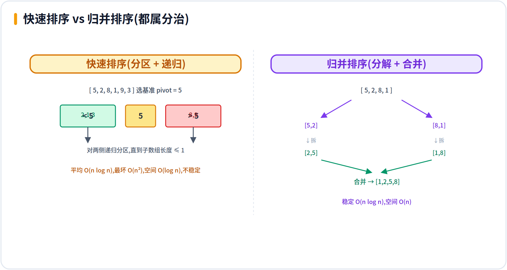

# 第 9 章 · 排序

> **一句话讲透**
> 常考排序:冒泡 / 选择 / 插入都是 O(n²);快速排序(分治 + 分区)平均 O(n log n)、最坏 O(n²)、空间 O(log n)(递归栈)、不稳定;归并排序(分治 + 合并)稳定 O(n log n)、空间 O(n);堆排序 O(n log n)、空间 O(1)、不稳定;计数 / 桶 / 基数是非比较排序,特定场景可达 O(n+k)。基于比较的排序,最坏情况的时间下界是 Ω(n log n)(下界用 Ω 记号;换句话说,比较排序不可能优于 O(n log n))。

| 算法 | 平均时间 | 最坏时间 | 空间 | 稳定性 |
| --- | --- | --- | --- | --- |
| 冒泡排序 | O(n²) | O(n²) | O(1) | 稳定 |
| 选择排序 | O(n²) | O(n²) | O(1) | 不稳定 |
| 插入排序 | O(n²) | O(n²) | O(1) | 稳定 |
| 快速排序 | O(n log n) | O(n²) | O(log n) | 不稳定 |
| 归并排序 | O(n log n) | O(n log n) | O(n) | 稳定 |
| 堆排序 | O(n log n) | O(n log n) | O(1) | 不稳定 |
| 计数排序 | O(n+k) | O(n+k) | O(k) | 稳定 |

**再往下挖**

- 稳定性 = 相等元素的相对顺序是否保持不变。快排最坏 O(n²) 出现在“数组近乎有序且基准选得差”时,用随机化基准或三数取中可避免。
- 工程里常用混合排序:如 Java 对象数组用 TimSort、基本类型用双轴快排;C++ sort 是内省排序(快排 + 堆排 + 插排)。
