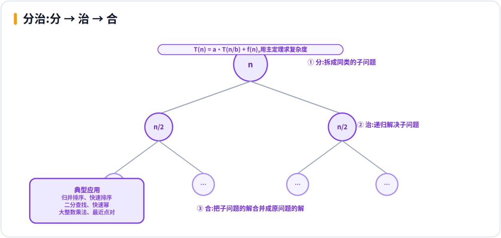

# 第 10 章 · 分治

> **一句话讲透**
> 分治把一个大问题分成若干同类的子问题,递归求解后再合并结果,三步:分(divide)、治(conquer)、合(combine)。归并排序、快速排序、二分查找、快速幂都是分治的典型应用;复杂度常用主定理 T(n) = a·T(n/b) + f(n) 求解。

**再往下挖**

分治与动态规划的关键区别:分治的子问题相互独立(各算各的),动态规划的子问题相互重叠(要把解存下来避免重复计算)。
