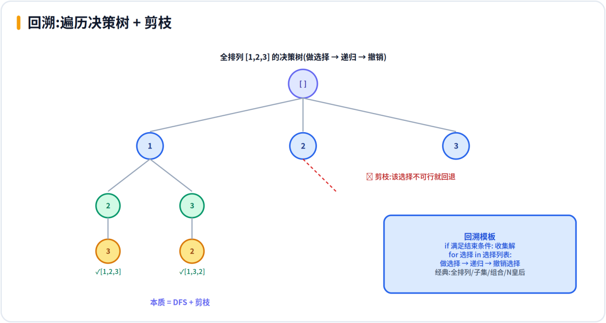

# 第 11 章 · 回溯

> **一句话讲透**
> 回溯是一种系统地搜索所有候选解的方法,本质是 DFS + 剪枝:沿着决策树“做选择 递归进入下一层 撤销选择”地遍历,遇到不可行的分支就剪枝返回。模板:满足结束条件就收集解,否则遍历选择列表,对每个选择执行“做选择 递归 撤销选择”。

**再往下挖**

经典题:全排列、组合、子集、N 皇后、数独、括号生成、单词搜索。剪枝是优化关键(可行性剪枝、去重剪枝),不剪枝就是暴力枚举,复杂度常为指数级。
