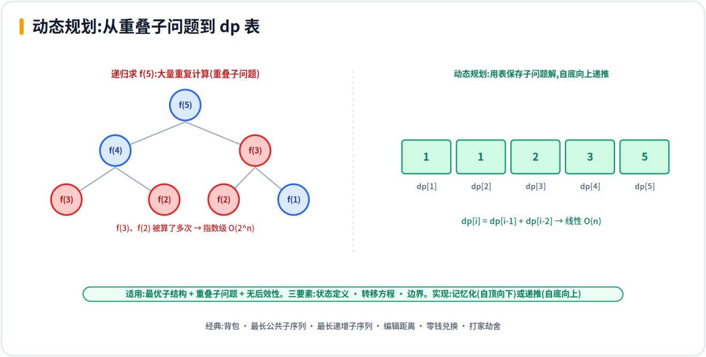

# 第 12 章 · 动态规划

> **一句话讲透**
> 动态规划把问题拆成相互重叠的子问题,保存子问题的解避免重复计算。适用条件:最优子结构 + 重叠子问题 + 无后效性。解题三要素:状态定义(dp[i] 表示什么)、状态转移方程、初始 / 边界条件。实现有自顶向下(记忆化递归)和自底向上(递推填表)两种。

**再往下挖**

- 经典题:爬楼梯 / 斐波那契、0-1 背包 / 完全背包、最长公共子序列 LCS、最长递增子序列 LIS、编辑距离、零钱兑换、打家劫舍、股票买卖。常可用“滚动数组”把空间从 O(n) 降到 O(1)。
 易错点
- 与分治区别:子问题是否重叠;与贪心区别:DP 会考虑所有选择求全局最优,贪心每步只取当前局部最优。
- DP 最难的是“定义状态 + 写对转移方程”;先想清楚 dp[i] 的确切含义,转移方程往往就出来了。

> **放到 vibe coding 里**　模型给的 DP 经常状态定义含糊、边界写错。你抓住“状态、转移、边界”三件套去对，比让它“再调调”高效得多。
