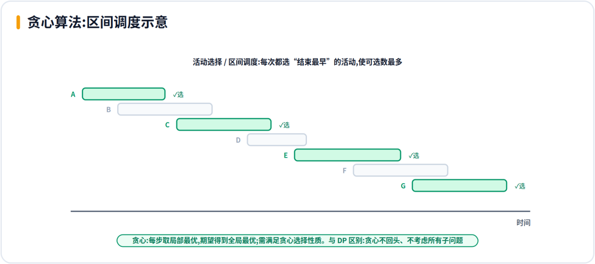

# 第 13 章 · 贪心

> **一句话讲透**
> 贪心在每一步都做当前看来最优的选择,期望最终得到全局最优。适用前提是问题具有“贪心选择性质”(局部最优能推出全局最优)和最优子结构;贪心不一定总能得到最优解,需要证明其正确性。

**再往下挖**

- 经典题:活动选择 / 区间调度(按结束时间排序后贪心选)、找零钱、霍夫曼编码、最小生成树(Prim / Kruskal)、跳跃游戏、分发糖果。很多贪心题要先排序。
 易错点 
与 DP 区别:贪心做出选择后不回头、不考虑所有子问题,DP 则会考虑所有可能。能用贪心的问题通常也能用 DP,但贪心更快;不确定时优先想 DP 保正确。
