# MySQL

**覆盖**：执行流程 · 存储引擎 · 索引(B+树/聚簇/覆盖/最左前缀) · 事务(ACID/隔离级别/MVCC) · 锁 · 日志 · SQL 优化 · 高性能

## 把它用在 vibe coding 上

数据库是 vibe coding 最容易埋雷的地方——模型写的 SQL 能跑，但慢查询、锁等待、丢数据往往要上线才暴露。

- **看 SQL 会不会走索引** —— 懂 B+ 树、最左前缀、索引失效，你在 review 时就能看出哪条查询会全表扫描，而不是等它拖垮库。
- **判断事务边界** —— 隔离级别、MVCC、锁决定并发下数据对不对。模型很少主动考虑并发，这是你必须补上的判断。
- **守住数据可靠性** —— redo / undo / binlog、主从复制让你知道“为什么这么写会丢数据、会有延迟”。

## 引言:MySQL 八股的一条主线

MySQL 的八股知识点很多,但可以用一条主线串起来——围绕“一条 SQL 的一生”和“数据怎么又快又稳地存取”展开:一条语句进来,先经过 Server 层的连接器、分析器、优化器、执行器,再交给存储引擎;数据要查得快,靠的是索引(B+ 树);多个事务并发读写,靠事务的隔离性 + 锁 + MVCC 来保证既正确又高效;数据不丢、宕机能恢复、主从能同步,靠 redo / undo / binlog 三大日志;查询慢了用索引和 explain 优化;单机扛不住了用主从复制和分库分表扩展。

本文就按这条主线展开:基础与存储引擎 索引(三章) 事务(三章:ACID、隔离级别、MVCC) 锁 日志与两阶段提交 SQL 优化 高性能,最后用速查表收尾。

## 第 1 章 · 基础:查询执行流程与存储引擎

**一条查询语句是怎么执行的**

> **一句话讲透**
> 一条查询语句会经过 Server 层和存储引擎层。Server 层依次是:连接器(管理连接、身份认证与权限) 查询缓存(MySQL 8.0 已移除) 分析器(词法、语法分析,生成解析树) 优化器(选择索引、决定执行计划,如 join 顺序) 执行器(校验权限并调用存储引擎接口);最后由存储引擎(InnoDB 等)负责真正的数据存取。

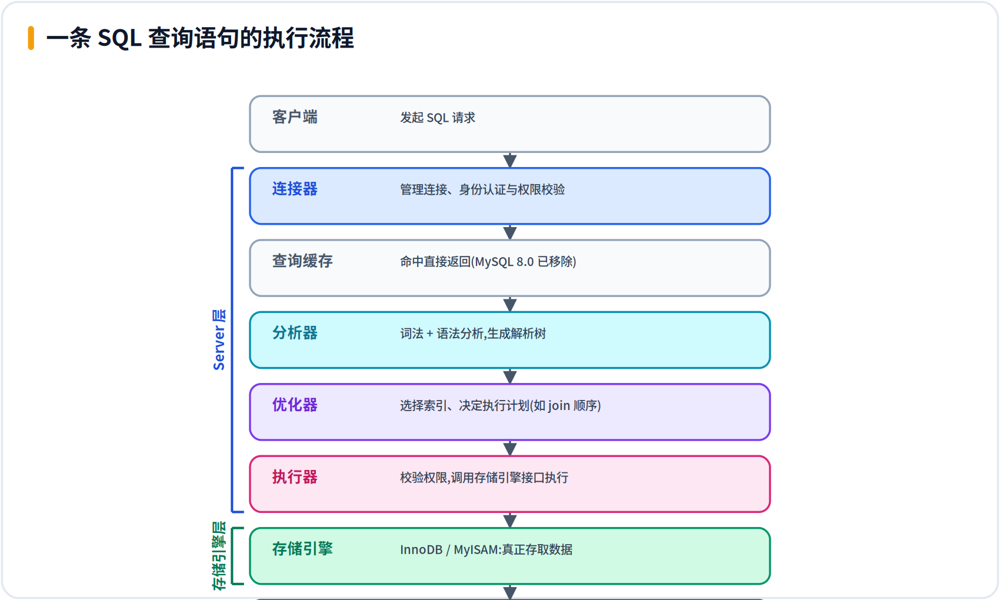

**MySQL 支持哪些存储引擎**

常见有 InnoDB、MyISAM、Memory 等;MySQL 5.5 起默认是 InnoDB。面试主要考 InnoDB 与 MyISAM 的区别。

| 对比维度 | InnoDB | MyISAM |
| --- | --- | --- |
| 事务 | 支持(ACID) | 不支持 |
| 锁粒度 | 行锁(也支持表锁) | 只有表锁 |
| 外键 | 支持 | 不支持 |
| 崩溃恢复 | 支持(redo log) | 不支持 |
| 索引/数据 | 聚簇索引(数据在叶子) | 非聚簇(索引与数据分离) |
| count(*) | 需扫描统计 | 存了总行数,很快 |
| 适用场景 | 高并发、事务 | 读多写少、不要事务 |

**再往下挖**

为什么默认用 InnoDB:支持事务、行锁带来更好的并发、以及崩溃安全(crash-safe)——这些是现代业务的刚需。MyISAM 现在基本只在特定只读场景见到。

## 第 2 章 · 索引①:为什么用 B+ 树

**索引为什么能加快查询**

> **一句话讲透**
> 没有索引时查询要全表扫描,复杂度 O(N);索引是一种排好序的数据结构(InnoDB 用 B+ 树),查找是 O(log N),还能利用有序性高效地做范围查询、排序和前缀匹配,从而大幅减少要扫描的数据量和磁盘 I/O。

为什么 InnoDB 选 B+ 树(而不是 B 树 / 红黑树 / Hash)

> **一句话讲透**
> B+ 树的非叶节点只存键、不存数据,数据全部放在叶子节点,且叶子用双向链表相连。相比 B 树:① 非叶不存数据 单个节点能放更多键 树更矮 磁盘 I/O 次数更少;② 叶子链表让范围查询、排序、全表扫描都很高效;③ 所有查询都要走到叶子,路径长度一致、性能稳定。不用二叉/红黑树是因为它们太“高”、磁盘 I/O 多;不用 Hash 是因为它只支持等值查询、不支持范围和排序。

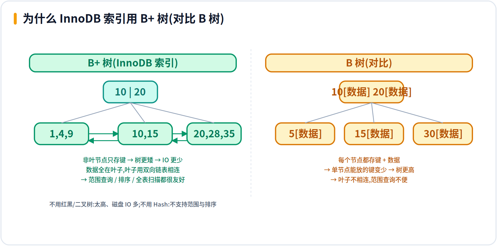

**索引的分类**

- **按功能** —— 主键索引、唯一索引、普通(二级)索引、全文索引、联合(组合)索引。
- **按数据结构** —— B+Tree 索引(最常用)、Hash 索引、全文索引、空间索引等。
- **按物理存储** —— 聚簇索引(数据和索引在一起)与非聚簇/二级索引(见第 3 章)。

**再往下挖**

磁盘按“页”读取,树越矮、每页能放的键越多,查一条数据需要的 I/O 次数就越少——这正是 B+ 树“矮胖”设计的核心收益。

## 第 3 章 · 索引②:聚簇索引、回表与覆盖索引

> **一句话讲透**
> 聚簇索引的叶子节点存的就是整行数据,InnoDB 的主键就是聚簇索引,一张表只有一个;二级(非聚簇)索引的叶子存的是主键值。用二级索引查到主键后,还要再拿主键到聚簇索引查一次完整行,这个过程叫回表。如果查询需要的列都已经在二级索引里(覆盖索引),就不必回表、直接返回——是常用的优化手段。

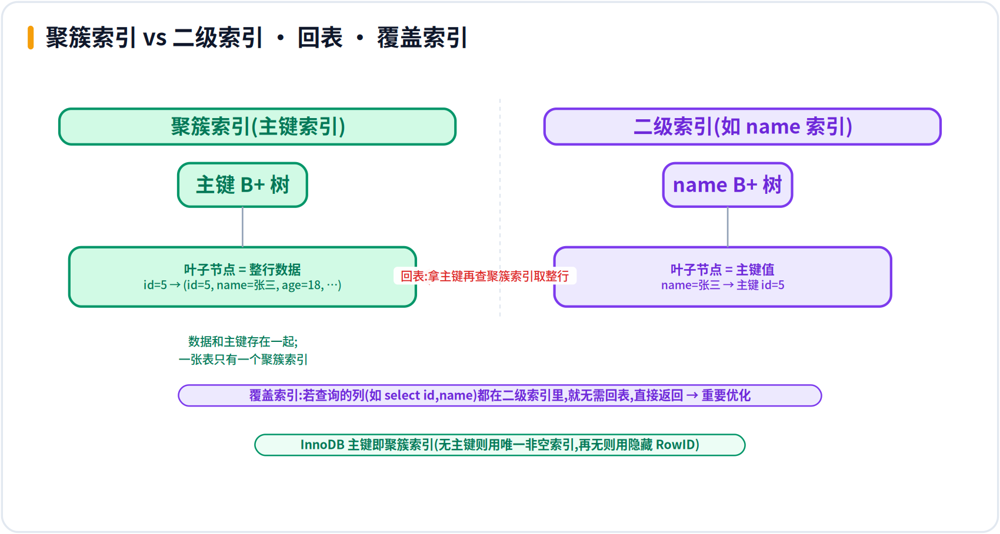

**再往下挖**

- 为什么二级索引存主键而不是物理地址?因为行可能因页分裂而移动,存主键更稳定(只要主键不变,回表仍能找到)。
- MyISAM 是非聚簇:索引和数据分开存,叶子节点存的是数据的地址,因此没有“回表”这一说。
- 想减少回表:尽量用覆盖索引(select 需要的列正好被索引覆盖),配合 explain 里出现 Using index 即命中。

## 第 4 章 · 索引③:最左前缀、索引下推与失效

**最左前缀匹配原则**

> **一句话讲透**
> 联合索引 (a, b, c) 按 a、b、c 的顺序排序;查询条件必须从最左列开始连续匹配,才能用上索引。一旦遇到范围查询(>、<、between、like),它后面的列就用不上索引了。

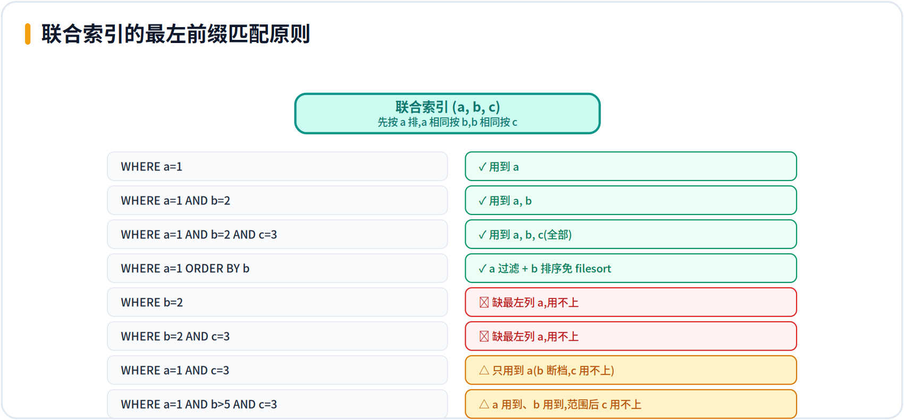

**索引下推(ICP)**

索引下推(Index Condition Pushdown,5.6+)把本可以在索引上判断的 where 条件下推到存储引擎层,在扫描索引时就先过滤掉不满足的记录,从而减少回表次数。

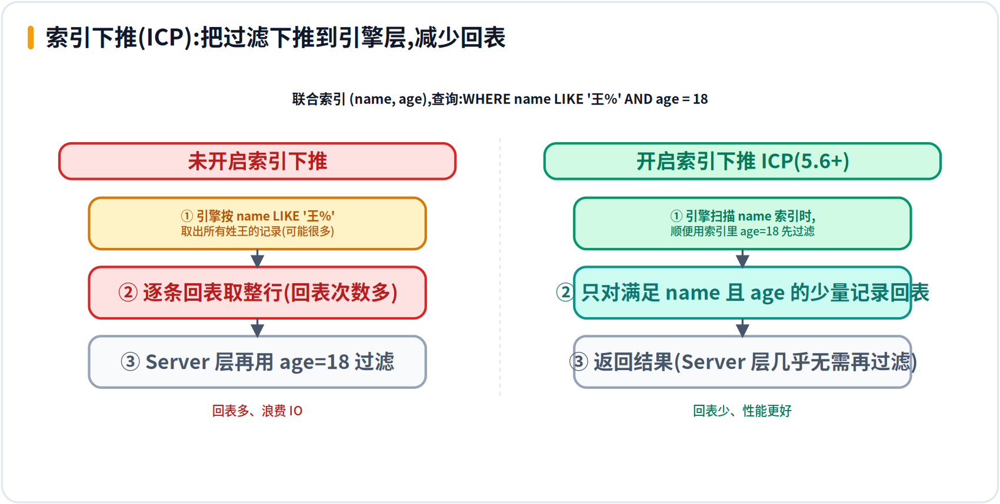

**索引失效的常见场景**

| 失效场景 | 说明 / 示例 |
| --- | --- |
| 对索引列做运算或函数 | 如 WHERE YEAR(create_time)=2024、WHERE a+1=10 |
| 隐式类型转换 | 字符串列用数字查、字符集不一致导致转换 |
| like 以 % 开头 | 如 LIKE '%张'(左模糊),无法用索引有序性 |
| 不满足最左前缀 | 联合索引跳过了最左列 |
| OR 连接非索引列 | OR 两边只要有一个列没索引,常导致全表扫描 |
| 范围条件后的列 | 范围列之后的联合索引列用不上 |
| 优化器判断全表更快 | 数据量很小或区分度很低时,可能放弃索引 |

**常见误区**

创建索引注意:选区分度高的列;遵循最左前缀;别建太多索引(拖慢写入、占空间);善用覆盖索引;长字符串可用前缀索引;不在频繁更新的列上滥建索引。

> **放到 vibe coding 里**　模型写的 WHERE 里对字段套函数、用 != 、或不按最左前缀，索引就废了。不用跑 explain，你也能先嗅出这条会全表扫。

## 第 5 章 · 事务①:ACID 与如何保证

> **一句话讲透**
> 事务有四大特性 ACID:原子性(要么全做、要么全不做,靠 undo log 回滚)、一致性(数据始终处于合法一致状态,是事务的目的,由原子性/隔离性/持久性 + 业务约束共同保证)、隔离性(并发事务互不干扰,靠锁 + MVCC)、持久性(提交后永久生效、不丢,靠 redo log)。

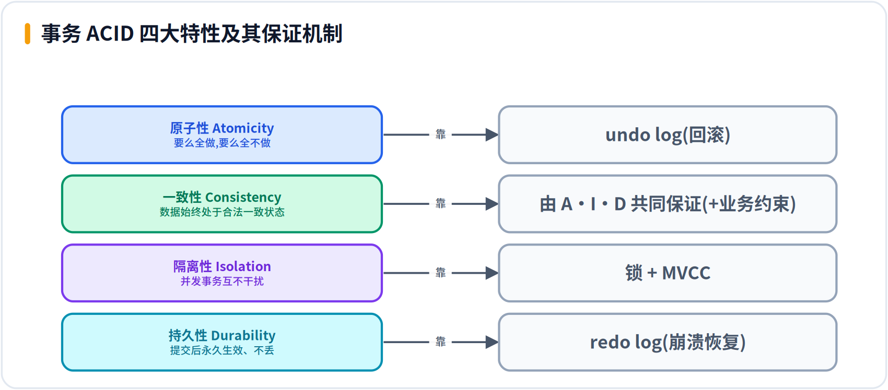

**再往下挖**

一句话点透:一致性是“目的”,原子性、隔离性、持久性是达成它的“手段”;undo log 保证 A、redo log 保证 D、锁 + MVCC 保证 I。

## 第 6 章 · 事务②:并发问题与隔离级别

**并发会带来哪些问题**

> **一句话讲透**
> 三类问题:脏读(读到别的事务还未提交的数据)、不可重复读(同一事务两次读同一行,值不一样,因为别的事务更新并提交了)、幻读(同一事务两次范围查询,行数不一样,因为别的事务插入/删除并提交了)。不可重复读针对“某一行的值”,幻读针对“满足条件的行数”。

**四种隔离级别**

| 隔离级别 | 脏读 | 不可重复读 | 幻读 |
| --- | --- | --- | --- |
| 读未提交 RU | 可能 | 可能 | 可能 |
| 读已提交 RC | 不会 | 可能 | 可能 |
| 可重复读 RR(InnoDB 默认) | 不会 | 不会 | 基本不会* |
| 串行化 Serializable | 不会 | 不会 | 不会 |

* 说明:SQL 标准里 RR 不解决幻读,但 InnoDB 的 RR 通过 MVCC(快照读)+ 间隙锁/临键锁(当前读)在很大程度上解决了幻读。

**再往下挖**

隔离级别如何实现:RC 和 RR 主要靠 MVCC(读)+ 锁(写)实现,串行化则靠加锁让事务串行执行。RC 与 RR 的关键差异在 ReadView 的生成时机(见第 7 章)。

> **放到 vibe coding 里**　“读到了别人没提交的数据”“两次读不一致”——模型写并发逻辑时不会主动想这些。你心里有隔离级别这把尺，才知道该把事务调到哪一档。

## 第 7 章 · 事务③:MVCC(版本链 + ReadView)

> **一句话讲透**
> MVCC(多版本并发控制)让“读不加锁”也能并发安全。每行有隐藏列 DB_TRX_ID(最近修改它的事务 ID)和 DB_ROLL_PTR(指向 undo log 里的上一版本);每次修改都生成一条 undo log,通过回滚指针串成版本链。普通快照读时会生成一个 ReadView(包含活跃事务列表 m_ids、最小活跃事务 min_trx_id、下一个事务 max_trx_id、本事务 creator_trx_id),按可见性规则沿版本链找到对当前事务可见的那个版本。

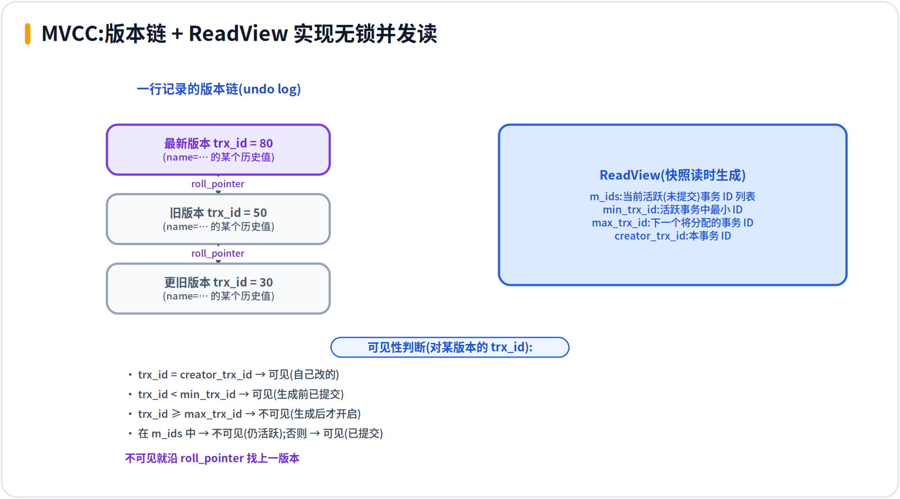

可重复读(RR)和读已提交(RC)在 ReadView 上的区别

> **一句话讲透**
> RC 每次快照读都重新生成一个 ReadView,所以能读到别的事务最新提交的数据 —— 这正是它会出现“不可重复读”的原因;RR 只在事务第一次快照读时生成一次 ReadView 并一直复用,后续读都用这同一个视图 —— 所以同一事务里多次读结果一致(可重复读)。

**常见误区**

区分快照读与当前读:普通 select 是快照读(走 MVCC、不加锁);select … for update / lock in share mode、update / delete / insert 是当前读(读最新版本并加锁)。幻读在当前读下要靠间隙锁/临键锁解决。

## 第 8 章 · 锁:分类、行锁、意向锁与死锁

> **一句话讲透**
> 锁可按思想分为乐观锁(假设不冲突,不加锁,提交时用版本号/CAS 检查,通常在应用层实现)和悲观锁(假设会冲突,先加锁,如 select … for update);按粒度分表锁、行锁;按性质分共享锁 S(读锁,可共享)和排他锁 X(写锁,独占)。InnoDB 的行锁加在索引上,有三种:记录锁(锁单条记录)、间隙锁(锁记录间的开区间、防插入)、临键锁(记录锁 + 间隙锁,RR 默认用它来防幻读)。

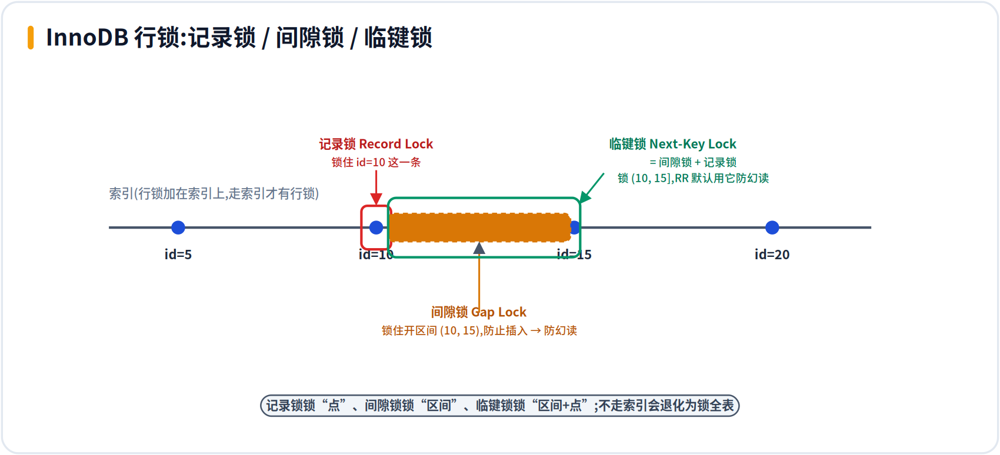

- **意向锁(IS / IX)** —— 表级锁,表示“事务打算在表中某些行加 S/X 锁”。用于快速判断表级锁与行级锁是否冲突,避免逐行检查;意向锁之间不冲突。

**再往下挖**

- 排查死锁:用 SHOW ENGINE INNODB STATUS 查看最近一次死锁日志(也可开启 innodb_print_all_deadlocks),看两个事务各自持有和等待什么锁。InnoDB 会自动检测死锁并回滚代价较小的事务。
- 预防死锁:固定加锁顺序、尽量缩小事务、走索引避免锁范围过大、必要时降低隔离级别。

**常见误区**

InnoDB 行锁是加在索引上的,所以走索引才有行锁;如果查询没走索引,会退化成锁住所有记录(相当于表锁)。

## 第 9 章 · 日志:redo / undo / binlog 与两阶段提交

> **一句话讲透**
> 三大日志:redo log(InnoDB 引擎层、物理日志,记录“对数据页做了什么修改”,保证持久性和崩溃恢复,采用 WAL 先写日志后刷盘、循环写);undo log(逻辑日志,记录修改前的值,用于事务回滚和 MVCC 版本链);binlog(Server 层、逻辑日志,记录所有更改操作,用于主从复制和数据恢复,追加写不覆盖)。

| 对比 | redo log | undo log | binlog |
| --- | --- | --- | --- |
| 所属层 | InnoDB 引擎层 | InnoDB 引擎层 | Server 层(通用) |
| 类型 | 物理日志 | 逻辑日志 | 逻辑日志 |
| 作用 | 崩溃恢复、持久性 | 回滚、MVCC | 主从复制、数据恢复 |
| 写入方式 | 循环写(覆盖) | 随事务生成/清理 | 追加写(保留) |

**一条更新语句的执行与两阶段提交**

以 update t set c=c+1 where id=2 为例,更新过程中 redo log 被拆成 prepare 和 commit 两步,中间夹着写 binlog:

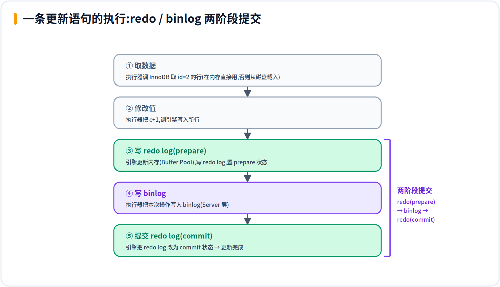

**再往下挖**

- 为什么要两阶段提交:为保证 redo log 与 binlog 两份日志的一致性。若不两阶段——先写 redo 后写 binlog,中途崩溃会导致本机有更新但 binlog 没有(从库丢更新);反之 binlog 有而 redo 没有(从库多更新)。两阶段提交 + 崩溃恢复时的判断(redo 有 commit 则提交;只有 prepare 则看 binlog 是否完整)保证两者一致。
- binlog 与 redo log 区别:binlog 是 Server 层、所有引擎通用、逻辑日志、追加写、用于归档复制;redo log 是 InnoDB 专有、物理日志、循环写、用于崩溃恢复。

**常见误区**

redo log 刷盘策略 innodb_flush_log_at_trx_commit:0(每秒刷盘,宕机可能丢 1 秒)、1(每次提交都刷盘,最安全,默认)、2(每次提交写到 OS 缓存,OS 崩溃才会丢)。

## 第 10 章 · SQL 优化:慢 SQL、explain 与优化手段

> **一句话讲透**
> 先用慢查询日志(slow_query_log、long_query_time)定位慢 SQL,再用 explain 分析执行计划,重点看 type(访问类型,至少要到 range,避免 ALL 全表扫描)、key(实际用到的索引)、rows(预估扫描行数)、Extra(出现 Using filesort / Using temporary 要警惕)。优化方向:加合适索引并避免索引失效、用覆盖索引、小表驱动大表、让 order by 走索引、深分页用延迟关联或书签、能用 UNION ALL 就别用 UNION。

**explain 关键列**

| 列 | 看什么 |
| --- | --- |
| type | 访问类型,优劣:system>const>eq_ref>ref>range>index>ALL;至少 range,避免 ALL |
| key | 实际使用的索引(为 NULL 表示没用上索引) |
| rows | 预估要扫描的行数,越小越好 |
| Extra | Using index=覆盖索引(好);Using filesort / Using temporary=要优化 |

**常见优化手段**

- **避免 select *** —— 只取需要的列,利于覆盖索引、减少 I/O 与网络传输。
- **深分页优化** —— limit 100000,10 很慢;用延迟关联(子查询先用覆盖索引定位主键再 join)或书签法(WHERE id > 上次最大 id LIMIT n)。
- **Join 优化** —— 小表驱动大表,给被驱动表的关联列加索引,减少嵌套循环扫描。
- **排序优化** —— 让 order by 用上索引的有序性,避免 Using filesort。
- **UNION 优化** —— 不需要去重时用 UNION ALL(UNION 要额外去重排序,开销大)。

## 第 11 章 · 高性能:主从复制与分库分表

**主从复制原理**

> **一句话讲透**
> 主库把变更写入 binlog,由 dump 线程发送给从库;从库的 I/O 线程接收后写入 relay log(中继日志),再由 SQL 线程读取 relay log 并重放,从而实现数据同步。主要用于读写分离、备份和高可用;默认是异步复制,因此从库存在一定的复制延迟。

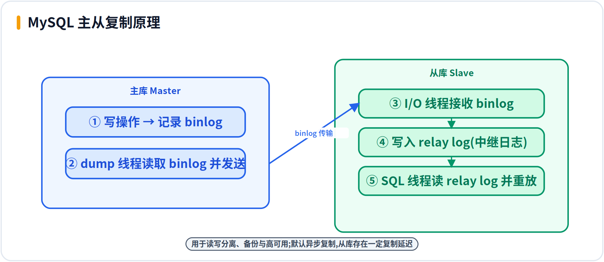

**分库分表**

> **一句话讲透**
> 当单库单表到达瓶颈时进行拆分。垂直拆分:按业务把表分到不同库(垂直分库),或把字段很多的宽表按列拆开(垂直分表);水平拆分:按行把同一张表的数据分散到多个库/表(如按 user_id 取模)。分表策略有范围、哈希取模、一致性哈希、时间等。

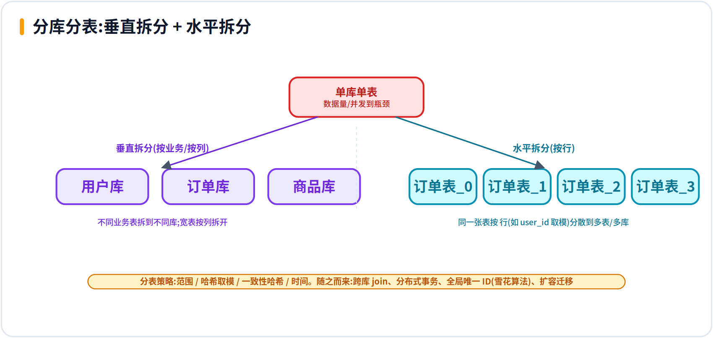

**再往下挖**

分库分表带来的新问题(常考):跨库 join 变难、分布式事务、全局唯一 ID(常用雪花算法 Snowflake)、以及扩容时的数据迁移。所以一般是“能不拆就不拆”,优先考虑加索引、读写分离、加缓存。

> **放到 vibe coding 里**　模型建议“读写分离扛压力”听着对，但它不会提主从延迟——刚写完就去从库读会读到旧值。懂复制机制，你才能判断这方案在你场景下成不成立。

## 第 12 章 · 总结:速查表 + 要点回顾

把 MySQL 八股收个尾:一条 SQL 先过 Server 层(连接器/分析器/优化器/执行器)再到存储引擎;查得快靠 B+ 树索引(聚簇存整行、二级存主键、回表与覆盖索引、最左前缀);并发正确靠事务的隔离性——隔离级别 + 锁 + MVCC(版本链 + ReadView);不丢可恢复靠 redo/undo/binlog 与两阶段提交;慢了用 explain 优化;扛不住用主从复制和分库分表。

**名词 / 高频题速查表**

| 考点 | 一句话速答 |
| --- | --- |
| 查询执行流程 | 连接器分析器优化器执行器存储引擎(8.0 去掉查询缓存)。 |
| InnoDB vs MyISAM | InnoDB 有事务/行锁/外键/崩溃恢复/聚簇索引;MyISAM 都没有但 count 快。 |
| 索引为何快 | 把全表扫描 O(N) 变成 B+ 树 O(log N),并支持范围/排序。 |
| 为什么 B+ 树 | 非叶只存键树矮 IO 少;叶子链表范围友好;不用 Hash 因不支持范围。 |
| 聚簇 vs 非聚簇 | 聚簇叶子存整行(主键);二级叶子存主键,取整行要回表。 |
| 回表 / 覆盖索引 | 二级索引拿主键再查聚簇=回表;查询列全在索引里则免回表。 |
| 最左前缀 | 联合索引从最左列连续匹配才生效,范围列之后失效。 |
| 索引下推 ICP | 把 where 过滤下推到引擎层,扫描索引时先过滤,减少回表。 |
| 索引失效 | 列上运算/函数、隐式转换、左模糊、断最左前缀、OR 非索引列等。 |
| ACID | A 靠 undo、D 靠 redo、I 靠锁+MVCC、C 是目的由三者保证。 |
| 脏读/不可重复读/幻读 | 读未提交;同行值变;范围行数变。 |
| 隔离级别 | RU<RC(防脏读)<RR(防不可重复读,InnoDB 默认)<串行化。 |
| MVCC | 隐藏列+版本链+ReadView,按可见性规则找可见版本,读不加锁。 |
| RC vs RR | RC 每次读建新 ReadView;RR 只在首次读建一次并复用。 |
| 锁分类 | 乐观/悲观、表锁/行锁、共享 S/排他 X。 |
| 行锁三种 | 记录锁(点)、间隙锁(区间)、临键锁(区间+点,防幻读)。 |
| 意向锁 | 表级 IS/IX,快速判断表锁与行锁是否冲突。 |
| 三大日志 | redo(物理,崩溃恢复)、undo(回滚+MVCC)、binlog(复制+恢复)。 |
| 两阶段提交 | redo prepare写 binlogredo commit,保证两份日志一致。 |
| explain 关键列 | type(至少 range)、key、rows、Extra(忌 filesort/temporary)。 |
| 主从复制 | 主库 binlog从库 IO 线程relay logSQL 线程重放。 |
| 分库分表 | 垂直按业务/列拆,水平按行拆;伴随分布式事务、全局 ID 等问题。 |

**抓住这几点**

- 先把“一句话讲透”讲清楚
- 索引(B+树/回表/最左前缀)和事务(隔离级别/MVCC/锁)是 MySQL 面试的两大重点,务必能讲透“为什么”
- 答完主动延伸一句相关追问(如覆盖索引、间隙锁防幻读、两阶段提交为什么、雪花算法),会显得功底扎实。

理解了“为什么”,八股就不再是死记硬背。愿你真正把它用起来!
