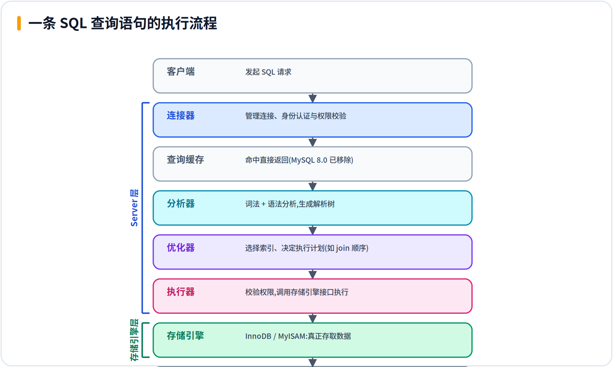

# 第 1 章 · 基础:查询执行流程与存储引擎

**一条查询语句是怎么执行的**

> **一句话讲透**
> 一条查询语句会经过 Server 层和存储引擎层。Server 层依次是:连接器(管理连接、身份认证与权限) 查询缓存(MySQL 8.0 已移除) 分析器(词法、语法分析,生成解析树) 优化器(选择索引、决定执行计划,如 join 顺序) 执行器(校验权限并调用存储引擎接口);最后由存储引擎(InnoDB 等)负责真正的数据存取。

**MySQL 支持哪些存储引擎**

常见有 InnoDB、MyISAM、Memory 等;MySQL 5.5 起默认是 InnoDB。面试主要考 InnoDB 与 MyISAM 的区别。

| 对比维度 | InnoDB | MyISAM |
| --- | --- | --- |
| 事务 | 支持(ACID) | 不支持 |
| 锁粒度 | 行锁(也支持表锁) | 只有表锁 |
| 外键 | 支持 | 不支持 |
| 崩溃恢复 | 支持(redo log) | 不支持 |
| 索引/数据 | 聚簇索引(数据在叶子) | 非聚簇(索引与数据分离) |
| count(*) | 需扫描统计 | 存了总行数,很快 |
| 适用场景 | 高并发、事务 | 读多写少、不要事务 |

**再往下挖**

为什么默认用 InnoDB:支持事务、行锁带来更好的并发、以及崩溃安全(crash-safe)——这些是现代业务的刚需。MyISAM 现在基本只在特定只读场景见到。
