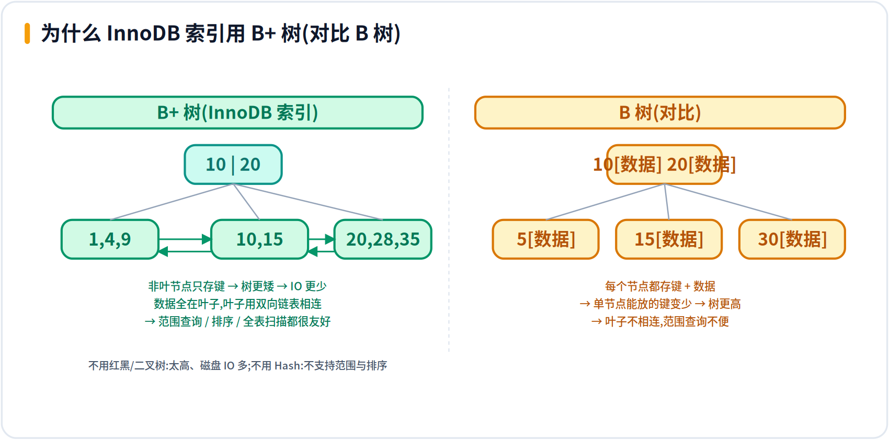

# 第 2 章 · 索引①:为什么用 B+ 树

**索引为什么能加快查询**

> **一句话讲透**
> 没有索引时查询要全表扫描,复杂度 O(N);索引是一种排好序的数据结构(InnoDB 用 B+ 树),查找是 O(log N),还能利用有序性高效地做范围查询、排序和前缀匹配,从而大幅减少要扫描的数据量和磁盘 I/O。

为什么 InnoDB 选 B+ 树(而不是 B 树 / 红黑树 / Hash)

> **一句话讲透**
> B+ 树的非叶节点只存键、不存数据,数据全部放在叶子节点,且叶子用双向链表相连。相比 B 树:① 非叶不存数据 单个节点能放更多键 树更矮 磁盘 I/O 次数更少;② 叶子链表让范围查询、排序、全表扫描都很高效;③ 所有查询都要走到叶子,路径长度一致、性能稳定。不用二叉/红黑树是因为它们太“高”、磁盘 I/O 多;不用 Hash 是因为它只支持等值查询、不支持范围和排序。

**索引的分类**

- **按功能** —— 主键索引、唯一索引、普通(二级)索引、全文索引、联合(组合)索引。
- **按数据结构** —— B+Tree 索引(最常用)、Hash 索引、全文索引、空间索引等。
- **按物理存储** —— 聚簇索引(数据和索引在一起)与非聚簇/二级索引(见第 3 章)。

**再往下挖**

磁盘按“页”读取,树越矮、每页能放的键越多,查一条数据需要的 I/O 次数就越少——这正是 B+ 树“矮胖”设计的核心收益。
