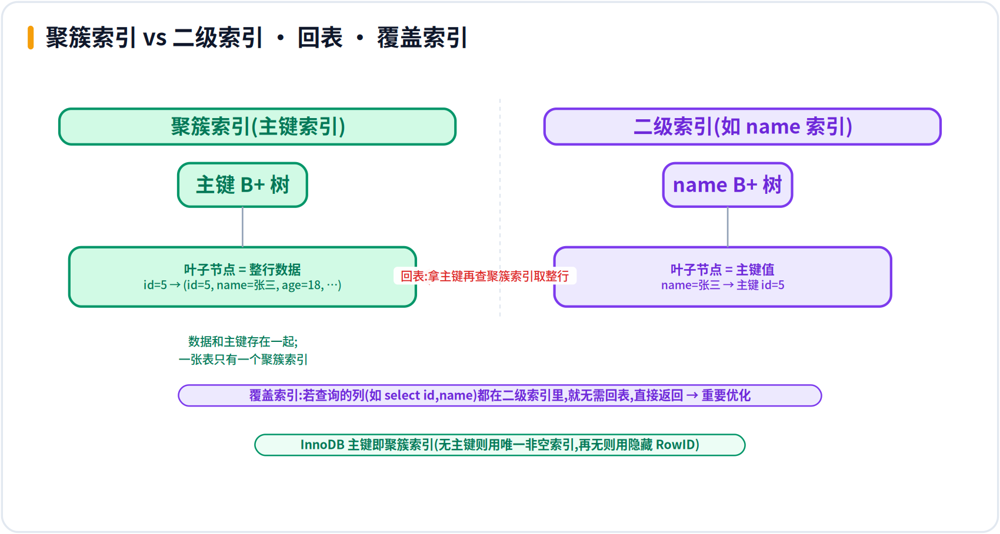

# 第 3 章 · 索引②:聚簇索引、回表与覆盖索引

> **一句话讲透**
> 聚簇索引的叶子节点存的就是整行数据,InnoDB 的主键就是聚簇索引,一张表只有一个;二级(非聚簇)索引的叶子存的是主键值。用二级索引查到主键后,还要再拿主键到聚簇索引查一次完整行,这个过程叫回表。如果查询需要的列都已经在二级索引里(覆盖索引),就不必回表、直接返回——是常用的优化手段。

**再往下挖**

- 为什么二级索引存主键而不是物理地址?因为行可能因页分裂而移动,存主键更稳定(只要主键不变,回表仍能找到)。
- MyISAM 是非聚簇:索引和数据分开存,叶子节点存的是数据的地址,因此没有“回表”这一说。
- 想减少回表:尽量用覆盖索引(select 需要的列正好被索引覆盖),配合 explain 里出现 Using index 即命中。
