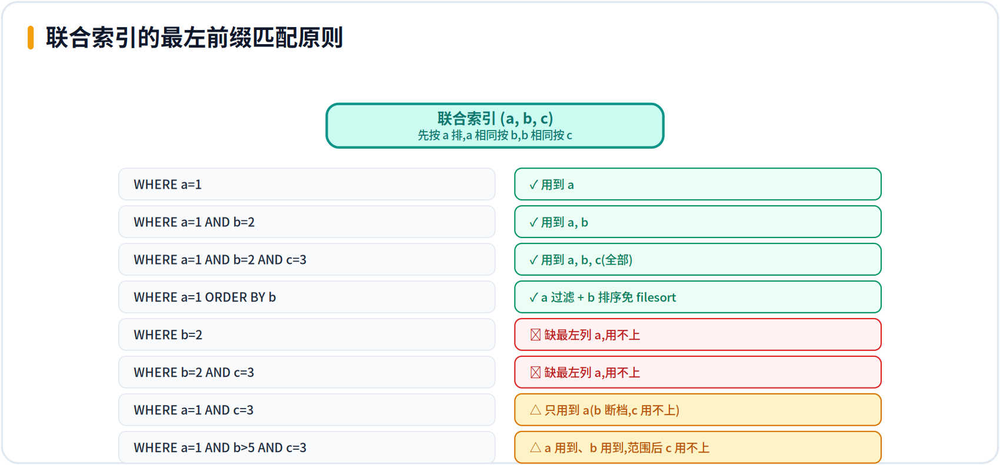
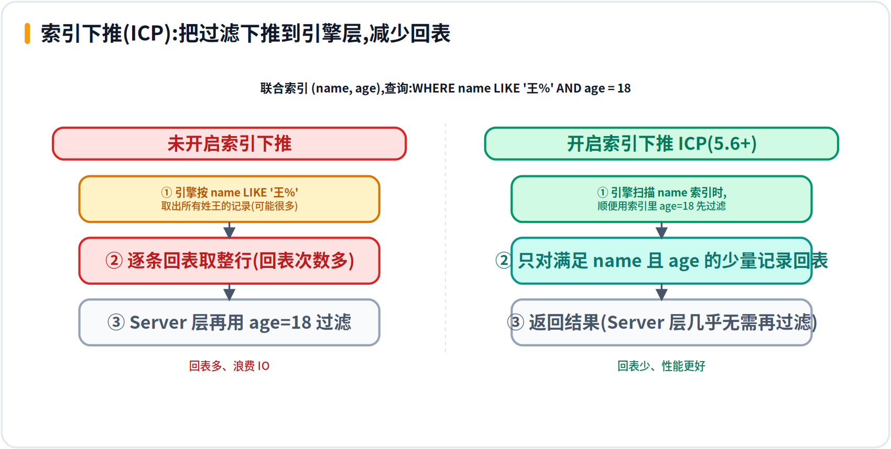

# 第 4 章 · 索引③:最左前缀、索引下推与失效

**最左前缀匹配原则**

> **一句话讲透**
> 联合索引 (a, b, c) 按 a、b、c 的顺序排序;查询条件必须从最左列开始连续匹配,才能用上索引。一旦某列用了范围查询(>、<、between、或 like 'x%' 这种前缀匹配),它后面的列就无法再用于索引定位了(注意:5.6+ 这些列仍可能被索引下推 ICP 在引擎层用作过滤,只是不能用来在 B+ 树上快速定位)。

**索引下推(ICP)**

索引下推(Index Condition Pushdown,5.6+)把本可以在索引上判断的 where 条件下推到存储引擎层,在扫描索引时就先过滤掉不满足的记录,从而减少回表次数。

**索引失效的常见场景**

| 失效场景 | 说明 / 示例 |
| --- | --- |
| 对索引列做运算或函数 | 如 WHERE YEAR(create_time)=2024、WHERE a+1=10 |
| 隐式类型转换 | 字符串列用数字查、字符集不一致导致转换 |
| like 以 % 开头 | 如 LIKE '%张'(左模糊),无法用索引有序性 |
| 不满足最左前缀 | 联合索引跳过了最左列 |
| OR 连接非索引列 | OR 两边只要有一个列没索引,常导致全表扫描 |
| 范围条件后的列 | 范围列之后的联合索引列用不上 |
| 优化器判断全表更快 | 数据量很小或区分度很低时,可能放弃索引 |

**常见误区**

创建索引注意:选区分度高的列;遵循最左前缀;别建太多索引(拖慢写入、占空间);善用覆盖索引;长字符串可用前缀索引;不在频繁更新的列上滥建索引。

> **放到 vibe coding 里**　模型写的 WHERE 里对字段套函数、用 != 、或不按最左前缀，索引就废了。不用跑 explain，你也能先嗅出这条会全表扫。
