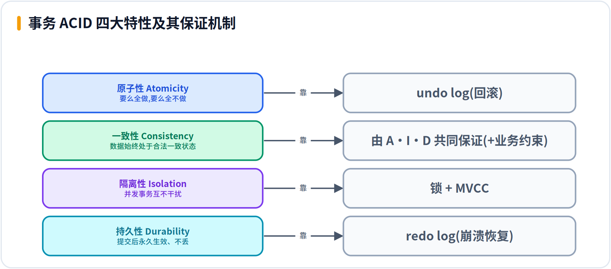

# 第 5 章 · 事务①:ACID 与如何保证

> **一句话讲透**
> 事务有四大特性 ACID:原子性(要么全做、要么全不做,靠 undo log 回滚)、一致性(数据始终处于合法一致状态,是事务的目的,由原子性/隔离性/持久性 + 业务约束共同保证)、隔离性(并发事务互不干扰,靠锁 + MVCC)、持久性(提交后永久生效、不丢,靠 redo log)。

**再往下挖**

一句话点透:一致性是“目的”,原子性、隔离性、持久性是达成它的“手段”;undo log 保证 A、redo log 保证 D、锁 + MVCC 保证 I。
