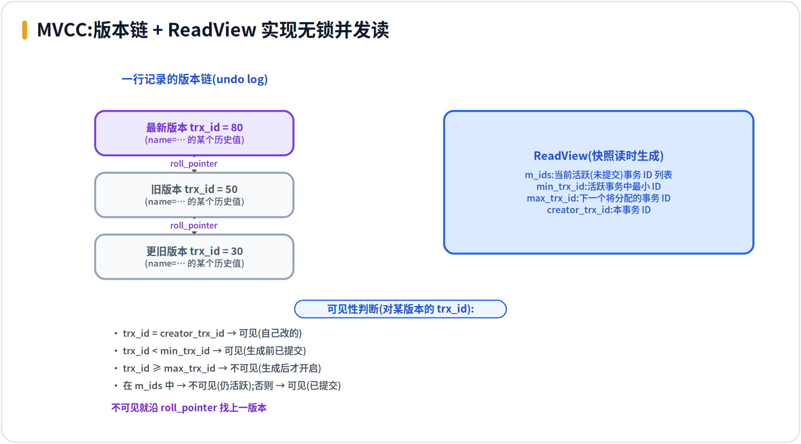

# 第 7 章 · 事务③:MVCC(版本链 + ReadView)

> **一句话讲透**
> MVCC(多版本并发控制)让“读不加锁”也能并发安全。每行有隐藏列 DB_TRX_ID(最近修改它的事务 ID)和 DB_ROLL_PTR(指向 undo log 里的上一版本);每次修改都生成一条 undo log,通过回滚指针串成版本链。普通快照读时会生成一个 ReadView(包含活跃事务列表 m_ids、最小活跃事务 min_trx_id、下一个事务 max_trx_id、本事务 creator_trx_id),按可见性规则沿版本链找到对当前事务可见的那个版本。

可重复读(RR)和读已提交(RC)在 ReadView 上的区别

> **一句话讲透**
> RC 每次快照读都重新生成一个 ReadView,所以能读到别的事务最新提交的数据 —— 这正是它会出现“不可重复读”的原因;RR 只在事务第一次快照读时生成一次 ReadView 并一直复用,后续读都用这同一个视图 —— 所以同一事务里多次读结果一致(可重复读)。

**常见误区**

区分快照读与当前读:普通 select 是快照读(走 MVCC、不加锁);select … for update / lock in share mode、update / delete / insert 是当前读(读最新版本并加锁)。幻读在当前读下要靠间隙锁/临键锁解决。
