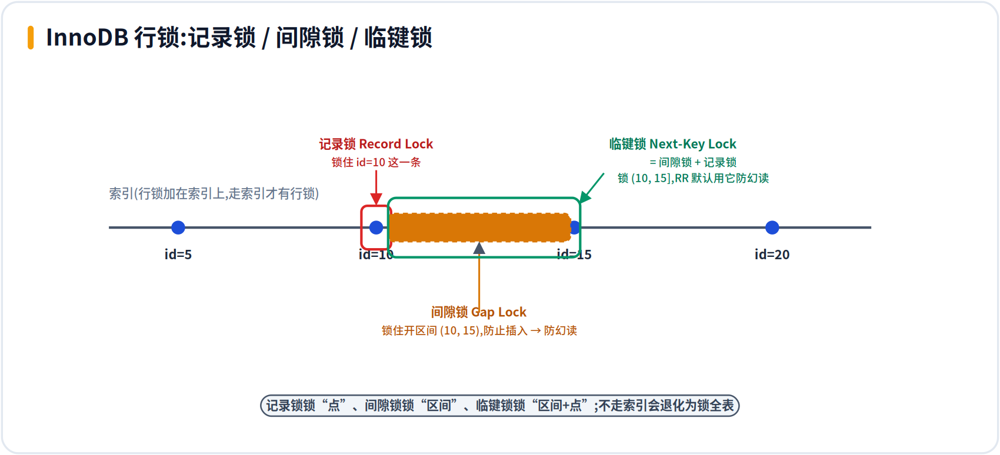

# 第 8 章 · 锁:分类、行锁、意向锁与死锁

> **一句话讲透**
> 锁可按思想分为乐观锁(假设不冲突,不加锁,提交时用版本号/CAS 检查,通常在应用层实现)和悲观锁(假设会冲突,先加锁,如 select … for update);按粒度分表锁、行锁;按性质分共享锁 S(读锁,可共享)和排他锁 X(写锁,独占)。InnoDB 的行锁加在索引上,有三种:记录锁(锁单条记录)、间隙锁(锁记录间的开区间、防插入)、临键锁(记录锁 + 间隙锁,RR 默认用它来防幻读)。

- **意向锁(IS / IX)** —— 表级锁,表示“事务打算在表中某些行加 S/X 锁”。用于快速判断表级锁与行级锁是否冲突,避免逐行检查;意向锁之间不冲突。

**再往下挖**

- 排查死锁:用 SHOW ENGINE INNODB STATUS 查看最近一次死锁日志(也可开启 innodb_print_all_deadlocks),看两个事务各自持有和等待什么锁。InnoDB 会自动检测死锁并回滚代价较小的事务。
- 预防死锁:固定加锁顺序、尽量缩小事务、走索引避免锁范围过大、必要时降低隔离级别。

**常见误区**

InnoDB 行锁是加在索引上的,所以走索引才有行锁;如果查询没走索引,会退化成锁住所有记录(相当于表锁)。
