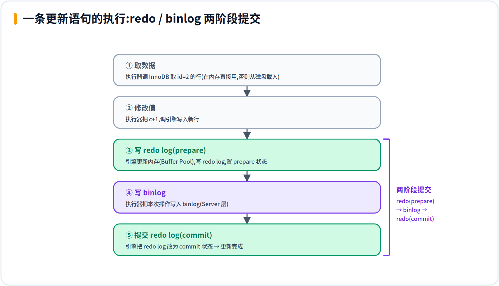

# 第 9 章 · 日志:redo / undo / binlog 与两阶段提交

> **一句话讲透**
> 三大日志:redo log(InnoDB 引擎层、物理日志,记录“对数据页做了什么修改”,保证持久性和崩溃恢复,采用 WAL 先写日志后刷盘、循环写);undo log(逻辑日志,记录修改前的值,用于事务回滚和 MVCC 版本链);binlog(Server 层、逻辑日志,记录所有更改操作,用于主从复制和数据恢复,追加写不覆盖)。

| 对比 | redo log | undo log | binlog |
| --- | --- | --- | --- |
| 所属层 | InnoDB 引擎层 | InnoDB 引擎层 | Server 层(通用) |
| 类型 | 物理日志 | 逻辑日志 | 逻辑日志 |
| 作用 | 崩溃恢复、持久性 | 回滚、MVCC | 主从复制、数据恢复 |
| 写入方式 | 循环写(覆盖) | 随事务生成/清理 | 追加写(保留) |

**一条更新语句的执行与两阶段提交**

以 update t set c=c+1 where id=2 为例,更新过程中 redo log 被拆成 prepare 和 commit 两步,中间夹着写 binlog:

**再往下挖**

- 为什么要两阶段提交:为保证 redo log 与 binlog 两份日志的一致性。若不两阶段——先写 redo 后写 binlog,中途崩溃会导致本机有更新但 binlog 没有(从库丢更新);反之 binlog 有而 redo 没有(从库多更新)。两阶段提交 + 崩溃恢复时的判断(redo 有 commit 则提交;只有 prepare 则看 binlog 是否完整)保证两者一致。
- binlog 与 redo log 区别:binlog 是 Server 层、所有引擎通用、逻辑日志、追加写、用于归档复制;redo log 是 InnoDB 专有、物理日志、循环写、用于崩溃恢复。

**常见误区**

redo log 刷盘策略 innodb_flush_log_at_trx_commit,关键在“提交时写不写文件、刷不刷盘”:
- **1(默认、最安全)** —— 每次提交都写文件并 fsync 刷盘,提交成功就不会丢。
- **2** —— 每次提交只写到 OS 文件缓存、不强制刷盘,后台每秒刷一次。所以 **MySQL 进程崩溃不丢**(数据已交给 OS),只有主机/OS 崩溃才丢约 1 秒。
- **0** —— 提交时既不写文件也不刷盘,全靠后台线程每秒写并刷一次。因此 **MySQL 进程崩溃或主机崩溃都可能丢约 1 秒**,性能最高但最不安全。
