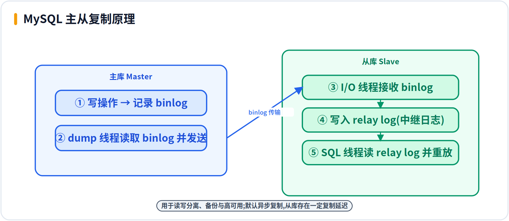
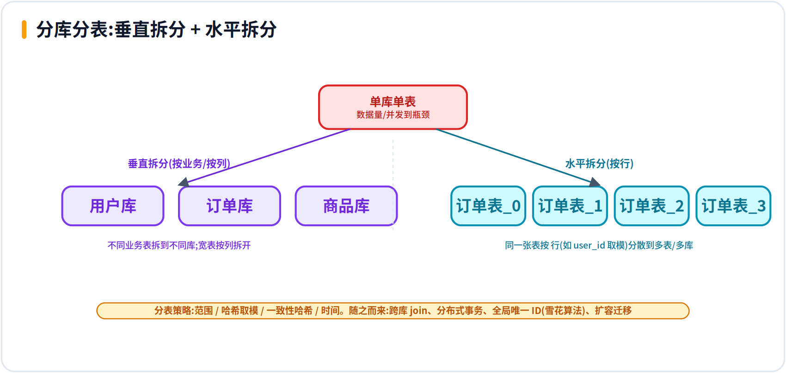

# 第 11 章 · 高性能:主从复制与分库分表

**主从复制原理**

> **一句话讲透**
> 主库把变更写入 binlog,由 dump 线程发送给从库;从库的 I/O 线程接收后写入 relay log(中继日志),再由 SQL 线程读取 relay log 并重放,从而实现数据同步。主要用于读写分离、备份和高可用;默认是异步复制,因此从库存在一定的复制延迟。

**分库分表**

> **一句话讲透**
> 当单库单表到达瓶颈时进行拆分。垂直拆分:按业务把表分到不同库(垂直分库),或把字段很多的宽表按列拆开(垂直分表);水平拆分:按行把同一张表的数据分散到多个库/表(如按 user_id 取模)。分表策略有范围、哈希取模、一致性哈希、时间等。

**再往下挖**

分库分表带来的新问题(常考):跨库 join 变难、分布式事务、全局唯一 ID(常用雪花算法 Snowflake)、以及扩容时的数据迁移。所以一般是“能不拆就不拆”,优先考虑加索引、读写分离、加缓存。

> **放到 vibe coding 里**　模型建议“读写分离扛压力”听着对，但它不会提主从延迟——刚写完就去从库读会读到旧值。懂复制机制，你才能判断这方案在你场景下成不成立。
