# 互联网架构演进

系统怎么从单机一步步长成扛得住流量的分布式，每一步解决什么、代价是什么。

## 引言:一个朴素的故事

互联网架构里那些让人眼花缭乱的高频名词——集群、负载均衡、缓存、分库分表、微服务、容器、K8s、云原生——单独看像是一堆互不相关的黑话。但只要把它们放回真实的演化顺序里,你会发现它们其实是同一条主线上的产物:每解决一个瓶颈,就会暴露出下一个瓶颈,于是再补上一个新组件。架构从来不是一开始就被设计成今天这样的,而是被业务和流量一步步“逼”出来的。

这份文档用一个最朴素的故事把这条主线串起来:你从一台服务器、几个用户的小网站起步,随着访问量越来越大,一路把它升级成能稳稳扛住千万级流量的现代化系统。后面每一章都只回答三个问题——上一步留下了什么瓶颈?这一步用什么组件来补?补完之后又带来了什么新代价?把这三个问题想清楚,所有名词就都有了自己的位置。

> **一句话抓住全文**
> 架构演进的本质,是不断用「空间换时间、复杂度换性能」来对抗持续增长的流量与并发。而判断一个架构好不好,永远只有一个标准:它是不是当前业务最合适的那个。

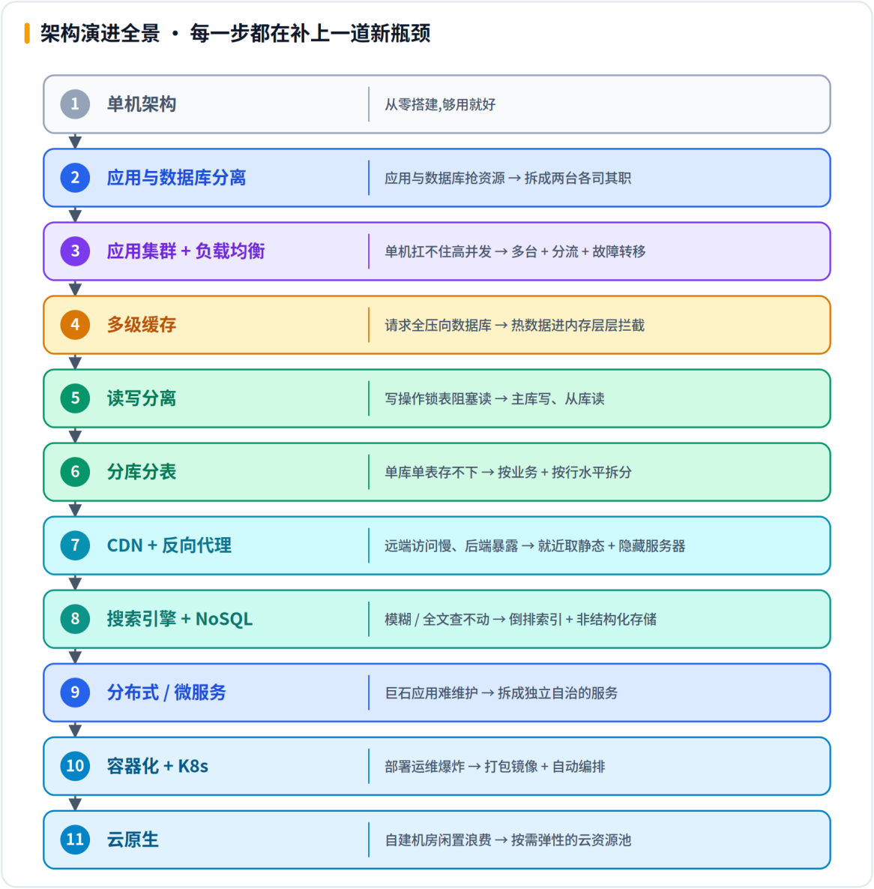

## 把它用在 vibe coding 上

这份是把前面所有单点知识“拼成一个能扛流量的系统”的地图。模型能说出缓存、负载均衡、微服务这些词，但什么时候该上、上了的代价是什么，要你来判断。

- **抵抗过度设计** —— 模型动不动给你微服务 + 消息队列 + K8s 全家桶。懂演进路线，你知道多数系统单机或读写分离就够，不必一步到位。
- **判断每步的代价** —— 缓存带来一致性问题、分库分表带来跨库 join 难题、微服务带来分布式复杂度。每个“解法”都有账单。
- **接得住系统设计** —— 这条演进线就是系统设计题的骨架，也是你和模型讨论架构时的共同语言。

## 第 1 章 · 单机架构

故事的起点非常朴素:你刚做好一个小网站,用户没几个,访问量极低。这时候怎么简单怎么来——一台服务器,上面同时装着应用程序和数据库,用一套成熟的开源技术栈(常见的如 LNMP / LAMP:Linux + Nginx 或 Apache + MySQL + PHP)就能迅速跑起来。这就是单机架构。

它的优点是极致的简单、便宜,开发和部署都快。在用户量很小的阶段,它完全够用,而且最省心。

**名词解释**

- **单机架构** —— 应用程序与数据库部署在同一台服务器上的最简形态。
- **LNMP / LAMP** —— 一套经典的开源 Web 技术栈;之所以流行,是因为它免费、成熟、上手快,能让你用最低成本把网站跑起来。

为什么它会作为起点存在:创业初期最大的成本是“先把东西跑起来、验证业务”,而不是性能。过早上复杂架构,只会拖慢上线、徒增维护负担。

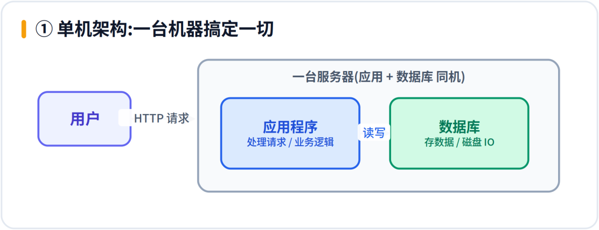

> **本阶段小结**
> 起点 用户极少,一台机器装下应用 + 数据库,够用就好。 埋下的隐患 应用要算逻辑、数据库要做磁盘 IO,挤在一台机器上迟早互相抢资源。

## 第 2 章 · 应用与数据库分离

业务慢慢有了起色,用户多了一点,单机开始扛不住了。最先暴露的问题是:应用程序和数据库在同一台机器上互相抢资源——应用忙着处理请求和计算业务逻辑,数据库忙着做大量磁盘 IO,两者抢同一份 CPU 和内存,谁都跑不痛快。

解决办法很直接:加一台机器,把应用和数据库拆到两台服务器上。应用服务器专门处理请求与业务逻辑,数据库服务器专门负责存储与磁盘 IO。两者各司其职、互不干扰,稳定性和可扩展的余地都立刻提升。

**名词解释**

- **应用与数据库分离** —— 把应用层与数据层部署到不同机器上,让两类资源需求完全不同的工作各自独占硬件。

为什么要分离:应用是“计算密集 + 高并发连接”,数据库是“IO 密集 + 状态存储”,两者的资源画像截然不同;放在一起只会互相拖累,拆开后才能分别按各自的特点扩展。

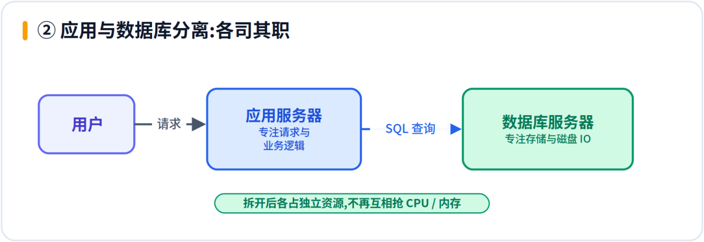

> **本阶段小结**
> 瓶颈 应用与数据库挤在一台机器,互相抢 CPU / 内存。 方案 拆成两台,各自专注计算与存储。 新代价 单台应用服务器仍有处理上限,数据库也还是单点。

## 第 3 章 · 应用集群与负载均衡

用户继续暴涨,单台应用服务器处理不过来,数据库也开始扛不住大量查询。故事进入高潮:高并发来了。一台应用服务器即使配置拉满也有上限——比如每秒只能扛 100 个请求,可现在一下子来了 500 个,500 ÷ 100 = 5,那就干脆上 5 台机器,每台都部署一模一样的代码。这一组机器就叫集群。

紧接着的问题是:流量怎么分配到每台机器?于是你在用户和应用之间加了一个中间层,由它把请求均匀地分发到每台应用服务器,这就是负载均衡。扛不住就继续加机器,这种“靠堆机器提升能力”的方式叫水平扩展;而一旦某台机器宕机,它能自动把流量摘除、由其他机器顶上,保证系统整体不崩,这种能力叫高可用。

**名词解释(这一章一口气出现四个关键词)**

- **集群 Cluster** —— 多台部署相同代码的服务器组成一个整体对外提供服务。之所以存在,是因为单机性能有物理天花板,横向堆机器是突破它最直接的办法。
- 负载均衡 Load Balancing —— 用户与应用集群之间的中间层,按规则把请求均匀分发到各台机器。有了多台机器,就必须有人决定“每个请求该去哪一台”,否则流量无法被多台共享。
- **水平扩展 Scale Out** —— 通过增加机器数量来提升整体处理能力(与之相对的“垂直扩展”是给单机升配)。垂直扩展有上限且越来越贵,水平扩展理论上可以近乎线性、无限地加。
- 高可用 High Availability —— 通过冗余 + 故障自动转移,保证个别节点宕机时系统整体仍可用。机器一定会坏,单点意味着“坏一个就全崩”,多副本才能让“坏一个”不等于“挂全部”。

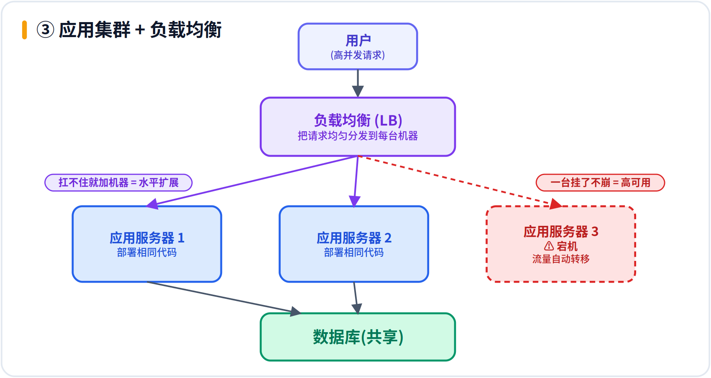

> **本阶段小结**
> 瓶颈 单台应用服务器扛不住高并发请求。 方案 集群多机 + 负载均衡分流 + 水平扩展 + 故障自动转移(高可用)。 新代价 应用层扛住了,但请求最终都要查数据库,数据库成了新瓶颈。

## 第 4 章 · 多级缓存

应用层不再是瓶颈,但所有请求最终都要落到数据库,数据库被打爆了。爱钻研的你研究起“应用查数据库”的底层原理:应用先把查询发给数据库,数据库会先在自己的内存缓冲区里找数据,找到就直接返回;找不到才去磁盘一通折腾,捞出来放回内存缓冲区,再返回给应用。你还发现一个关键事实——从内存读比从磁盘读要快一千倍以上。

于是一个自然的想法冒出来:既然内存这么快,能不能把经常被访问的“热数据”直接放进内存,查这里就好,不用再去数据库?不能全放,因为内存太小、根本装不下整个库。那就只把热数据放进去——这就是缓存。再进一步,你设计了三层缓存:浏览器缓存 应用服务器本地缓存 分布式缓存(如 Redis)。用户的每次请求先到浏览器缓存找,没有就到应用本地缓存,再到分布式缓存,最后才轮到数据库。绝大多数请求在缓存层就被拦住,根本到不了数据库。

> **一个容易混淆的点**
> 数据库的内存缓冲区只缓存“原始表数据”;而你设计的多级缓存是“什么快、什么常用就缓存什么”——不只是数据库里的行,还包括页面片段、接口返回结果、静态资源、计算结果……一切能提高访问效率的东西,都可以放进缓存。

**名词解释**

- **缓存 Cache** —— 把热数据放在更快介质(内存)里的一份副本,本质是“用空间换时间”。为什么不直接把数据库全搬进内存?因为内存又贵又小,所以只把“热的”放进来。
- **多级缓存** —— 浏览器、应用本地、分布式缓存三层依次铺开。越靠近用户的缓存越快、越能卸载后端,但容量与共享性越差;分层就是为了兼顾速度与共享。

**收益与代价**

收益很可观:查询速度从毫秒级降到微秒级,数据库压力骤降;即使数据库短暂宕机,缓存还能顶上一阵,可用性也随之提升。

> **原讲解略过的“缓存真正难的地方”**
> 缓存几乎被讲成了纯收益,但工程上最棘手的恰恰是它的代价:① 缓存一致性——缓存和数据库的数据如何保持同步; ② 缓存穿透——大量查询一个根本不存在的 key,每次都击穿到数据库; ③ 缓存击穿——某个热点 key 失效的瞬间,海量请求同时压向数据库; ④ 缓存雪崩——大量 key 同时失效或缓存服务宕机,流量瞬间全部砸到数据库。

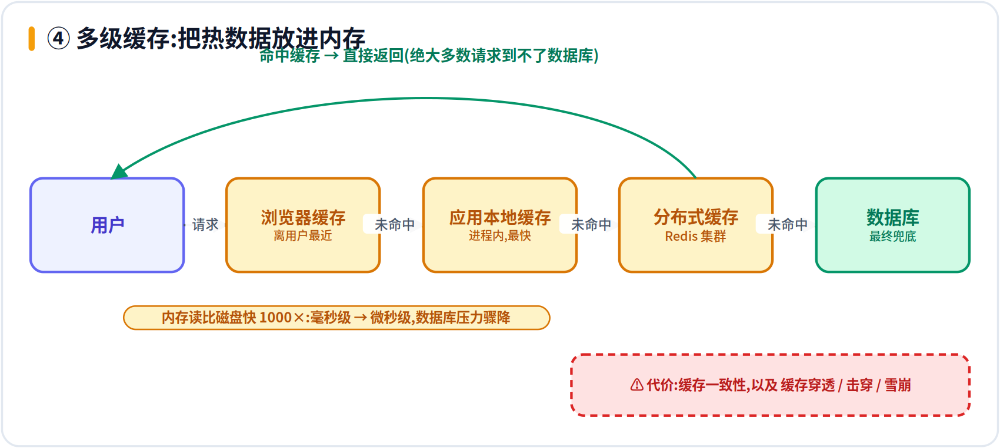

> **本阶段小结**
> 瓶颈 请求全部压向数据库,数据库被打爆。 方案 把热数据放进内存,用浏览器 / 本地 / 分布式三级缓存层层拦截。 新代价 缓存一致性,以及穿透 / 击穿 / 雪崩;且写请求与非热点读仍要打数据库。

> **放到 vibe coding 里**　模型加缓存往往只写“读缓存、没有就查库”，但缓存穿透 / 击穿 / 雪崩、以及写完后怎么失效，它常常不管——而这些恰恰是缓存上线后出事的地方。

## 第 5 章 · 读写分离

缓存解决了“热点读”,但写请求和非热点读还是要落到数据库。而数据库有个固有特点:写比读慢得多。写操作要加行锁、表锁,并发一高就排队,还会连带把读也阻塞住。

既然如此,能不能给数据库分工?于是你让主库只负责写,从库只负责读,主库通过主从复制把数据同步给从库,保证主从数据一致。这就是读写分离。现实中的互联网系统大多“读多写少”,所以可以一主多从,读压力一下子就被分摊到多台从库上,数据库读写互相阻塞的问题被极大缓解。

**名词解释**

- **读写分离** —— 写走主库、读走从库的架构。读和写的性能特征与量级差异巨大,分开后可以各自独立扩展,读压力还能通过“加从库”来线性分摊。
- 主从复制 Master-Slave Replication —— 主库把数据变更同步给从库的机制。从库要能提供与主库一致的数据来分担读,就必须有这样一条同步通道。

> **一个常被忽略的坑:复制延迟**
> 主从复制通常是异步的,存在复制延迟——用户刚在主库写入,立刻去从库读,可能读到的还是旧数据(即 read-after-write 不一致)。所以“写完马上要读”的场景需要特殊处理,比如强制让这次读走主库。原讲解里“彻底解决了读写阻塞”的说法其实略显乐观。

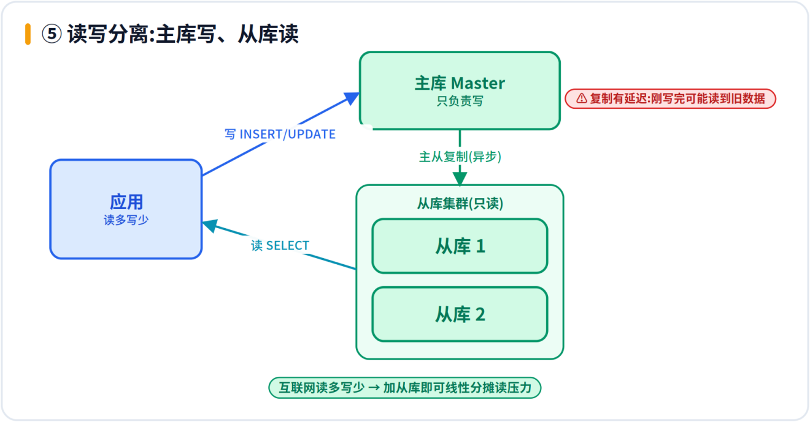

> **本阶段小结**
> 瓶颈 写操作锁表,并发一高就排队,连读也被阻塞。 方案 主库写、从库读;一主多从,线性分摊读压力。 新代价 主从复制有延迟,“写后立即读”可能读到旧数据。

## 第 6 章 · 分库分表

系统跑了几年,数据量越来越大,订单表、日志表动辄上亿行,单库单表无论在存储还是性能上都撑不住了。这时候必须对数据库本身做拆分,而拆分有两个方向。

第一个方向是垂直分库:按业务边界把一个大库拆成多个库——用户库、商品库、订单库各自独立、互不干扰。第二个方向是水平分表:把一张大表按行拆成多张结构相同的小表(比如按用户 ID 做哈希,均匀分到 4 张订单表里),从而分散单表的数据量和并发压力;再配合数据库中间件来做路由,整个分片过程对应用透明,不用大改业务代码。

**名词解释**

- **垂直分库(按业务拆)** —— 把不同业务的数据放进不同的库。不同业务的数据与访问彼此独立,拆开后能独立扩展、隔离故障。
- **水平分表 / 分库(按行拆)** —— 把同一类数据按某个键(如 UID 哈希)拆成多份。单表行数、单库容量都有物理上限,水平拆分让存储与并发可以继续横向扩展。
- **数据库中间件** —— 位于应用与多个库表之间,按规则把 SQL 路由到正确的库表,对应用屏蔽分片细节。分片之后,应用不应该再关心数据具体落在哪张表,需要这样一层来做透明路由。

收益:数据库自此从“单点”变成“分布式”,存储和并发能力可以近乎无限地横向扩展。

> 原讲解完全跳过、却最“疼”的一块:分布式事务 一旦你拆了库表、后面又拆了服务,就再也不能靠“一个本地数据库事务”来保证「扣库存 + 生成订单 + 扣余额」要么全部成功、要么全部失败了。如何在跨库、跨服务的情况下保证数据一致,就是分布式事务问题。工程上常用的近似方案包括:可靠消息 / 本地消息表(配合消息队列做最终一致性)、Saga、TCC 等。这是真实系统里最容易出事、也最考验设计的一环。

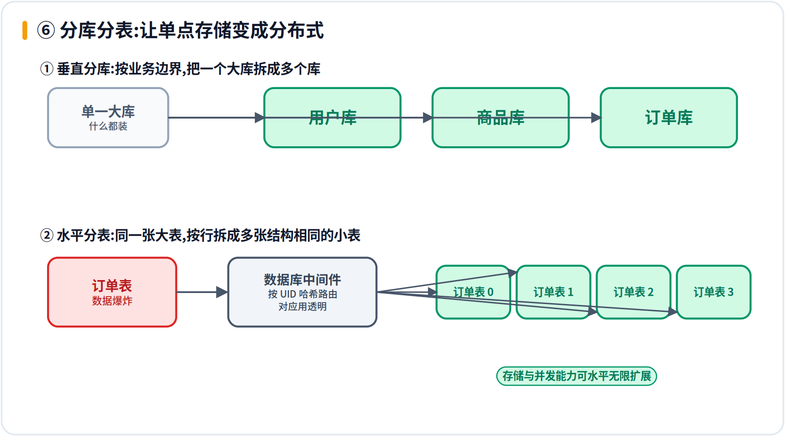

> **本阶段小结**
> 瓶颈 单库单表数据爆炸,存储与性能都撑不住。 方案 垂直分库(按业务)+ 水平分表(按行)+ 中间件透明路由。 新代价 跨库跨服务的数据一致性变难——引出分布式事务问题。

> **放到 vibe coding 里**　分库分表是“不得已才用”的重手段。模型轻飘飘建议拆表前，你要先问：跨库事务、跨库 join、分页怎么办——这些代价它很少主动摆上台面。

## 第 7 章 · CDN 与反向代理

你的系统用户遍布全国,离机房近的访问飞快,远的却慢如蜗牛;与此同时,应用服务器直接暴露在公网上太危险,容易被攻击。为此你引入了两个新组件。

第一个是 CDN:在全国(乃至全球)铺设大量边缘节点,把静态资源(图片、JS、CSS、视频)提前缓存到离用户最近的节点。用户通过域名解析拿到最近节点的 IP 去取数据,不必每次都跑到中心机房——就像把快递仓直接建到你家门口,速度直接起飞。第二个是反向代理:把它放在用户和应用之间,公网请求先到它,再由它转发给内网的应用服务器,从而隐藏了真实的后端服务器。

**名词解释**

- **CDN 内容分发网络** —— 把静态内容缓存在地理上离用户最近的边缘节点的网络。物理距离决定了网络延迟的下限,把内容“搬到用户身边”是降低延迟最有效的办法,同时还能为源站卸载大量流量。
- **反向代理 Reverse Proxy** —— 代表后端接收外部请求并转发的服务器(与“代表客户端”的正向代理相反)。需要一个统一入口来隐藏和保护后端,并顺带做流量清洗、鉴权、负载分发等。

一举多得:① 访问速度起飞;② 真实服务器被隐藏,可以防攻击、做流量清洗与权限校验。

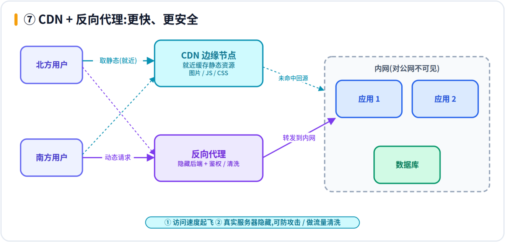

> **本阶段小结**
> 瓶颈 远端用户访问慢;应用服务器暴露在公网,易被攻击。 方案 CDN 就近缓存静态资源;反向代理隐藏后端并做安全防护。 新代价 动态的复杂查询(模糊 / 全文)仍然没有好办法。

## 第 8 章 · 搜索引擎与 NoSQL

互联网玩法越来越花,场景越来越复杂,传统关系数据库在模糊查询、全文搜索、多维统计面前开始力不从心。比如电商搜商品、新闻搜热点,用 SQL 的 LIKE '%关键词%' 会慢到无法忍受——因为它用不上索引,只能逐行扫描全表。为此你又引入了两个组件。

第一个是搜索引擎:它利用倒排索引让全文检索做到秒级响应。所谓倒排索引,不是建立“文档 词”的映射,而是反过来建立“词 包含该词的文档列表”;于是你输入一个词,可以立刻拿到所有相关文档,完全不需要逐行扫描(常见实现如 Elasticsearch)。第二个是 NoSQL 数据库:它专门用来存储非结构化、半结构化的数据,而且天生支持高并发、易于水平扩展。

**名词解释**

- **搜索引擎 / 倒排索引** —— 为全文检索而生的数据结构与系统。关系库的 B+ 树索引擅长精确与范围查询,却不擅长“任意词的全文匹配”,倒排索引正是为后者而设计的。
- **NoSQL 数据库** —— 不遵循关系模型、为特定场景(海量、高并发、灵活结构)优化的数据库统称(含键值、文档、列族、图等类型)。关系库的强一致与固定表结构在超大规模、灵活数据下成了束缚,NoSQL 用“放松部分约束”换取扩展性与性能。

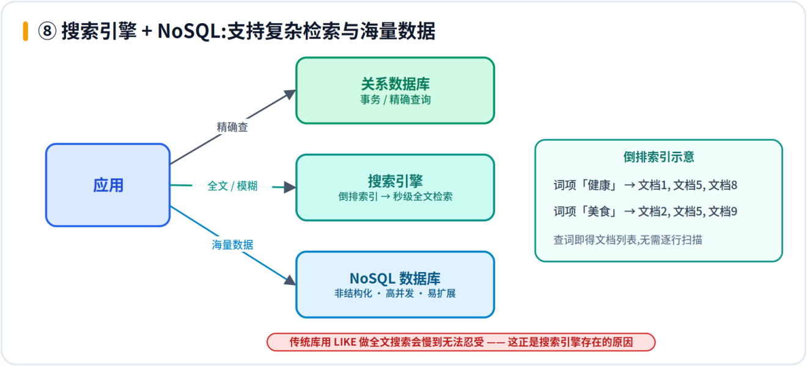

> **本阶段小结**
> 瓶颈 模糊 / 全文 / 多维查询,关系库力不从心(LIKE 慢到无法忍受)。 方案 搜索引擎(倒排索引)做全文检索;NoSQL 存海量非结构化数据。 新代价 应用本身越长越大,演化为难以维护的“巨石”。

## 第 9 章 · 从巨石应用到分布式

这一次,问题出在应用侧。你的网站从一个小电商,长成了集用户、商品、订单于一体的大平台,所有功能的代码全挤在同一个应用里——这就是大家常说的巨石应用(单体应用)。麻烦随之而来:改一行用户相关的代码,也要把整个应用全量发布;多个开发同时改同一套代码,天天冲突;明明只想给订单服务加机器抗流量,却只能让整个应用一起扩容,大量资源被白白浪费。

解决办法还是那个字:拆。你按业务边界把这个庞大的应用一刀刀切开——用户相关的功能做成独立的用户系统,商品、订单也各自独立成系统,每个系统单独部署、单独发布、单独扩容,谁也不影响谁。这就是分布式架构。可拆完之后,新问题马上来了:用户下单时要查商品库存、生成订单,这些系统已经分开了,它们之间该怎么互相调用、怎么通信?于是你又陆续发明了几个配套组件。

**名词解释**

- **分布式架构** —— 把一个大应用按业务拆成多个可独立部署的系统。让各业务能独立开发、发布、扩容,互不拖累。
- **RPC 远程过程调用** —— 让跨机器、跨进程的服务调用,在代码里写起来就像调用本地方法一样简单。服务拆开后散落在不同机器,需要一种机制屏蔽网络通信的细节。
- **服务注册与发现中心** —— 一个“总管”:所有服务启动后都来这里登记自己的地址,调用方要找谁就先来这里查、再去调用。服务很多且地址会动态变化(扩缩容、漂移),硬编码地址行不通,需要一本动态的“通讯录”。
- **消息队列 Message Queue** —— 一个超大容量的“智能收件箱”:服务之间不必死等对方立刻回复,把消息扔进队列就继续干自己的事,消费方有空再来取。同步调用会让服务相互等待、相互拖累,一个卡住就堵死整条链路;异步化能彻底解耦,还能保证消息不丢。
- **削峰填谷** —— 用队列把瞬时高峰的请求先缓存起来,后端再按自己的处理能力匀速消化。突发流量若直接砸到后端会压垮系统,先排队、再慢慢消化能保护后端。

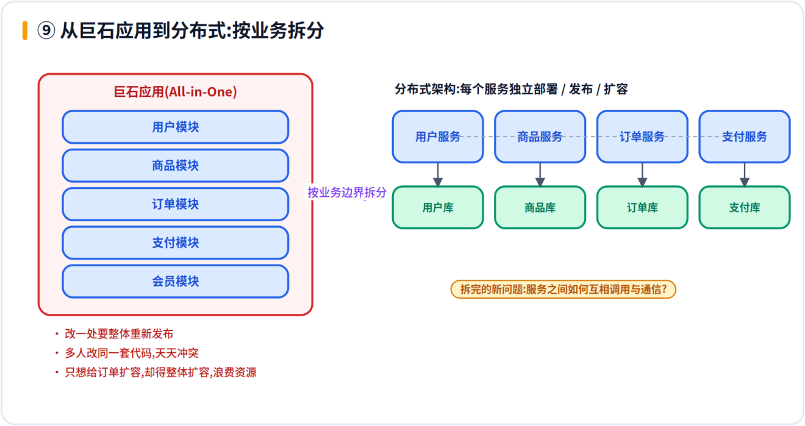

> **本阶段小结**
> 瓶颈 巨石应用:牵一发动全身,无法独立发布与扩容。 方案 按业务拆成分布式服务,配以 RPC、注册发现、消息队列。 新代价 拆得还不够细;调用链变长,跨服务一致性更突出。

## 第 10 章 · 微服务架构与治理体系

分布式是拆了,但拆得还不够细。就拿用户系统来说,里面又塞了登录、个人信息、会员、地址……还是一大坨,不够清爽;不同团队想用的技术也不一样,有人想用 Java、有人想用 Go,混在一个系统里根本没法搞;会员模块想单独扩容,结果只能把整个用户系统一起加,机器和资源全浪费了。

于是继续拆,按“一个服务只干一件事”的原则,把系统拆得更细更小:登录做成独立服务,会员、支付各自独立,每个小服务只干一件事,能独立开发、独立发布、独立扩容,想用什么技术栈就用什么,互不干扰。这套更极致的架构就叫微服务架构。它带来的灵活性是惊人的:大促时只给订单、支付这几个最热的服务加 10 倍机器,其他不忙的服务一动不动、资源零浪费;哪个服务出 bug 也只影响一个小功能,绝不会拖垮整站;多个团队各管各的服务,开发效率直接起飞。

当然,有利就有挑战:服务一多,调用关系就像蜘蛛网,出了问题找不到在哪。下面这些“治理”名词,正是为应对这些挑战而存在的。

**名词解释(微服务的配套治理设施)**

- **API 网关** —— 所有外部请求的统一入口,在这里集中做鉴权、限流、路由、协议转换与结果聚合。服务一多,不能让客户端直接面对几十个服务地址、各自处理鉴权限流,需要一个统一门面(它与第 7 章的反向代理职责相关,但更偏业务聚合)。
- **配置中心** —— 统一管理各服务的配置,并能动态下发。几百个服务的配置若散落各处、改一次要逐个重启,会是运维灾难;集中管理 + 动态下发才可控。
- **全链路追踪** —— 给每个请求打上唯一标识,串起它流经的所有服务,出问题能一眼定位是哪一环慢、哪一环出错。调用关系像蜘蛛网,必须有手段还原整条调用链。
- **限流 / 熔断 / 降级** —— 流量过大时限制进入量(限流);某个依赖持续失败时暂时切断对它的调用、避免被一起拖死(熔断);非核心功能临时关闭、优先保住核心(降级)。服务相互依赖,一个雪崩可能连锁拖垮全站,这套机制就是“保险丝”。
- **服务治理** —— 对大量服务做统一的监控、日志、告警、注册与配置管理。服务太多,必须有统一手段才管得过来。

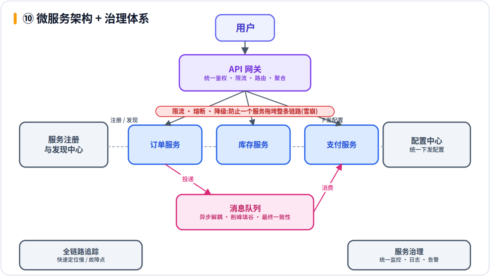

> **本阶段小结**
> 瓶颈 分布式拆得不够细;团队协作与按需扩容仍受限。 方案 极致拆分为微服务,配齐网关、配置中心、链路追踪、限流熔断降级、治理。 新代价 服务从几个变成几百个,部署与运维成本爆炸。

> **放到 vibe coding 里**　“拆成微服务”听着先进，代价是分布式事务、服务发现、链路追踪一整套。懂这账单，你才判断得了当前项目到底该不该拆，而不是被模型带着一上来就拆。

## 第 11 章 · 容器化、K8s 与云原生

微服务确实好用,可运维同学直接哭了:服务越拆越细,从原来的几个应用一下子变成几百个微服务,部署运维成了噩梦。每个服务上线都要配环境、装依赖、调参数,稍有不同就出现“我电脑能跑、服务器跑不起来”的玄学 bug;大促前几百台机器一台台配,大促后又得一台台清理,效率低到离谱。架构最后这一程,要解决的就是“运维成本与自动化”。

**① 容器化(Docker):一次打包,到处运行**

你灵机一动:能不能把服务和它需要的运行环境一起打包成一个“密封盒子”,放到哪台机器都能直接跑?于是把每个微服务的代码、依赖、配置、运行环境全部打包成一个镜像,一次打包、到处运行,彻底解决环境不一致的世纪难题。

- **Docker / 容器** —— 把应用及其完整运行环境一起打包、隔离运行的技术。“环境不一致”是部署最大的隐性成本,容器把环境随应用一起带走,实现真正的一次构建、处处运行。
- **镜像 Image** —— 容器的“模板”,是代码 + 依赖 + 环境的只读打包。需要一个可分发、可版本化的标准交付物,镜像就是它。

② 容器编排(Kubernetes / K8s):全能大管家

几百上千个容器谁来管?于是你请来一个“全能大管家”——Kubernetes(简称 K8s)。它负责编排容器:流量高了自动加容器,流量低了自动减容器(自动扩缩容),容器挂了自动重启(自愈),全程几乎无人值守。

- **Kubernetes(K8s)** —— 容器编排系统,自动完成容器的调度、扩缩容、自愈、服务发现等。容器数量一多,人工管理根本不可能,需要一个自动化的“编排大脑”。

**③ 云平台与云原生:把机房变成按需的资源池**

就算有了 K8s,你还是得自己买服务器、租机房;为了大促备一堆机器,平时却全闲着,太浪费钱。于是你干脆把系统搬上云平台——一个近乎无限大的资源池,要多少 CPU、内存、带宽都随时申请、用完即释放、按需付费,底层机房对你完全透明。至此,你的架构彻底进入了新时代:弹性、自动化、高可用、可无限扩展。这套理念就叫云原生。

- **云平台** —— 按需提供计算 / 存储 / 网络资源的公共资源池。自建机房要为峰值预留、平时闲置,成本高;云把“买”变成“租”,用多少付多少。
- **云原生 Cloud Native** —— 一套“生于云、长于云”的架构理念与技术组合(容器 + 编排 + 微服务 + 弹性 + 自动化)。要榨取云的弹性红利,应用本身的设计也要随之改变,这套理念就是答案。

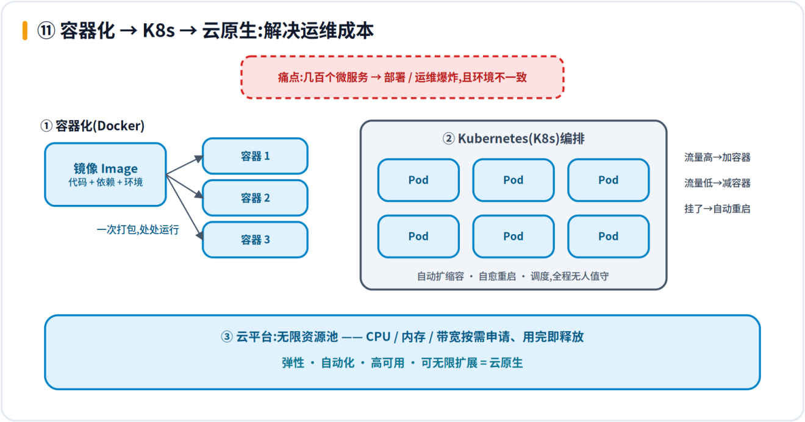

> **本阶段小结**
> 瓶颈 几百个微服务,部署运维爆炸,且环境处处不一致。 方案 Docker 打包镜像 + K8s 自动编排 + 云平台弹性资源池 = 云原生。 终点 从一台小服务器,走到弹性、自动化、高可用、可无限扩展的现代化架构。

## 第 12 章 · 总结:主线、速查表与三大思维

回头看整条主线,每一步都对应着一个被解决的瓶颈:单机架构解决“从零搭建”;应用与数据库分离解决资源争抢;应用集群加负载均衡解决高并发;多级缓存解决查询性能与数据库压力;读写分离解决读写阻塞;分库分表加分布式数据库解决海量存储;CDN 加反向代理解决访问速度与系统安全;搜索引擎加 NoSQL 解决复杂查询;业务拆分加分布式、再到微服务解决业务膨胀、代码维护与团队协作;容器化加云平台解决运维成本与自动化。一环扣一环,这就是架构演进的完整脉络。

**名词速查表**

| 名词 | 作用 / 为什么而存在 |
| --- | --- |
| 单机架构 | 应用与数据库同机部署的最简形态;初期够用、成本最低。 |
| 应用与数据库分离 | 计算与存储分到两台机器,各占资源、互不争抢。 |
| 集群 Cluster | 多台相同代码的服务器组成整体;突破单机性能上限。 |
| 负载均衡 | 把请求均匀分发到集群各机器;让多机能共享流量。 |
| 水平扩展 | 靠加机器提升能力;比升配(垂直扩展)更可持续。 |
| 高可用 | 冗余 + 故障自动转移;让坏一台不等于全挂。 |
| 缓存 | 把热数据放内存的副本;用空间换时间,挡住数据库读压力。 |
| 多级缓存 | 浏览器 / 本地 / 分布式三层;层层拦截请求。 |
| 缓存穿透/击穿/雪崩 | 缓存的三大经典风险;分别对应查不存在的 key、热点 key 失效、大量 key 同时失效。 |
| 读写分离 | 主库写、从库读;按读多写少分摊读压力。 |
| 主从复制 | 主库向从库同步数据的通道;注意异步复制有延迟。 |
| 垂直分库 | 按业务把大库拆成多库;独立扩展、隔离故障。 |
| 水平分表 | 按行(如 UID 哈希)把大表拆多份;突破单表 / 单库上限。 |
| 数据库中间件 | 在应用与库表间做透明路由;屏蔽分片细节。 |
| 分布式事务 | 跨库 / 跨服务保证数据一致;常用最终一致性、Saga、TCC。 |
| CDN | 把静态资源缓存到离用户最近的边缘节点;降低延迟、卸载源站。 |
| 反向代理 | 后端的统一入口;隐藏并保护后端,做安全与分发。 |
| 搜索引擎/倒排索引 | 建“词 文档列表”映射;让全文检索秒级命中。 |
| NoSQL | 为海量、高并发、灵活结构优化的非关系数据库。 |
| 巨石应用 | 所有功能挤在一个应用;牵一发动全身。 |
| 分布式架构 | 按业务拆成可独立部署的系统;互不拖累。 |
| RPC | 让远程调用写起来像调本地方法;屏蔽网络细节。 |
| 服务注册与发现 | 服务的动态“通讯录”;解决地址动态变化。 |
| 消息队列 | 异步“智能收件箱”;解耦服务、削峰填谷、保证消息不丢。 |
| 削峰填谷 | 用队列缓冲高峰、匀速消化;保护后端不被压垮。 |
| 微服务 | 一个服务只干一件事;独立开发 / 发布 / 扩容,技术栈自由。 |
| API 网关 | 外部请求统一入口;集中鉴权、限流、路由、聚合。 |
| 配置中心 | 集中管理并动态下发配置;避免逐个重启。 |
| 全链路追踪 | 给请求打唯一标识串起调用链;快速定位慢 / 故障点。 |
| 限流/熔断/降级 | 微服务的“保险丝”;防止单点雪崩连锁拖垮全站。 |
| 服务治理 | 对大量服务统一监控、日志、告警与管理。 |
| Docker / 容器 | 把应用与运行环境打包隔离;一次构建、处处运行。 |
| 镜像 Image | 代码+依赖+环境的只读打包;可分发、可版本化。 |
| Kubernetes(K8s) | 容器编排大脑;自动调度、扩缩容、自愈。 |
| 云平台 | 按需的计算 / 存储 / 网络资源池;用多少付多少。 |
| 云原生 | 生于云、长于云的架构理念;容器+编排+微服务+弹性+自动化。 |

**送给你的三句架构师核心思维**

> ① 没有最好的架构,只有最适合业务的架构 初创公司别一上来就微服务,单机够用就先用单机。让业务推着架构走,而不是反过来用架构去“秀肌肉”。

> ② 架构演进的本质:用空间换时间、用复杂度换性能 加机器、加组件、加分层,本质都是在“花成本”去扛住更大的流量和更高的并发。每一次复杂度的提升,都应该换来与之匹配的性能或可用性收益。

> ③ 永远围绕五大目标:高性能、高可用、可伸缩、可扩展、够安全 任何一个架构决策,都可以拿这五个词去检验:它让系统更快、更稳、更能弹性伸缩、更易扩展、还是更安全了?

从一台服务器,到千万级流量。架构不是设计出来的,是长出来的。
