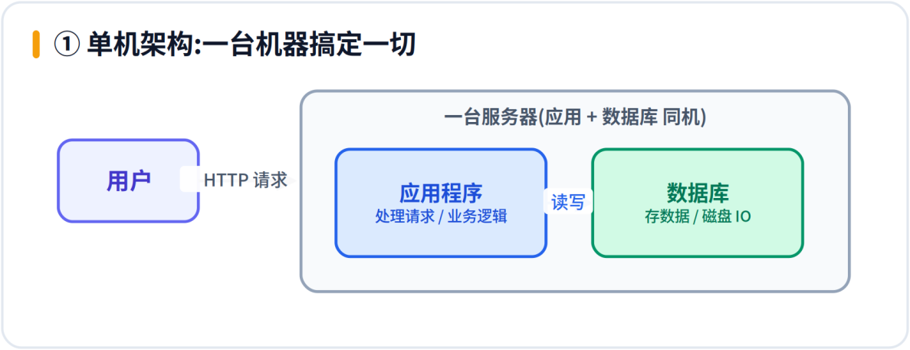

# 第 1 章 · 单机架构

故事的起点非常朴素:你刚做好一个小网站,用户没几个,访问量极低。这时候怎么简单怎么来——一台服务器,上面同时装着应用程序和数据库,用一套成熟的开源技术栈(常见的如 LNMP / LAMP:Linux + Nginx 或 Apache + MySQL + PHP)就能迅速跑起来。这就是单机架构。

它的优点是极致的简单、便宜,开发和部署都快。在用户量很小的阶段,它完全够用,而且最省心。

**名词解释**

- **单机架构** —— 应用程序与数据库部署在同一台服务器上的最简形态。
- **LNMP / LAMP** —— 一套经典的开源 Web 技术栈;之所以流行,是因为它免费、成熟、上手快,能让你用最低成本把网站跑起来。

为什么它会作为起点存在:创业初期最大的成本是“先把东西跑起来、验证业务”,而不是性能。过早上复杂架构,只会拖慢上线、徒增维护负担。

> **本阶段小结**
> 起点 用户极少,一台机器装下应用 + 数据库,够用就好。 埋下的隐患 应用要算逻辑、数据库要做磁盘 IO,挤在一台机器上迟早互相抢资源。
