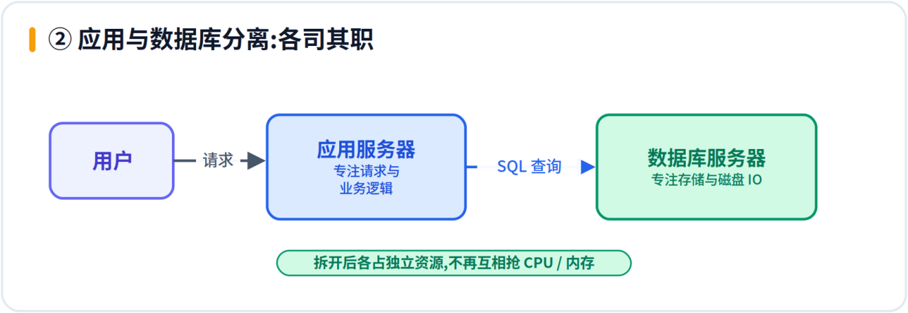

# 第 2 章 · 应用与数据库分离

业务慢慢有了起色,用户多了一点,单机开始扛不住了。最先暴露的问题是:应用程序和数据库在同一台机器上互相抢资源——应用忙着处理请求和计算业务逻辑,数据库忙着做大量磁盘 IO,两者抢同一份 CPU 和内存,谁都跑不痛快。

解决办法很直接:加一台机器,把应用和数据库拆到两台服务器上。应用服务器专门处理请求与业务逻辑,数据库服务器专门负责存储与磁盘 IO。两者各司其职、互不干扰,稳定性和可扩展的余地都立刻提升。

**名词解释**

- **应用与数据库分离** —— 把应用层与数据层部署到不同机器上,让两类资源需求完全不同的工作各自独占硬件。

为什么要分离:应用是“计算密集 + 高并发连接”,数据库是“IO 密集 + 状态存储”,两者的资源画像截然不同;放在一起只会互相拖累,拆开后才能分别按各自的特点扩展。

> **本阶段小结**
> 瓶颈 应用与数据库挤在一台机器,互相抢 CPU / 内存。 方案 拆成两台,各自专注计算与存储。 新代价 单台应用服务器仍有处理上限,数据库也还是单点。
