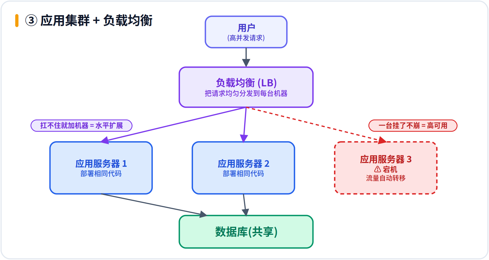

# 第 3 章 · 应用集群与负载均衡

用户继续暴涨,单台应用服务器处理不过来,数据库也开始扛不住大量查询。故事进入高潮:高并发来了。一台应用服务器即使配置拉满也有上限——比如每秒只能扛 100 个请求,可现在一下子来了 500 个,500 ÷ 100 = 5,那就干脆上 5 台机器,每台都部署一模一样的代码。这一组机器就叫集群。

紧接着的问题是:流量怎么分配到每台机器?于是你在用户和应用之间加了一个中间层,由它把请求均匀地分发到每台应用服务器,这就是负载均衡。扛不住就继续加机器,这种“靠堆机器提升能力”的方式叫水平扩展;而一旦某台机器宕机,它能自动把流量摘除、由其他机器顶上,保证系统整体不崩,这种能力叫高可用。

**名词解释(这一章一口气出现四个关键词)**

- **集群 Cluster** —— 多台部署相同代码的服务器组成一个整体对外提供服务。之所以存在,是因为单机性能有物理天花板,横向堆机器是突破它最直接的办法。
- 负载均衡 Load Balancing —— 用户与应用集群之间的中间层,按规则把请求均匀分发到各台机器。有了多台机器,就必须有人决定“每个请求该去哪一台”,否则流量无法被多台共享。
- **水平扩展 Scale Out** —— 通过增加机器数量来提升整体处理能力(与之相对的“垂直扩展”是给单机升配)。垂直扩展有上限且越来越贵,水平扩展理论上可以近乎线性、无限地加。
- 高可用 High Availability —— 通过冗余 + 故障自动转移,保证个别节点宕机时系统整体仍可用。机器一定会坏,单点意味着“坏一个就全崩”,多副本才能让“坏一个”不等于“挂全部”。

> **本阶段小结**
> 瓶颈 单台应用服务器扛不住高并发请求。 方案 集群多机 + 负载均衡分流 + 水平扩展 + 故障自动转移(高可用)。 新代价 应用层扛住了,但请求最终都要查数据库,数据库成了新瓶颈。
