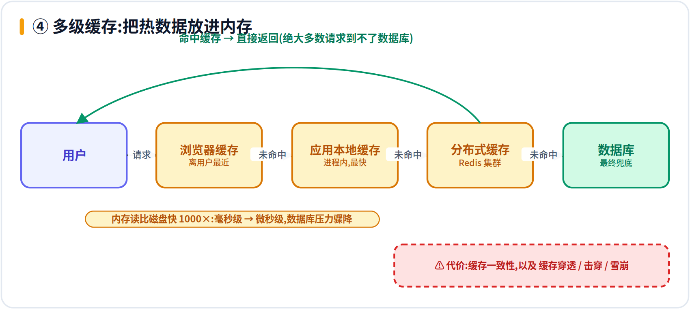

# 第 4 章 · 多级缓存

应用层不再是瓶颈,但所有请求最终都要落到数据库,数据库被打爆了。爱钻研的你研究起“应用查数据库”的底层原理:应用先把查询发给数据库,数据库会先在自己的内存缓冲区里找数据,找到就直接返回;找不到才去磁盘一通折腾,捞出来放回内存缓冲区,再返回给应用。你还发现一个关键事实——从内存读比从磁盘读要快一千倍以上。

于是一个自然的想法冒出来:既然内存这么快,能不能把经常被访问的“热数据”直接放进内存,查这里就好,不用再去数据库?不能全放,因为内存太小、根本装不下整个库。那就只把热数据放进去——这就是缓存。再进一步,你设计了三层缓存:浏览器缓存 应用服务器本地缓存 分布式缓存(如 Redis)。用户的每次请求先到浏览器缓存找,没有就到应用本地缓存,再到分布式缓存,最后才轮到数据库。绝大多数请求在缓存层就被拦住,根本到不了数据库。

> **一个容易混淆的点**
> 数据库的内存缓冲区只缓存“原始表数据”;而你设计的多级缓存是“什么快、什么常用就缓存什么”——不只是数据库里的行,还包括页面片段、接口返回结果、静态资源、计算结果……一切能提高访问效率的东西,都可以放进缓存。

**名词解释**

- **缓存 Cache** —— 把热数据放在更快介质(内存)里的一份副本,本质是“用空间换时间”。为什么不直接把数据库全搬进内存?因为内存又贵又小,所以只把“热的”放进来。
- **多级缓存** —— 浏览器、应用本地、分布式缓存三层依次铺开。越靠近用户的缓存越快、越能卸载后端,但容量与共享性越差;分层就是为了兼顾速度与共享。

**收益与代价**

收益很可观:查询速度从毫秒级降到微秒级,数据库压力骤降;即使数据库短暂宕机,缓存还能顶上一阵,可用性也随之提升。

> **原讲解略过的“缓存真正难的地方”**
> 缓存几乎被讲成了纯收益,但工程上最棘手的恰恰是它的代价:① 缓存一致性——缓存和数据库的数据如何保持同步; ② 缓存穿透——大量查询一个根本不存在的 key,每次都击穿到数据库; ③ 缓存击穿——某个热点 key 失效的瞬间,海量请求同时压向数据库; ④ 缓存雪崩——大量 key 同时失效或缓存服务宕机,流量瞬间全部砸到数据库。

> **本阶段小结**
> 瓶颈 请求全部压向数据库,数据库被打爆。 方案 把热数据放进内存,用浏览器 / 本地 / 分布式三级缓存层层拦截。 新代价 缓存一致性,以及穿透 / 击穿 / 雪崩;且写请求与非热点读仍要打数据库。

> **放到 vibe coding 里**　模型加缓存往往只写“读缓存、没有就查库”，但缓存穿透 / 击穿 / 雪崩、以及写完后怎么失效，它常常不管——而这些恰恰是缓存上线后出事的地方。
