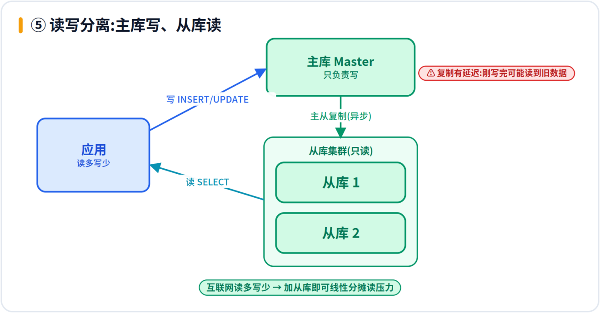

# 第 5 章 · 读写分离

缓存解决了“热点读”,但写请求和非热点读还是要落到数据库。而数据库有个固有特点:写比读慢得多。写操作要加行锁、表锁,并发一高就排队,还会连带把读也阻塞住。

既然如此,能不能给数据库分工?于是你让主库只负责写,从库只负责读,主库通过主从复制把数据同步给从库,保证主从数据一致。这就是读写分离。现实中的互联网系统大多“读多写少”,所以可以一主多从,读压力一下子就被分摊到多台从库上,数据库读写互相阻塞的问题被极大缓解。

**名词解释**

- **读写分离** —— 写走主库、读走从库的架构。读和写的性能特征与量级差异巨大,分开后可以各自独立扩展,读压力还能通过“加从库”来线性分摊。
- 主从复制 Master-Slave Replication —— 主库把数据变更同步给从库的机制。从库要能提供与主库一致的数据来分担读,就必须有这样一条同步通道。

> **一个常被忽略的坑:复制延迟**
> 主从复制通常是异步的,存在复制延迟——用户刚在主库写入,立刻去从库读,可能读到的还是旧数据(即 read-after-write 不一致)。所以“写完马上要读”的场景需要特殊处理,比如强制让这次读走主库。原讲解里“彻底解决了读写阻塞”的说法其实略显乐观。

> **本阶段小结**
> 瓶颈 写操作锁表,并发一高就排队,连读也被阻塞。 方案 主库写、从库读;一主多从,线性分摊读压力。 新代价 主从复制有延迟,“写后立即读”可能读到旧数据。
