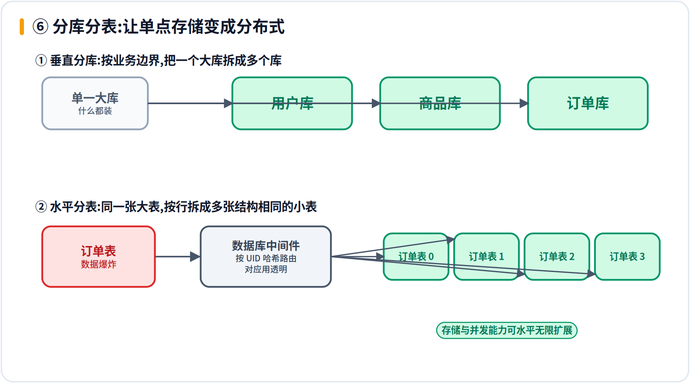

# 第 6 章 · 分库分表

系统跑了几年,数据量越来越大,订单表、日志表动辄上亿行,单库单表无论在存储还是性能上都撑不住了。这时候必须对数据库本身做拆分,而拆分有两个方向。

第一个方向是垂直分库:按业务边界把一个大库拆成多个库——用户库、商品库、订单库各自独立、互不干扰。第二个方向是水平分表:把一张大表按行拆成多张结构相同的小表(比如按用户 ID 做哈希,均匀分到 4 张订单表里),从而分散单表的数据量和并发压力;再配合数据库中间件来做路由,整个分片过程对应用透明,不用大改业务代码。

**名词解释**

- **垂直分库(按业务拆)** —— 把不同业务的数据放进不同的库。不同业务的数据与访问彼此独立,拆开后能独立扩展、隔离故障。
- **水平分表 / 分库(按行拆)** —— 把同一类数据按某个键(如 UID 哈希)拆成多份。单表行数、单库容量都有物理上限,水平拆分让存储与并发可以继续横向扩展。
- **数据库中间件** —— 位于应用与多个库表之间,按规则把 SQL 路由到正确的库表,对应用屏蔽分片细节。分片之后,应用不应该再关心数据具体落在哪张表,需要这样一层来做透明路由。

收益:数据库自此从“单点”变成“分布式”,存储和并发能力可以近乎无限地横向扩展。

> 原讲解完全跳过、却最“疼”的一块:分布式事务 一旦你拆了库表、后面又拆了服务,就再也不能靠“一个本地数据库事务”来保证「扣库存 + 生成订单 + 扣余额」要么全部成功、要么全部失败了。如何在跨库、跨服务的情况下保证数据一致,就是分布式事务问题。工程上常用的近似方案包括:可靠消息 / 本地消息表(配合消息队列做最终一致性)、Saga、TCC 等。这是真实系统里最容易出事、也最考验设计的一环。

> **本阶段小结**
> 瓶颈 单库单表数据爆炸,存储与性能都撑不住。 方案 垂直分库(按业务)+ 水平分表(按行)+ 中间件透明路由。 新代价 跨库跨服务的数据一致性变难——引出分布式事务问题。

> **放到 vibe coding 里**　分库分表是“不得已才用”的重手段。模型轻飘飘建议拆表前，你要先问：跨库事务、跨库 join、分页怎么办——这些代价它很少主动摆上台面。
