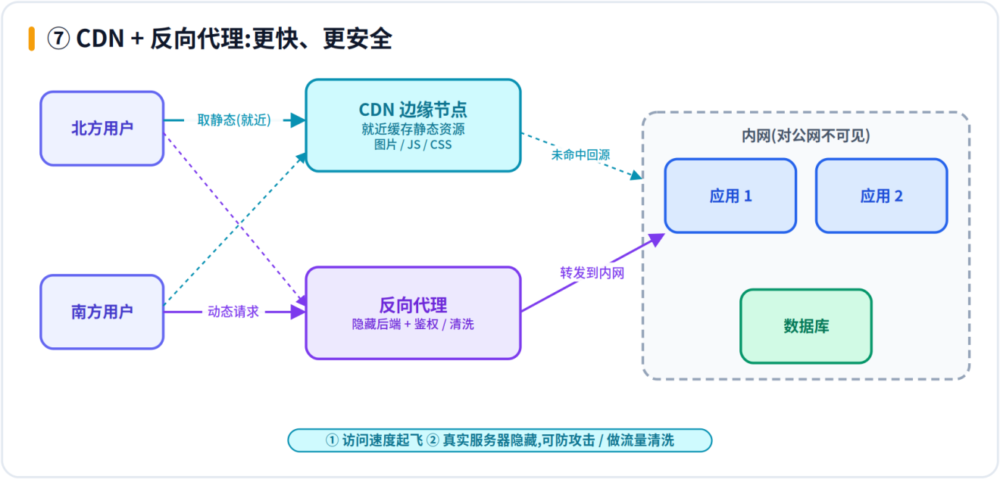

# 第 7 章 · CDN 与反向代理

你的系统用户遍布全国,离机房近的访问飞快,远的却慢如蜗牛;与此同时,应用服务器直接暴露在公网上太危险,容易被攻击。为此你引入了两个新组件。

第一个是 CDN:在全国(乃至全球)铺设大量边缘节点,把静态资源(图片、JS、CSS、视频)提前缓存到离用户最近的节点。用户通过域名解析拿到最近节点的 IP 去取数据,不必每次都跑到中心机房——就像把快递仓直接建到你家门口,速度直接起飞。第二个是反向代理:把它放在用户和应用之间,公网请求先到它,再由它转发给内网的应用服务器,从而隐藏了真实的后端服务器。

**名词解释**

- **CDN 内容分发网络** —— 把静态内容缓存在地理上离用户最近的边缘节点的网络。物理距离决定了网络延迟的下限,把内容“搬到用户身边”是降低延迟最有效的办法,同时还能为源站卸载大量流量。
- **反向代理 Reverse Proxy** —— 代表后端接收外部请求并转发的服务器(与“代表客户端”的正向代理相反)。需要一个统一入口来隐藏和保护后端,并顺带做流量清洗、鉴权、负载分发等。

一举多得:① 访问速度起飞;② 真实服务器被隐藏,可以防攻击、做流量清洗与权限校验。

> **本阶段小结**
> 瓶颈 远端用户访问慢;应用服务器暴露在公网,易被攻击。 方案 CDN 就近缓存静态资源;反向代理隐藏后端并做安全防护。 新代价 动态的复杂查询(模糊 / 全文)仍然没有好办法。
