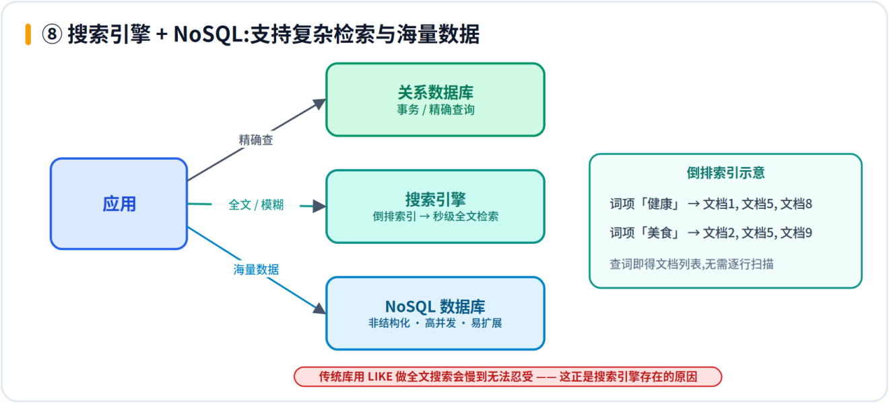

# 第 8 章 · 搜索引擎与 NoSQL

互联网玩法越来越花,场景越来越复杂,传统关系数据库在模糊查询、全文搜索、多维统计面前开始力不从心。比如电商搜商品、新闻搜热点,用 SQL 的 LIKE '%关键词%' 会慢到无法忍受——因为它用不上索引,只能逐行扫描全表。为此你又引入了两个组件。

第一个是搜索引擎:它利用倒排索引让全文检索做到毫秒级、近实时响应。所谓倒排索引,不是建立“文档 词”的映射,而是反过来建立“词 包含该词的文档列表”;于是你输入一个词,可以立刻拿到所有相关文档,无需逐行扫描全表(常见实现如 Elasticsearch)。第二个是 NoSQL 数据库:它专门用来存储非结构化、半结构化的数据,其中许多类型(尤其键值、列族)为高并发和水平扩展而设计——但这并非所有 NoSQL 的通性(如图数据库的水平扩展就不轻松)。

**名词解释**

- **搜索引擎 / 倒排索引** —— 为全文检索而生的数据结构与系统。关系库的 B+ 树索引擅长精确与范围查询,却不擅长“任意词的全文匹配”,倒排索引正是为后者而设计的。
- **NoSQL 数据库** —— 不遵循关系模型、为特定场景(海量、高并发、灵活结构)优化的数据库统称(含键值、文档、列族、图等类型)。关系库的强一致与固定表结构在超大规模、灵活数据下成了束缚,NoSQL 用“放松部分约束”换取扩展性与性能。

> **本阶段小结**
> 瓶颈 模糊 / 全文 / 多维查询,关系库力不从心(LIKE 慢到无法忍受)。 方案 搜索引擎(倒排索引)做全文检索;NoSQL 存海量非结构化数据。 新代价 应用本身越长越大,演化为难以维护的“巨石”。
