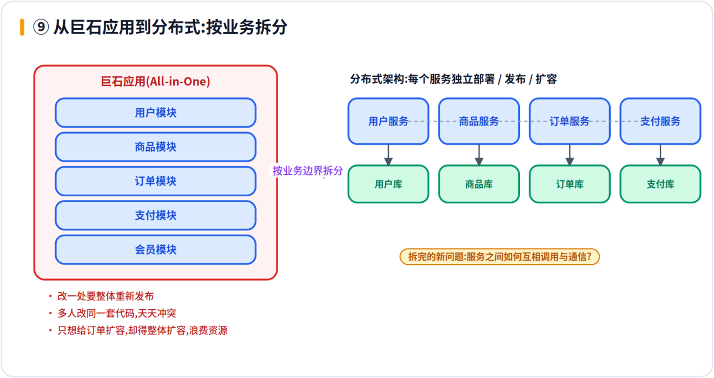

# 第 9 章 · 从巨石应用到分布式

这一次,问题出在应用侧。你的网站从一个小电商,长成了集用户、商品、订单于一体的大平台,所有功能的代码全挤在同一个应用里——这就是大家常说的巨石应用(单体应用)。麻烦随之而来:改一行用户相关的代码,也要把整个应用全量发布;多个开发同时改同一套代码,天天冲突;明明只想给订单服务加机器抗流量,却只能让整个应用一起扩容,大量资源被白白浪费。

解决办法还是那个字:拆。你按业务边界把这个庞大的应用一刀刀切开——用户相关的功能做成独立的用户系统,商品、订单也各自独立成系统,每个系统单独部署、单独发布、单独扩容,谁也不影响谁。这就是分布式架构。可拆完之后,新问题马上来了:用户下单时要查商品库存、生成订单,这些系统已经分开了,它们之间该怎么互相调用、怎么通信?于是你又陆续发明了几个配套组件。

**名词解释**

- **分布式架构** —— 把一个大应用按业务拆成多个可独立部署的系统。让各业务能独立开发、发布、扩容,互不拖累。
- **RPC 远程过程调用** —— 让跨机器、跨进程的服务调用,在代码里写起来就像调用本地方法一样简单。服务拆开后散落在不同机器,需要一种机制屏蔽网络通信的细节。
- **服务注册与发现中心** —— 一个“总管”:所有服务启动后都来这里登记自己的地址,调用方要找谁就先来这里查、再去调用。服务很多且地址会动态变化(扩缩容、漂移),硬编码地址行不通,需要一本动态的“通讯录”。
- **消息队列 Message Queue** —— 一个超大容量的“智能收件箱”:服务之间不必死等对方立刻回复,把消息扔进队列就继续干自己的事,消费方有空再来取。同步调用会让服务相互等待、相互拖累,一个卡住就堵死整条链路;异步化能彻底解耦,还能保证消息不丢。
- **削峰填谷** —— 用队列把瞬时高峰的请求先缓存起来,后端再按自己的处理能力匀速消化。突发流量若直接砸到后端会压垮系统,先排队、再慢慢消化能保护后端。

> **本阶段小结**
> 瓶颈 巨石应用:牵一发动全身,无法独立发布与扩容。 方案 按业务拆成分布式服务,配以 RPC、注册发现、消息队列。 新代价 拆得还不够细;调用链变长,跨服务一致性更突出。
