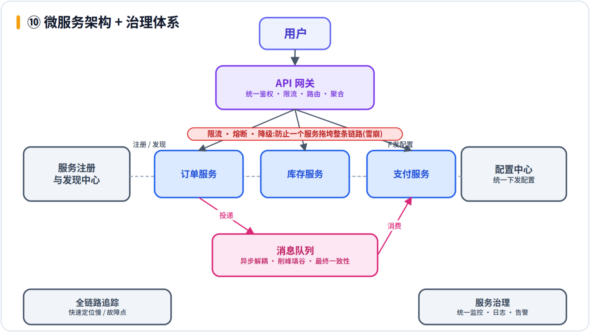

# 第 10 章 · 微服务架构与治理体系

分布式是拆了,但拆得还不够细。就拿用户系统来说,里面又塞了登录、个人信息、会员、地址……还是一大坨,不够清爽;不同团队想用的技术也不一样,有人想用 Java、有人想用 Go,混在一个系统里根本没法搞;会员模块想单独扩容,结果只能把整个用户系统一起加,机器和资源全浪费了。

于是继续拆,按“一个服务只干一件事”的原则,把系统拆得更细更小:登录做成独立服务,会员、支付各自独立,每个小服务只干一件事,能独立开发、独立发布、独立扩容,想用什么技术栈就用什么,互不干扰。这套更极致的架构就叫微服务架构。它带来的灵活性是惊人的:大促时只给订单、支付这几个最热的服务加 10 倍机器,其他不忙的服务一动不动、资源零浪费;哪个服务出 bug 也只影响一个小功能,绝不会拖垮整站;多个团队各管各的服务,开发效率直接起飞。

当然,有利就有挑战:服务一多,调用关系就像蜘蛛网,出了问题找不到在哪。下面这些“治理”名词,正是为应对这些挑战而存在的。

**名词解释(微服务的配套治理设施)**

- **API 网关** —— 所有外部请求的统一入口,在这里集中做鉴权、限流、路由、协议转换与结果聚合。服务一多,不能让客户端直接面对几十个服务地址、各自处理鉴权限流,需要一个统一门面(它与第 7 章的反向代理职责相关,但更偏业务聚合)。
- **配置中心** —— 统一管理各服务的配置,并能动态下发。几百个服务的配置若散落各处、改一次要逐个重启,会是运维灾难;集中管理 + 动态下发才可控。
- **全链路追踪** —— 给每个请求打上唯一标识,串起它流经的所有服务,出问题能一眼定位是哪一环慢、哪一环出错。调用关系像蜘蛛网,必须有手段还原整条调用链。
- **限流 / 熔断 / 降级** —— 流量过大时限制进入量(限流);某个依赖持续失败时暂时切断对它的调用、避免被一起拖死(熔断);非核心功能临时关闭、优先保住核心(降级)。服务相互依赖,一个雪崩可能连锁拖垮全站,这套机制就是“保险丝”。
- **服务治理** —— 对大量服务做统一的监控、日志、告警、注册与配置管理。服务太多,必须有统一手段才管得过来。

> **本阶段小结**
> 瓶颈 分布式拆得不够细;团队协作与按需扩容仍受限。 方案 极致拆分为微服务,配齐网关、配置中心、链路追踪、限流熔断降级、治理。 新代价 服务从几个变成几百个,部署与运维成本爆炸。

> **放到 vibe coding 里**　“拆成微服务”听着先进，代价是分布式事务、服务发现、链路追踪一整套。懂这账单，你才判断得了当前项目到底该不该拆，而不是被模型带着一上来就拆。
