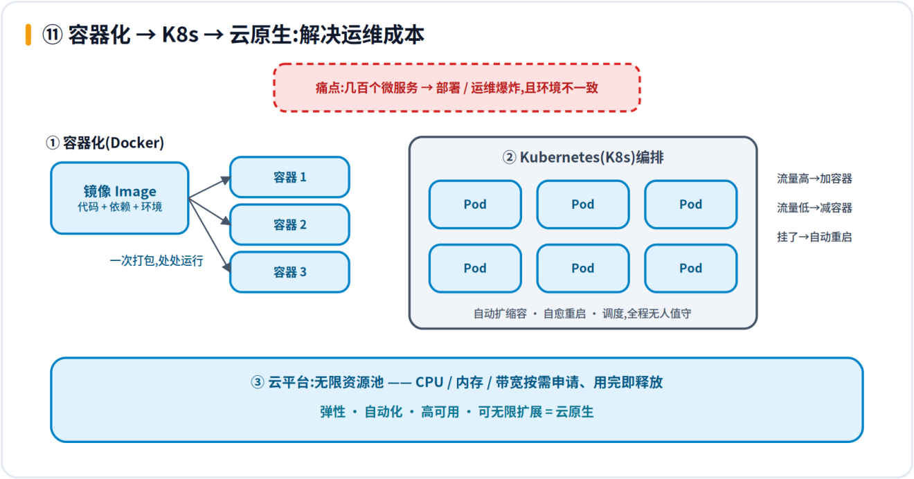

# 第 11 章 · 容器化、K8s 与云原生

微服务确实好用,可运维同学直接哭了:服务越拆越细,从原来的几个应用一下子变成几百个微服务,部署运维成了噩梦。每个服务上线都要配环境、装依赖、调参数,稍有不同就出现“我电脑能跑、服务器跑不起来”的玄学 bug;大促前几百台机器一台台配,大促后又得一台台清理,效率低到离谱。架构最后这一程,要解决的就是“运维成本与自动化”。

**① 容器化(Docker):一次打包,到处运行**

你灵机一动:能不能把服务和它需要的运行环境一起打包成一个“密封盒子”,放到哪台机器都能直接跑?于是把每个微服务的代码、依赖、配置、运行环境全部打包成一个镜像,一次打包、到处运行,彻底解决环境不一致的世纪难题。

- **Docker / 容器** —— 把应用及其完整运行环境一起打包、隔离运行的技术。“环境不一致”是部署最大的隐性成本,容器把环境随应用一起带走,实现真正的一次构建、处处运行。
- **镜像 Image** —— 容器的“模板”,是代码 + 依赖 + 环境的只读打包。需要一个可分发、可版本化的标准交付物,镜像就是它。

② 容器编排(Kubernetes / K8s):全能大管家

几百上千个容器谁来管?于是你请来一个“全能大管家”——Kubernetes(简称 K8s)。它负责编排容器:流量高了自动加容器,流量低了自动减容器(自动扩缩容),容器挂了自动重启(自愈),全程几乎无人值守。

- **Kubernetes(K8s)** —— 容器编排系统,自动完成容器的调度、扩缩容、自愈、服务发现等。容器数量一多,人工管理根本不可能,需要一个自动化的“编排大脑”。

**③ 云平台与云原生:把机房变成按需的资源池**

就算有了 K8s,你还是得自己买服务器、租机房;为了大促备一堆机器,平时却全闲着,太浪费钱。于是你干脆把系统搬上云平台——一个近乎无限大的资源池,要多少 CPU、内存、带宽都随时申请、用完即释放、按需付费,底层机房对你完全透明。至此,你的架构彻底进入了新时代:弹性、自动化、高可用、可无限扩展。这套理念就叫云原生。

- **云平台** —— 按需提供计算 / 存储 / 网络资源的公共资源池。自建机房要为峰值预留、平时闲置,成本高;云把“买”变成“租”,用多少付多少。
- **云原生 Cloud Native** —— 一套“生于云、长于云”的架构理念与技术组合(容器 + 编排 + 微服务 + 弹性 + 自动化)。要榨取云的弹性红利,应用本身的设计也要随之改变,这套理念就是答案。

> **本阶段小结**
> 瓶颈 几百个微服务,部署运维爆炸,且环境处处不一致。 方案 Docker 打包镜像 + K8s 自动编排 + 云平台弹性资源池 = 云原生。 终点 从一台小服务器,走到弹性、自动化、高可用、可无限扩展的现代化架构。
