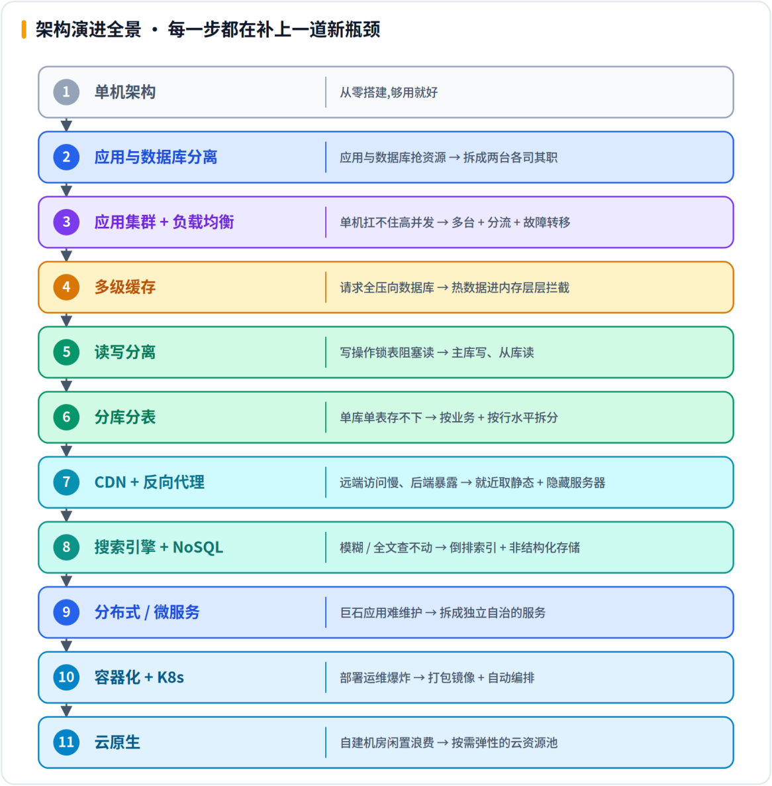

# 互联网架构演进

系统怎么从单机一步步长成扛得住流量的分布式，每一步解决什么、代价是什么。

## 引言:一个朴素的故事

互联网架构里那些让人眼花缭乱的高频名词——集群、负载均衡、缓存、分库分表、微服务、容器、K8s、云原生——单独看像是一堆互不相关的黑话。但只要把它们放回真实的演化顺序里,你会发现它们其实是同一条主线上的产物:每解决一个瓶颈,就会暴露出下一个瓶颈,于是再补上一个新组件。架构从来不是一开始就被设计成今天这样的,而是被业务和流量一步步“逼”出来的。

这份文档用一个最朴素的故事把这条主线串起来:你从一台服务器、几个用户的小网站起步,随着访问量越来越大,一路把它升级成能稳稳扛住千万级流量的现代化系统。后面每一章都只回答三个问题——上一步留下了什么瓶颈?这一步用什么组件来补?补完之后又带来了什么新代价?把这三个问题想清楚,所有名词就都有了自己的位置。

> **一句话抓住全文**
> 架构演进的本质,是不断用「空间换时间、复杂度换性能」来对抗持续增长的流量与并发。而判断一个架构好不好,永远只有一个标准:它是不是当前业务最合适的那个。

## 把它用在 vibe coding 上

这份是把前面所有单点知识“拼成一个能扛流量的系统”的地图。模型能说出缓存、负载均衡、微服务这些词，但什么时候该上、上了的代价是什么，要你来判断。

- **抵抗过度设计** —— 模型动不动给你微服务 + 消息队列 + K8s 全家桶。懂演进路线，你知道多数系统单机或读写分离就够，不必一步到位。
- **判断每步的代价** —— 缓存带来一致性问题、分库分表带来跨库 join 难题、微服务带来分布式复杂度。每个“解法”都有账单。
- **接得住系统设计** —— 这条演进线就是系统设计题的骨架，也是你和模型讨论架构时的共同语言。

## 本篇章节

- [第 1 章 · 单机架构](./ch01)
- [第 2 章 · 应用与数据库分离](./ch02)
- [第 3 章 · 应用集群与负载均衡](./ch03)
- [第 4 章 · 多级缓存](./ch04)
- [第 5 章 · 读写分离](./ch05)
- [第 6 章 · 分库分表](./ch06)
- [第 7 章 · CDN 与反向代理](./ch07)
- [第 8 章 · 搜索引擎与 NoSQL](./ch08)
- [第 9 章 · 从巨石应用到分布式](./ch09)
- [第 10 章 · 微服务架构与治理体系](./ch10)
- [第 11 章 · 容器化、K8s 与云原生](./ch11)
- [第 12 章 · 总结:主线、速查表与三大思维](./ch12)
