# 系统质量属性

## 把它用在 vibe coding 上

这份教你用“质量属性”的语言谈架构——性能、可用性、可修改性、安全性之间永远在权衡。这正是你给模型提需求时最该说清的东西。

- **把模糊需求说成可验收的标准** —— “要快”“要稳”没法验收。懂质量属性场景（六要素），你能把它变成“99% 的请求 200ms 内返回”这种模型能照着做、你能验收的目标。
- **逼出权衡** —— 模型爱说“又快又稳又灵活”。懂 ATAM 这类评估，你知道每个决策都有牺牲，会主动追问“代价是什么”。
- **系统地审架构** —— 用效用树、敏感点 / 权衡点的视角审模型给的设计，而不是凭感觉点头。

## 引言:这份怎么读

这一份讲的是软件架构设计的「灵魂」——功能决定系统「能不能用」,质量属性决定它「好不好用、扛不扛得住」,而质量属性在很大程度上由架构决定。所以在系统架构设计师考试里,这块是案例分析第一题和论文几乎必考的核心。

全篇主线分两段:先认识质量属性(分类,以及性能/可用性/可修改性/安全性等怎么用「战术」去实现) 学会用「质量属性场景」把模糊需求变成可测量的东西 再学架构评估(敏感点 / 权衡点 / 风险点、效用树、以及 ATAM / SAAM / CBAM 三种评估方法)。

## 第 1 章 · 什么是质量属性

> **一句话讲透**
> 软件需求分为功能需求(系统要做什么)和质量属性(非功能需求:系统做得好不好)。质量属性分两类:运行期(性能、可用性、安全性、可靠性、易用性、可伸缩性、互操作性)和开发期(可修改性、可维护性、可测试性、可移植性、可重用性)。质量属性主要由架构决定。

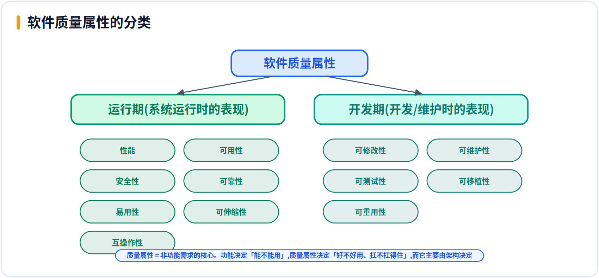

**常见质量属性与度量**

| 质量属性 | 关注 | 常见度量 |
| --- | --- | --- |
| 性能 | 快不快 | 响应时间、吞吐量 |
| 可用性 | 可用比例 | 几个 9、MTBF / MTTR |
| 可修改性 | 改动成本 | 改动影响范围 / 人日 |
| 安全性 | 防攻击 | 抵抗 / 检测 / 恢复能力 |
| 可伸缩性 | 可扩展性 | 加资源后的承载线性度 |

**再往下挖**

质量属性靠「战术(tactics)」来实现——每个属性都有一组对应的架构手段。质量属性之间常常互相冲突(如安全性提升常使性能下降),所以架构设计本质上是在做权衡。

**常见误区**

质量属性不是功能;它常被叫「非功能需求」却极其重要,而且改起来比改功能贵得多——因为它由架构决定,架构定错了后期很难补救。

## 第 2 章 · 性能(Performance)

> **一句话讲透**
> 性能关注「快不快」(响应时间)和「扛多少」(吞吐量)。三类战术:资源需求(减少计算开销、管理事件率、限制执行时间)、资源管理(引入并发、复制数据 / 资源、增加计算资源)、资源仲裁(用合适的调度策略,如优先级、时间片)。

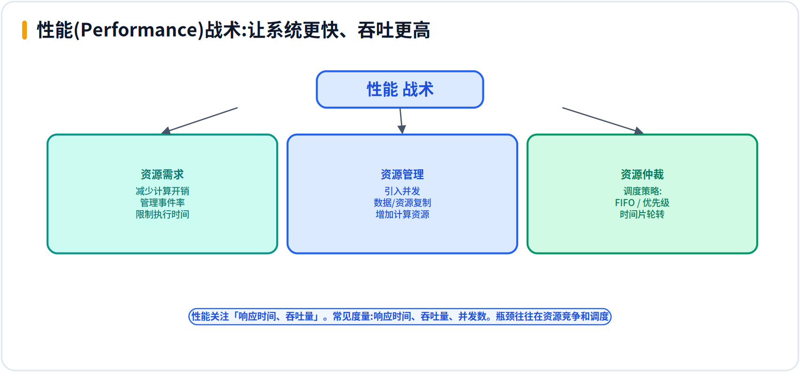

**再往下挖**

常见度量:响应时间、吞吐量、并发数、资源利用率。性能瓶颈往往出在资源竞争和调度上;缓存、异步、并发、负载均衡是常用的提升手段。

**常见误区**

别把「性能」和「可伸缩性」混:性能是单位时间的处理能力,可伸缩性是「加了资源能不能近似线性地扛更多负载」。

## 第 3 章 · 可用性(Availability)

> **一句话讲透**
> 可用性 = 系统正常可用时间所占的比例,常用「几个 9」度量(如 99.9% 约等于一年停机 8.76 小时)。三类战术:错误检测(Ping/Echo、心跳 Heartbeat、异常)、错误恢复(冗余——主动 / 被动 / 备件、表决 Voting、检查点 + 回滚)、错误预防。

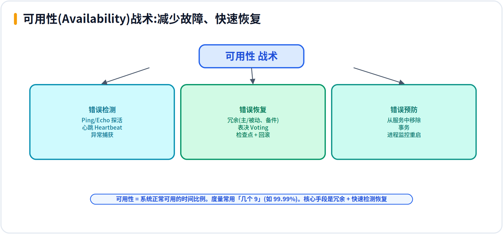

**再往下挖**

MTBF(平均无故障时间)、MTTR(平均修复时间),可用性 = MTBF /(MTBF + MTTR)。冗余是核心手段:主动冗余(热备,切换快)、被动冗余(温备)、备件(冷备,最省但恢复慢)。

**常见误区**

可用性 vs 可靠性:可靠性强调「持续不出错」,可用性强调「出错后整体可用比例和恢复速度」;高可靠不一定高可用(若恢复很慢)。

## 第 4 章 · 可修改性(Modifiability)

> **一句话讲透**
> 可修改性 = 改动的成本和波及范围。三类战术:局部化修改(提高内聚、预测可能的变更)、防止连锁反应(信息隐藏、用接口隔离、加中介 / 抽象层)、推迟绑定时间(运行时配置、插件 / 参数化、发布-订阅)。

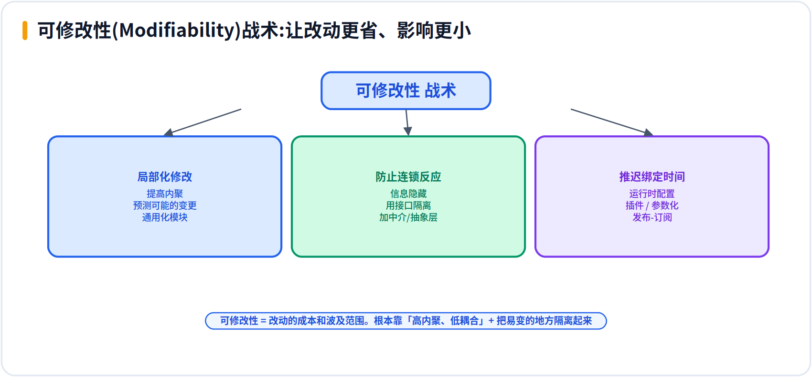

**再往下挖**

根本上靠「高内聚、低耦合」+ 把易变的地方隔离起来(变化点封装)。「推迟绑定」就是把「什么时候确定下来」往后推:编译期 部署期 运行期,越晚越灵活。

**常见误区**

可修改性是开发期质量属性(看改起来难不难),别和运行期属性混;过度追求灵活会增加复杂度,本身也是一种权衡。

## 第 5 章 · 安全性(Security)

> **一句话讲透**
> 安全三性(CIA):机密性(不被泄露)、完整性(不被篡改)、可用性(不被瘫痪)。三类战术:抵抗攻击(身份认证、授权 / 访问控制、数据加密)、检测攻击(入侵检测、审计日志)、从攻击中恢复(审计追踪、恢复)。

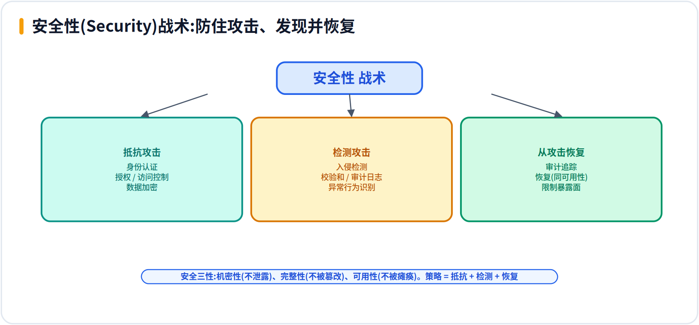

**再往下挖**

认证(你是谁)和授权(你能干什么)是两回事;加密分对称(快,但密钥分发难)和非对称(慢,但解决密钥分发)。最小权限、纵深防御是常用的安全设计思想。

**常见误区**

安全性常和性能、易用性冲突(加密、多重验证会让系统变慢变繁琐),是架构里典型的「权衡点」。

## 第 6 章 · 其他质量属性速览

> **一句话讲透**
> 还有几个常考的质量属性:可靠性(持续无故障运行)、易用性(好不好上手)、可测试性(好不好暴露缺陷、便于测试)、可移植性(好不好迁移到不同环境)、可伸缩性(加资源能不能扛更多)、互操作性(能不能和其他系统协作交换数据)。

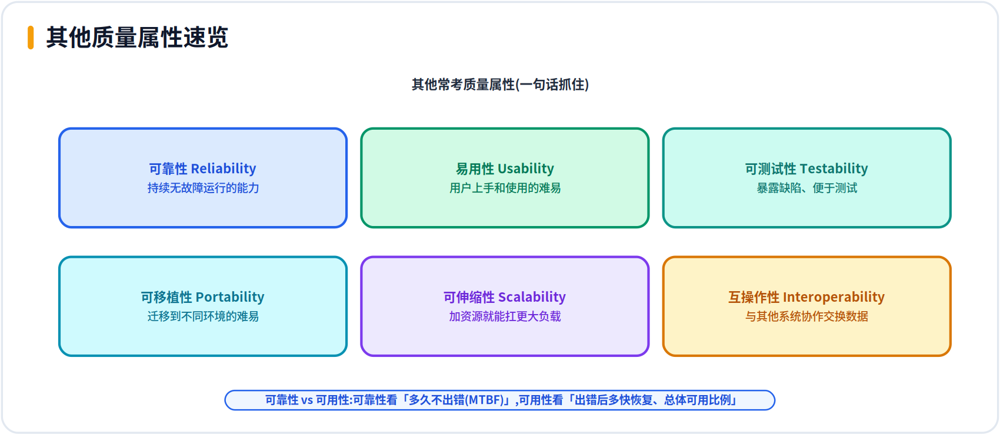

**再往下挖**

可伸缩性分垂直伸缩(升级单机配置)和水平伸缩(加机器);互操作性靠标准接口和协议(如 REST、统一的消息格式)来实现。

**常见误区**

可靠性看 MTBF(多久不出错),可用性看恢复速度和整体可用比例,两者相关但侧重不同,别混。

## 第 7 章 · 质量属性场景(六要素)

> **一句话讲透**
> 质量属性需求往往很模糊(「系统要快、要稳」),没法测、没法评估。质量属性场景把它拆成可测量的六要素:刺激源、刺激、环境、制品、响应、响应度量。读法:[刺激源] 发出 [刺激],在 [环境] 下作用于 [制品],产生 [响应],用 [响应度量] 来衡量。

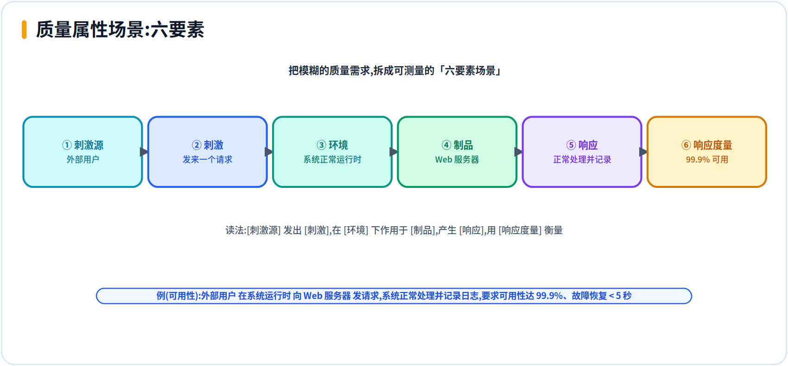

**再往下挖**

六要素能把「快」变成「在高峰期(环境)用户(刺激源)发来请求(刺激),系统(制品)在 2 秒内返回(响应 + 响应度量)」——可测、可验收,也能直接作为架构评估的输入。

**常见误区**

关键是最后的「响应度量」必须量化(给出具体数字),否则还是没法评估。质量属性场景是连接「需求」和「架构评估」的桥梁。

> **放到 vibe coding 里**　给模型提“优化性能”几乎等于没提。用六要素（刺激、环境、响应、度量……）把它写成一句可度量的话，模型的产出质量和你的验收标准会一起变清晰。

## 第 8 章 · 架构评估与关键概念

> **一句话讲透**
> 架构在很大程度上决定了质量属性能否达成,而且越早评估越省钱(架构错了,后期改代价巨大)。评估要找四类点:敏感点(影响某个质量属性的关键决策)、权衡点(同时影响多个属性、且此消彼长的敏感点)、风险点(可能导致质量属性达不成的隐患)、非风险点(分析后认为安全合理的决策)。

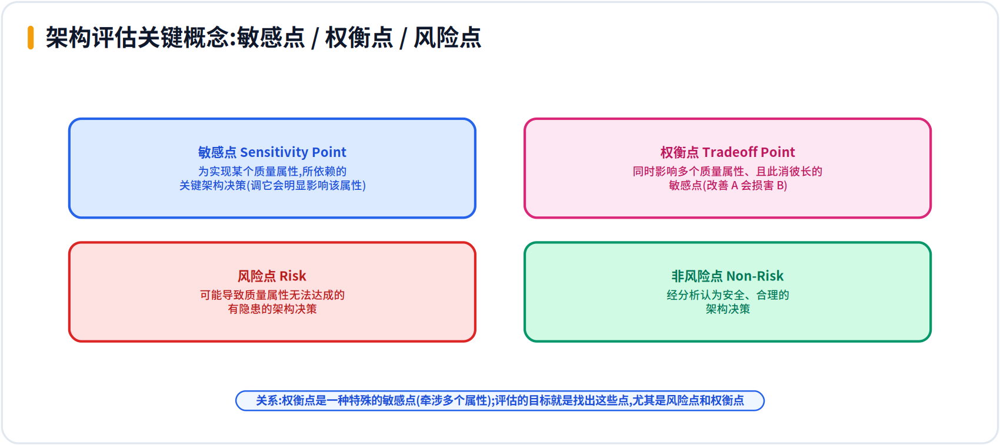

**四类关键点对比**

| 概念 | 含义 | 例子 |
| --- | --- | --- |
| 敏感点 | 影响某一质量属性的关键决策 | 用几个线程,直接影响性能 |
| 权衡点 | 同时影响多个属性的敏感点 | 加密提升安全,却降低性能 |
| 风险点 | 有隐患、可能让属性达不成 | 关键服务单点、无冗余 |
| 非风险点 | 经分析安全、合理的决策 | 用成熟框架做缓存 |

**再往下挖**

评估的主要产出是:发现的风险点、敏感点、权衡点清单 + 改进建议。其中权衡点是重中之重,因为它要求在相互冲突的质量属性之间做出取舍决策。

**常见误区**

权衡点是一种特殊的敏感点(牵涉多个属性);风险点不是「一定会出事」,而是「有隐患、需要关注」。

## 第 9 章 · 效用树(Utility Tree)

> **一句话讲透**
> 效用树是 ATAM 的核心工具,把抽象的「效用(Utility)」自上而下细化:根 = 效用 质量属性(性能 / 可用性 / 可修改性…) 属性细化 叶子 = 具体的质量属性场景,每个叶子标注(重要性, 实现难度),用 H / M / L 表示。

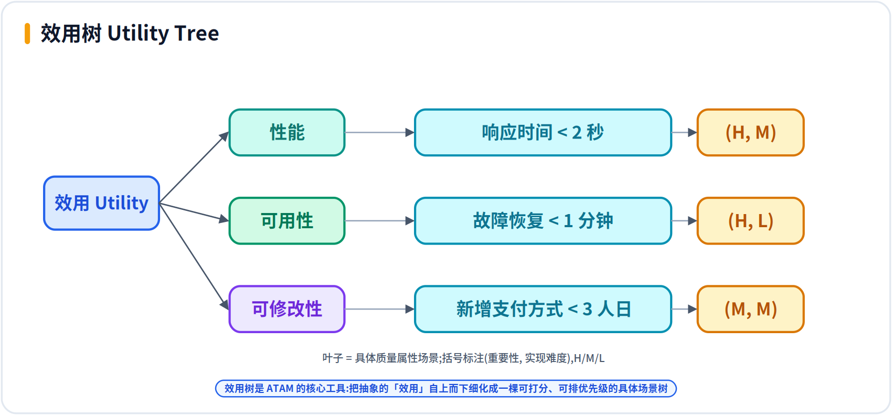

**再往下挖**

通过效用树,评估团队能把有限精力集中在「既重要、又难实现」(如 H,H 或 H,M)的场景上,优先去分析它们对应的架构决策。

**常见误区**

效用树的叶子是「具体场景」(可测量的),不是笼统的属性名;括号里两个值分别是「重要性」和「实现难度」,别记反。

## 第 10 章 · ATAM 架构权衡分析方法

> **一句话讲透**
> ATAM(架构权衡分析方法)是最常用的架构评估方法,基于场景、以效用树为核心,系统分析多个质量属性之间的权衡。流程分四阶段九步:展示(介绍 ATAM / 商业动机 / 架构) 调查与分析(识别架构方法、生成效用树、分析架构方法) 测试(头脑风暴并排序场景、再次分析架构方法) 报告(呈现评估结果)。

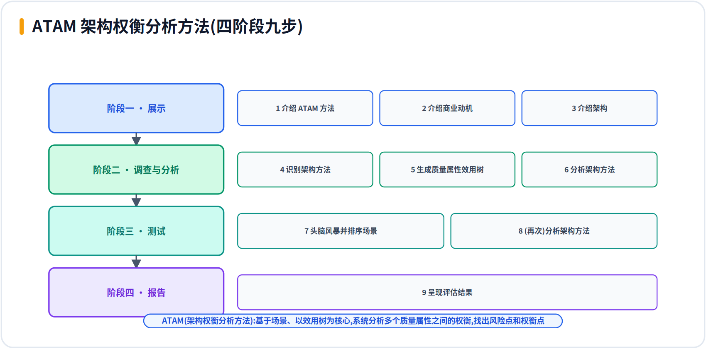

**再往下挖**

ATAM 的核心产出:风险点、非风险点、敏感点、权衡点。它强调「权衡」——因为质量属性之间常有冲突,要帮决策者看清每个架构决策的影响和代价。

**常见误区**

ATAM 评估的是「架构」(设计决策),不是代码或最终产品;它不给「通过 / 不通过」的结论,而是揭示风险和权衡,供决策者参考。

> **放到 vibe coding 里**　ATAM 的内核是“找权衡点”。和模型讨论方案时主动追问“这个选择牺牲了哪个质量属性”，比让它给一个看似完美的方案有用得多。

## 第 11 章 · SAAM 与 CBAM

> **一句话讲透**
> SAAM(场景驱动的架构分析方法)是最早的架构评估方法,主要评估可修改性。ATAM 在它的基础上发展,做多质量属性的权衡分析(最常用)。CBAM(成本效益分析方法)在 ATAM 基础上再加入经济视角,权衡架构决策的成本和收益。

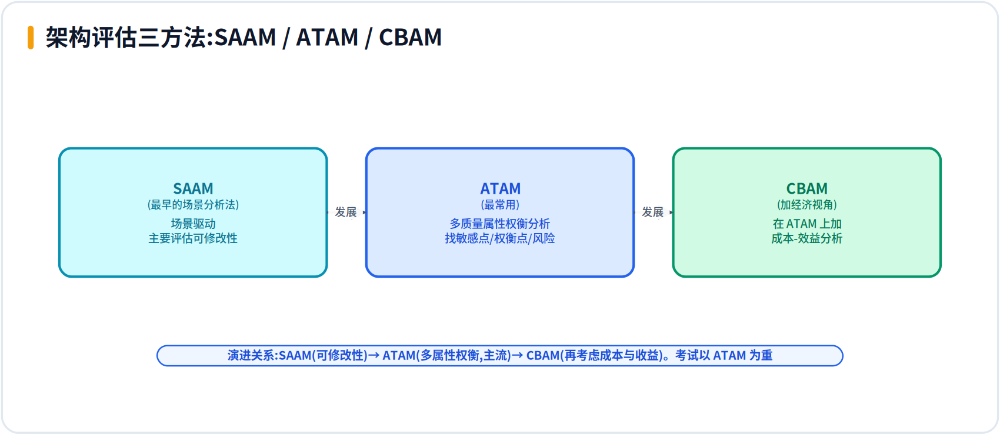

**三种评估方法对比**

| 方法 | 关注 | 特点 |
| --- | --- | --- |
| SAAM | 以可修改性为主 | 最早、场景驱动 |
| ATAM | 多质量属性的权衡 | 最常用,找敏感 / 权衡 / 风险点 |
| CBAM | 架构决策的成本与收益 | 在 ATAM 上加入经济分析 |

**再往下挖**

演进关系:SAAM ATAM CBAM,关注点从「单一属性」到「多属性权衡」再到「加上成本收益」。考试以 ATAM 为重点。

**常见误区**

三者都是「基于场景」的;别把 SAAM 和 ATAM 的侧重搞反——SAAM 偏可修改性,ATAM 偏多质量属性的权衡。

## 第 12 章 · 总结与速查

把这块收个尾。主线再走一遍:认识质量属性(分类 + 各属性的实现战术) 用质量属性场景(六要素)把模糊需求变可测 架构评估(找敏感点 / 权衡点 / 风险点,用效用树组织场景,用 ATAM / SAAM / CBAM 系统评估)。一句话:质量属性由架构决定,而架构评估就是在冲突的质量属性间「找风险、做权衡」。

**核心考点速查**

| 概念 | 一句话 |
| --- | --- |
| 质量属性分类 | 运行期(性能/可用/安全…)+ 开发期(可修改/可测试…)。 |
| 性能战术 | 资源需求 / 资源管理 / 资源仲裁。 |
| 可用性战术 | 错误检测 / 恢复(冗余)/ 预防;度量看几个 9。 |
| 可修改性战术 | 局部化 / 防连锁 / 推迟绑定;靠高内聚低耦合。 |
| 安全三性 | 机密性 / 完整性 / 可用性(CIA)。 |
| 质量属性场景 | 六要素:源/刺激/环境/制品/响应/响应度量。 |
| 敏感点 | 影响某个质量属性的关键架构决策。 |
| 权衡点 | 同时影响多个属性、此消彼长的敏感点。 |
| 风险点 | 有隐患、可能让质量属性达不成的决策。 |
| 效用树 | 效用属性细化场景(标重要性,难度)。 |
| ATAM | 四阶段九步,多属性权衡分析,最常用。 |
| SAAM | 最早,主要评估可修改性。 |
| CBAM | 在 ATAM 上加成本-效益分析。 |
| 可靠 vs 可用 | 可靠看不出错(MTBF),可用看恢复+比例。 |

**学习建议**

这块是架构师案例第一题和论文的核心。案例常考:给一个架构场景,识别敏感点 / 权衡点 / 风险点、画效用树、用质量属性场景描述需求、写出 ATAM 步骤。论文常考「论软件架构评估」「论系统的质量属性及其实现」。建议把质量属性场景六要素、三类点的定义、效用树、ATAM 四阶段九步背到能默写,再用真题练「给架构识别三点」。

质量属性由架构决定,评估就是找风险、做权衡。
