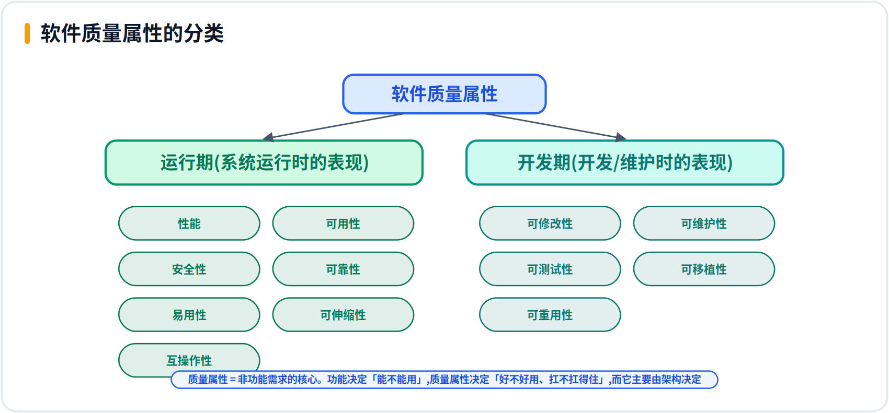

# 第 1 章 · 什么是质量属性

> **一句话讲透**
> 软件需求分为功能需求(系统要做什么)和质量属性(非功能需求:系统做得好不好)。质量属性分两类:运行期(性能、可用性、安全性、可靠性、易用性、可伸缩性、互操作性)和开发期(可修改性、可维护性、可测试性、可移植性、可重用性)。质量属性主要由架构决定。

**常见质量属性与度量**

| 质量属性 | 关注 | 常见度量 |
| --- | --- | --- |
| 性能 | 快不快 | 响应时间、吞吐量 |
| 可用性 | 可用比例 | 几个 9、MTBF / MTTR |
| 可修改性 | 改动成本 | 改动影响范围 / 人日 |
| 安全性 | 防攻击 | 抵抗 / 检测 / 恢复能力 |
| 可伸缩性 | 可扩展性 | 加资源后的承载线性度 |

**再往下挖**

质量属性靠「战术(tactics)」来实现——每个属性都有一组对应的架构手段。质量属性之间常常互相冲突(如安全性提升常使性能下降),所以架构设计本质上是在做权衡。

**常见误区**

质量属性不是功能;它常被叫「非功能需求」却极其重要,而且改起来比改功能贵得多——因为它由架构决定,架构定错了后期很难补救。
