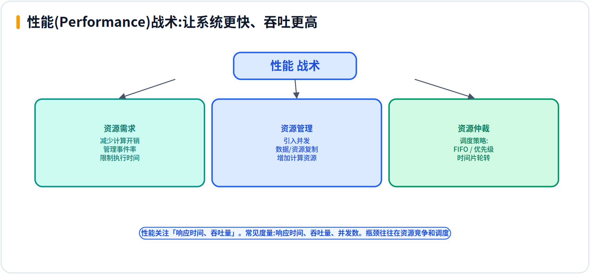

# 第 2 章 · 性能(Performance)

> **一句话讲透**
> 性能关注「快不快」(响应时间)和「扛多少」(吞吐量)。三类战术:资源需求(减少计算开销、管理事件率、限制执行时间)、资源管理(引入并发、复制数据 / 资源、增加计算资源)、资源仲裁(用合适的调度策略,如优先级、时间片)。

**再往下挖**

常见度量:响应时间、吞吐量、并发数、资源利用率。性能瓶颈往往出在资源竞争和调度上;缓存、异步、并发、负载均衡是常用的提升手段。

**常见误区**

别把「性能」和「可伸缩性」混:性能是单位时间的处理能力,可伸缩性是「加了资源能不能近似线性地扛更多负载」。
