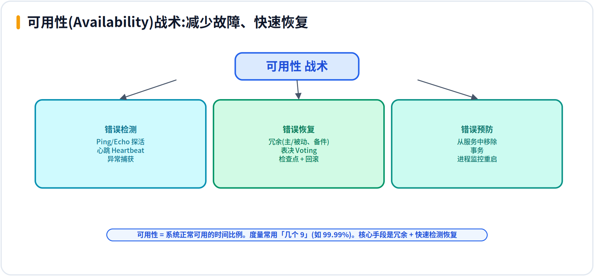

# 第 3 章 · 可用性(Availability)

> **一句话讲透**
> 可用性 = 系统正常可用时间所占的比例,常用「几个 9」度量(如 99.9% 约等于一年停机 8.76 小时)。三类战术:错误检测(Ping/Echo、心跳 Heartbeat、异常)、错误恢复(冗余——主动 / 被动 / 备件、表决 Voting、检查点 + 回滚)、错误预防。

**再往下挖**

MTBF(平均无故障时间)、MTTR(平均修复时间),可用性 = MTBF /(MTBF + MTTR)。冗余是核心手段:主动冗余(热备,切换快)、被动冗余(温备)、备件(冷备,最省但恢复慢)。

**常见误区**

可用性 vs 可靠性:可靠性强调「持续不出错」,可用性强调「出错后整体可用比例和恢复速度」;高可靠不一定高可用(若恢复很慢)。
