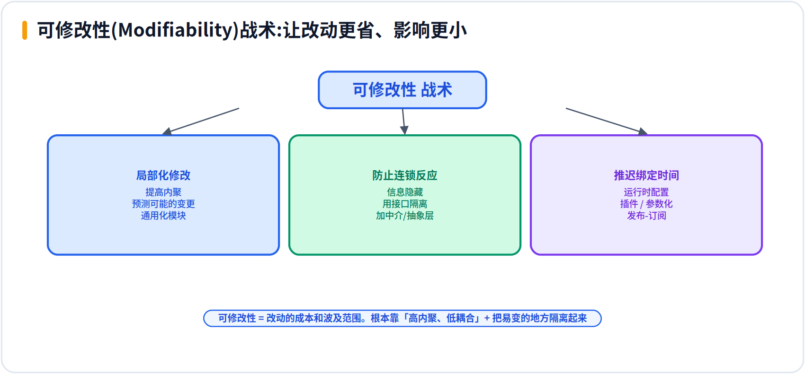

# 第 4 章 · 可修改性(Modifiability)

> **一句话讲透**
> 可修改性 = 改动的成本和波及范围。三类战术:局部化修改(提高内聚、预测可能的变更)、防止连锁反应(信息隐藏、用接口隔离、加中介 / 抽象层)、推迟绑定时间(运行时配置、插件 / 参数化、发布-订阅)。

**再往下挖**

根本上靠「高内聚、低耦合」+ 把易变的地方隔离起来(变化点封装)。「推迟绑定」就是把「什么时候确定下来」往后推:编译期 部署期 运行期,越晚越灵活。

**常见误区**

可修改性是开发期质量属性(看改起来难不难),别和运行期属性混;过度追求灵活会增加复杂度,本身也是一种权衡。
