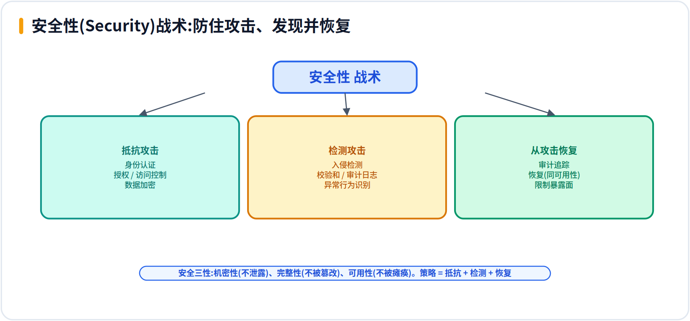

# 第 5 章 · 安全性(Security)

> **一句话讲透**
> 安全三性(CIA):机密性(不被泄露)、完整性(不被篡改)、可用性(不被瘫痪)。三类战术:抵抗攻击(身份认证、授权 / 访问控制、数据加密)、检测攻击(入侵检测、审计日志)、从攻击中恢复(审计追踪、恢复)。

**再往下挖**

认证(你是谁)和授权(你能干什么)是两回事;加密分对称(快,但密钥分发难)和非对称(慢,但解决密钥分发)。最小权限、纵深防御是常用的安全设计思想。

**常见误区**

安全性常和性能、易用性冲突(加密、多重验证会让系统变慢变繁琐),是架构里典型的「权衡点」。
