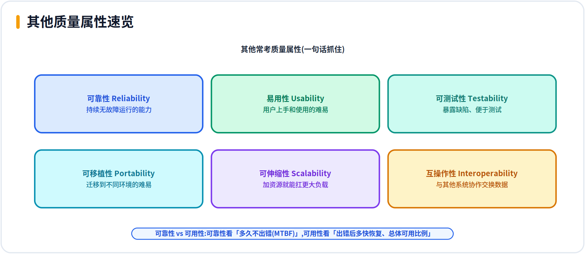

# 第 6 章 · 其他质量属性速览

> **一句话讲透**
> 还有几个常考的质量属性:可靠性(持续无故障运行)、易用性(好不好上手)、可测试性(好不好暴露缺陷、便于测试)、可移植性(好不好迁移到不同环境)、可伸缩性(加资源能不能扛更多)、互操作性(能不能和其他系统协作交换数据)。

**再往下挖**

可伸缩性分垂直伸缩(升级单机配置)和水平伸缩(加机器);互操作性靠标准接口和协议(如 REST、统一的消息格式)来实现。

**常见误区**

可靠性看 MTBF(多久不出错),可用性看恢复速度和整体可用比例,两者相关但侧重不同,别混。
