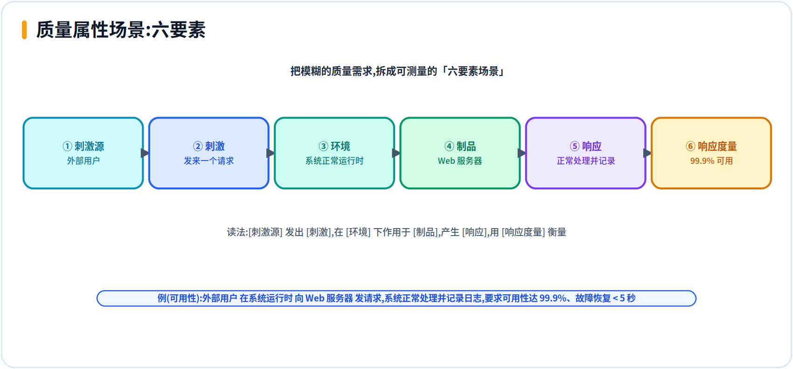

# 第 7 章 · 质量属性场景(六要素)

> **一句话讲透**
> 质量属性需求往往很模糊(「系统要快、要稳」),没法测、没法评估。质量属性场景把它拆成可测量的六要素:刺激源、刺激、环境、制品、响应、响应度量。读法:[刺激源] 发出 [刺激],在 [环境] 下作用于 [制品],产生 [响应],用 [响应度量] 来衡量。

**再往下挖**

六要素能把「快」变成「在高峰期(环境)用户(刺激源)发来请求(刺激),系统(制品)在 2 秒内返回(响应 + 响应度量)」——可测、可验收,也能直接作为架构评估的输入。

**常见误区**

关键是最后的「响应度量」必须量化(给出具体数字),否则还是没法评估。质量属性场景是连接「需求」和「架构评估」的桥梁。

> **放到 vibe coding 里**　给模型提“优化性能”几乎等于没提。用六要素（刺激、环境、响应、度量……）把它写成一句可度量的话，模型的产出质量和你的验收标准会一起变清晰。
