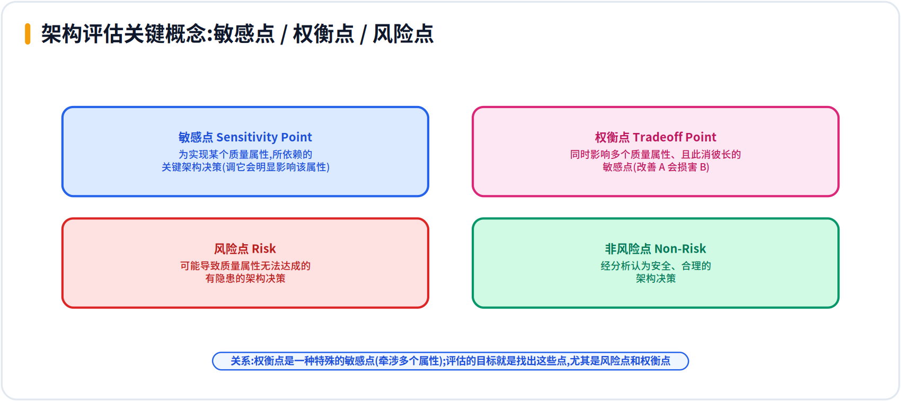

# 第 8 章 · 架构评估与关键概念

> **一句话讲透**
> 架构在很大程度上决定了质量属性能否达成,而且越早评估越省钱(架构错了,后期改代价巨大)。评估要找四类点:敏感点(影响某个质量属性的关键决策)、权衡点(同时影响多个属性、且此消彼长的敏感点)、风险点(可能导致质量属性达不成的隐患)、非风险点(分析后认为安全合理的决策)。

**四类关键点对比**

| 概念 | 含义 | 例子 |
| --- | --- | --- |
| 敏感点 | 影响某一质量属性的关键决策 | 用几个线程,直接影响性能 |
| 权衡点 | 同时影响多个属性的敏感点 | 加密提升安全,却降低性能 |
| 风险点 | 有隐患、可能让属性达不成 | 关键服务单点、无冗余 |
| 非风险点 | 经分析安全、合理的决策 | 用成熟框架做缓存 |

**再往下挖**

评估的主要产出是:发现的风险点、敏感点、权衡点清单 + 改进建议。其中权衡点是重中之重,因为它要求在相互冲突的质量属性之间做出取舍决策。

**常见误区**

权衡点是一种特殊的敏感点(牵涉多个属性);风险点不是「一定会出事」,而是「有隐患、需要关注」。
