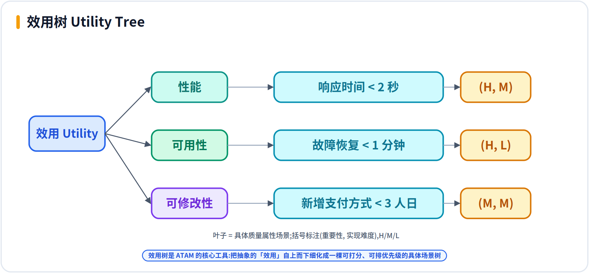

# 第 9 章 · 效用树(Utility Tree)

> **一句话讲透**
> 效用树是 ATAM 的核心工具,把抽象的「效用(Utility)」自上而下细化:根 = 效用 质量属性(性能 / 可用性 / 可修改性…) 属性细化 叶子 = 具体的质量属性场景,每个叶子标注(重要性, 实现难度),用 H / M / L 表示。

**再往下挖**

通过效用树,评估团队能把有限精力集中在「既重要、又难实现」(如 H,H 或 H,M)的场景上,优先去分析它们对应的架构决策。

**常见误区**

效用树的叶子是「具体场景」(可测量的),不是笼统的属性名;括号里两个值分别是「重要性」和「实现难度」,别记反。
