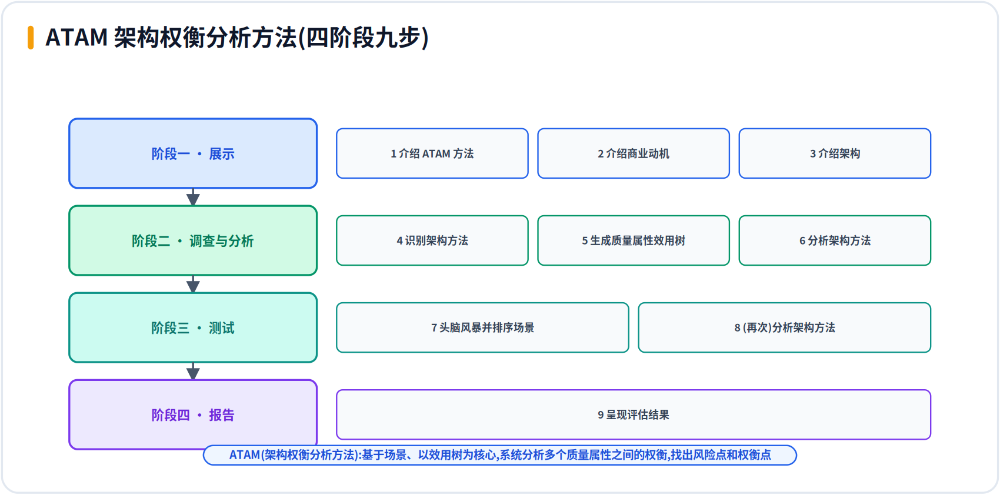

# 第 10 章 · ATAM 架构权衡分析方法

> **一句话讲透**
> ATAM(架构权衡分析方法)是最常用的架构评估方法,基于场景、以效用树为核心,系统分析多个质量属性之间的权衡。流程分四阶段九步:展示(介绍 ATAM / 商业动机 / 架构) 调查与分析(识别架构方法、生成效用树、分析架构方法) 测试(头脑风暴并排序场景、再次分析架构方法) 报告(呈现评估结果)。

**再往下挖**

ATAM 的核心产出:风险点、非风险点、敏感点、权衡点。它强调「权衡」——因为质量属性之间常有冲突,要帮决策者看清每个架构决策的影响和代价。

**常见误区**

ATAM 评估的是「架构」(设计决策),不是代码或最终产品;它不给「通过 / 不通过」的结论,而是揭示风险和权衡,供决策者参考。

> **放到 vibe coding 里**　ATAM 的内核是“找权衡点”。和模型讨论方案时主动追问“这个选择牺牲了哪个质量属性”，比让它给一个看似完美的方案有用得多。
