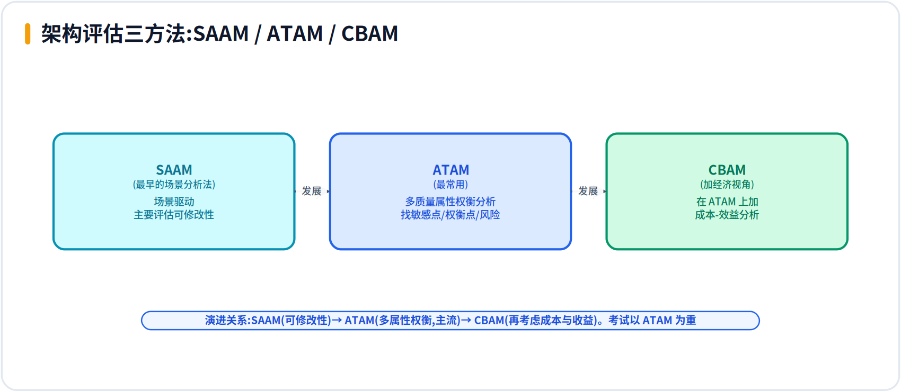

# 第 11 章 · SAAM 与 CBAM

> **一句话讲透**
> SAAM(场景驱动的架构分析方法)是最早的架构评估方法,最初面向可修改性,后来扩展为通用的场景驱动评估(可评任意质量属性)。ATAM 在它的基础上发展,做多质量属性的权衡分析(最常用)。CBAM(成本效益分析方法)在 ATAM 基础上再加入经济视角,权衡架构决策的成本和收益。

**三种评估方法对比**

| 方法 | 关注 | 特点 |
| --- | --- | --- |
| SAAM | 以可修改性为主 | 最早、场景驱动 |
| ATAM | 多质量属性的权衡 | 最常用,找敏感 / 权衡 / 风险点 |
| CBAM | 架构决策的成本与收益 | 在 ATAM 上加入经济分析 |

**再往下挖**

演进关系:SAAM ATAM CBAM,关注点从「单一属性」到「多属性权衡」再到「加上成本收益」。考试以 ATAM 为重点。

**常见误区**

三者都是「基于场景」的;别把 SAAM 和 ATAM 的侧重搞反——SAAM 偏可修改性,ATAM 偏多质量属性的权衡。
