# 软件工程

## 把它用在 vibe coding 上

软件工程是“怎么把事做对、做稳”的方法论层。vibe coding 把写代码的成本打到很低，但需求、设计、测试、维护这些“非写代码”的判断反而更重要——因为你要在更高一层指挥模型。

- **管住需求与设计** —— 模型实现得飞快，但需求理解错、设计耦合高，返工更贵。需求工程和设计原则帮你在动手前把方向定对。
- **看懂它的设计质量** —— SOLID、设计模式、UML 给你审视模型产出结构的语言：这段耦合是不是太高、职责是不是混了。
- **守住测试与维护** —— 模型给的代码“能跑”不等于“可维护”。测试意识是你不让代码库滑成一堆 vibe 垃圾的闸门。

## 引言:这份怎么读

软件工程研究的是「如何用工程化的方法,系统、规范、高效地开发和维护软件」。它是为了解决「软件危机」(项目超期、超预算、质量差、难维护)而诞生的——当软件规模变大,只靠个人编程技巧已经管不住,必须像盖房子一样有流程、有分工、有文档。

全篇主线是一条软件从无到有再到维护的旅程:先看整体(概述与生命周期) 怎么组织开发(开发模型) 搞清楚要做什么(需求工程) 怎么设计(结构化 / 面向对象 / UML / 设计模式) 怎么验证(测试) 上线之后(维护与质量) 怎么管项目(项目管理) 怎么提升团队过程(CMMI) 怎么管版本和复用(配置管理与复用)。

## 第 1 章 · 软件工程概述

> **一句话讲透**
> 软件工程是用工程化的方法系统地开发和维护软件,目的是解决「软件危机」(开发超期超预算、质量差、难维护)。软件生命周期(SDLC)是软件从立项到退役的全过程:可行性研究 需求分析 设计(概要 + 详细) 编码 测试 运行维护。

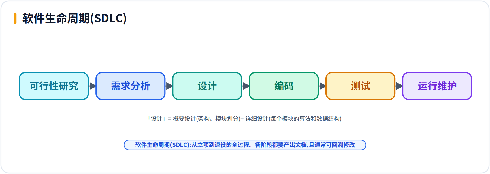

**再往下挖**

软件 = 程序 + 数据 + 文档(不只是代码)。软件工程三要素:方法、工具、过程。每个阶段都要产出文档,既便于团队沟通,也是后续维护的依据。

**常见误区**

软件危机的根源不是「程序写不出来」,而是「规模大了之后难以管理」;软件的维护成本往往超过开发成本,所以可维护性要在设计时就考虑。

## 第 2 章 · 软件开发模型

> **一句话讲透**
> 开发模型规定各阶段如何组织。瀑布模型:线性、阶段分明、文档驱动,但需求要提前定死、后期改动成本高;原型模型:先做个原型让用户确认需求;增量模型:分块逐步交付;螺旋模型:风险驱动、迭代;敏捷:短迭代 + 持续反馈、拥抱变化。

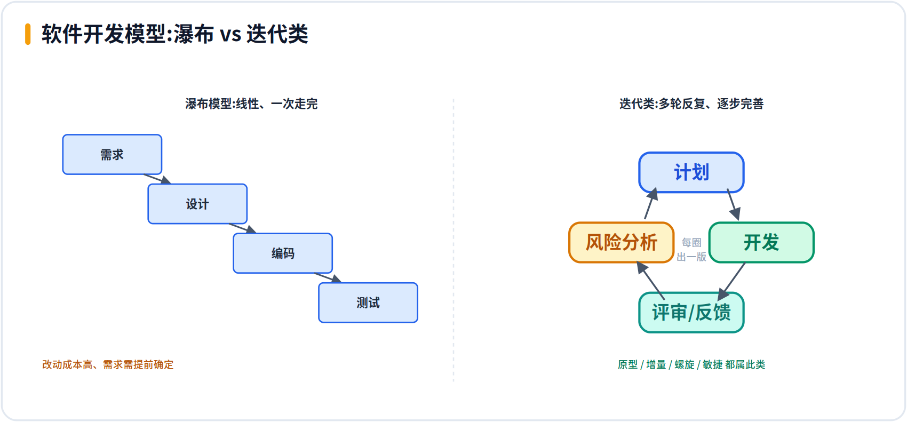

| 模型 | 特点 | 适用 |
| --- | --- | --- |
| 瀑布 | 线性、文档驱动、阶段分明 | 需求明确稳定的项目 |
| 原型 | 先做原型探清需求 | 需求不清晰时 |
| 增量 | 分块、逐步交付 | 可分阶段上线 |
| 螺旋 | 风险驱动、迭代 | 大型、高风险项目 |
| 敏捷(Scrum) | 短迭代 + 持续反馈 | 需求多变、要快速交付 |

**再往下挖**

RUP(统一过程)以用例驱动、以架构为中心、迭代增量。敏捷代表:Scrum(冲刺 Sprint、每日站会、产品待办)、XP(极限编程)。V 模型是瀑布的变体,强调「每个开发阶段都对应一个测试阶段」。

**常见误区**

瀑布不是「过时无用」(需求稳定时仍合适);敏捷不是「不写文档」,而是「文档够用即可、拥抱变化」。

## 第 3 章 · 需求工程

> **一句话讲透**
> 需求分三类:功能需求(系统要做什么)、非功能需求(性能、安全、可用性等)、设计约束(技术、平台、法规)。需求工程四阶段:需求获取 需求分析 需求规约(写 SRS 需求规格说明书) 需求验证。

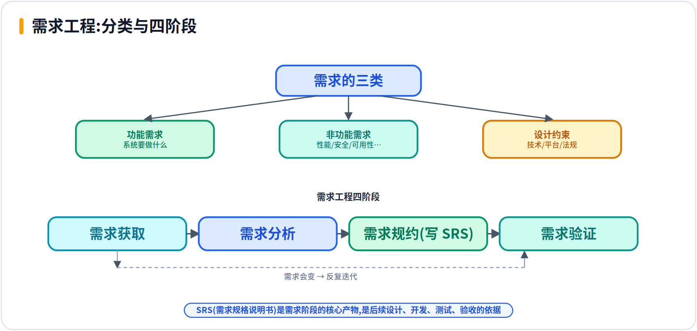

**再往下挖**

需求获取方法:访谈、问卷、观察、做原型。SRS(需求规格说明书)是需求阶段的核心产物,是后续设计、开发、测试、验收的共同依据,也是甲乙双方的「合同」基础。

**常见误区**

需求一定会变,要做好需求变更管理;非功能需求(性能、安全)经常被忽视,却往往是项目成败的关键。

> **放到 vibe coding 里**　给模型一句模糊需求，它会自信地补全一个可能不是你要的东西。需求工程教你先把“到底要解决什么”问清楚——这一步省下的返工，远多于它写代码省下的时间。

## 第 4 章 · 结构化分析与设计

> **一句话讲透**
> 结构化方法面向「过程 / 数据流」。分析阶段用数据流图(DFD)描述数据如何流动和变换,四要素:外部实体、加工处理、数据存储、数据流,并配数据字典定义数据。设计阶段追求高内聚、低耦合,用结构图表示模块层次。

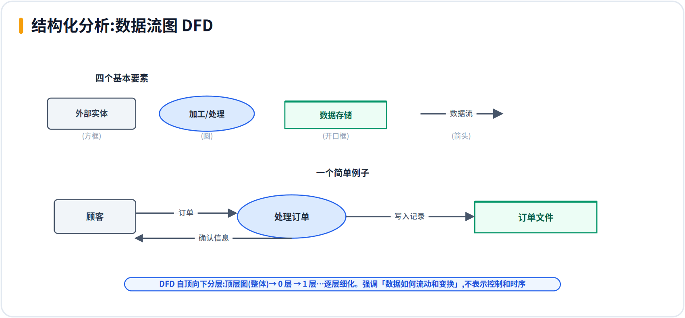

**内聚与耦合(衡量模块设计好坏的核心)**

| 内聚(模块内部,越高越好) | 耦合(模块之间,越低越好) |
| --- | --- |
| 功能 > 顺序 > 通信 > 过程 | 非直接 < 数据 < 标记 |
| > 时间 > 逻辑 > 偶然 | < 控制 < 外部 < 公共 < 内容 |

**再往下挖**

DFD 自顶向下分层:顶层图(整体) 0 层 1 层…逐层细化。结构化设计原则:模块化、抽象、信息隐藏、模块独立——其中「高内聚、低耦合」是衡量模块独立性的核心。

**常见误区**

DFD 只表示数据如何流动和变换,不表示控制和时序(别和程序流程图混);「高内聚、低耦合」不止是结构化设计,而是一切软件设计的核心目标。

## 第 5 章 · 面向对象

> **一句话讲透**
> 面向对象三大特性:封装(把数据和操作包在一起、对外隐藏细节)、继承(子类复用父类、可扩展)、多态(同一接口、不同实现、运行时决定调哪个)。类之间有六种关系:泛化(继承)、实现、关联、聚合、组合、依赖。

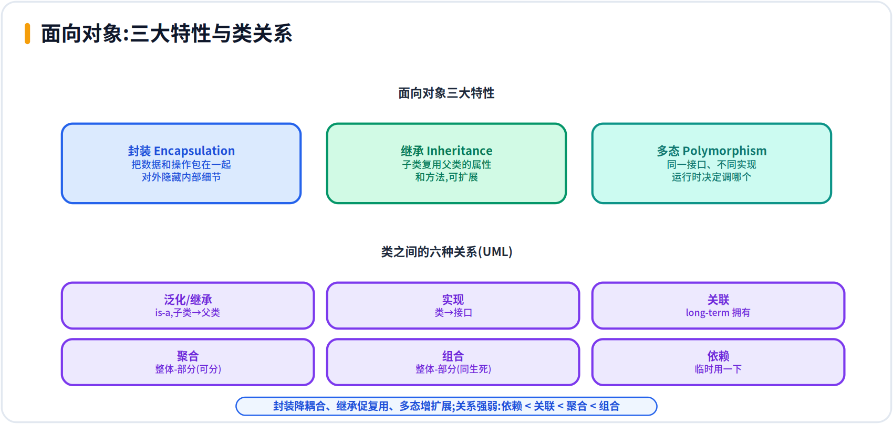

**再往下挖**

对象 = 属性 + 方法,类是对象的模板。关系强弱:依赖 < 关联 < 聚合 < 组合。开发流程:面向对象分析(OOA) 面向对象设计(OOD) 面向对象编程(OOP)。

**常见误区**

聚合和组合都是「整体-部分」,区别在生命周期是否绑定:组合是「同生共死」(如人和心脏),聚合是「可分离」(如班级和学生);多态依赖继承和方法重写(override)。

## 第 6 章 · UML 建模

> **一句话讲透**
> UML 是面向对象建模的标准图形语言,图分两大类:结构图(静态:类图、对象图、构件图、部署图)和行为图(动态:用例图、时序图、活动图、状态图)。最常用三个:用例图(表达需求)、类图(静态结构)、时序图(对象交互)。

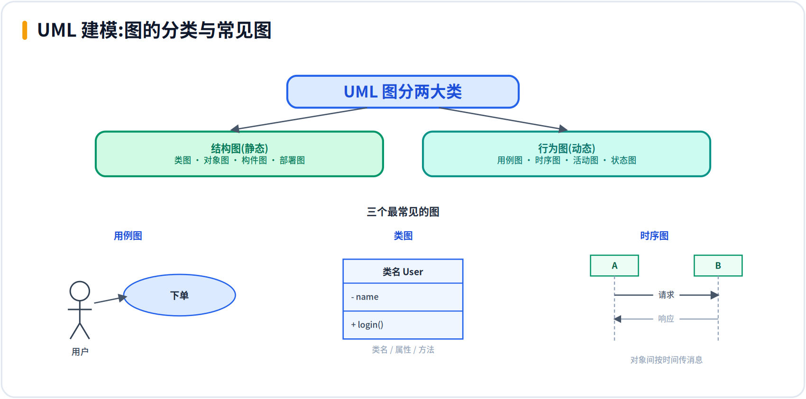

**再往下挖**

用例图描述「谁(参与者)能用系统做什么(用例)」;类图分三段(类名 / 属性 / 方法);时序图按时间顺序展示对象间的消息传递;活动图≈流程图;状态图描述对象状态的变迁。

**常见误区**

类图是静态(结构)、时序图是动态(行为),别搞混;用例图是需求分析阶段的核心产物,不要和流程图混为一谈。

## 第 7 章 · 设计原则与设计模式

> **一句话讲透**
> 设计模式是前人总结的、可复用的设计经验,GoF 共 23 种,分三类:创建型(关注怎么创建对象)、结构型(关注怎么组合类 / 对象)、行为型(关注对象间怎么协作)。配合面向对象设计五大原则 SOLID,目标都是高内聚、低耦合、易扩展。

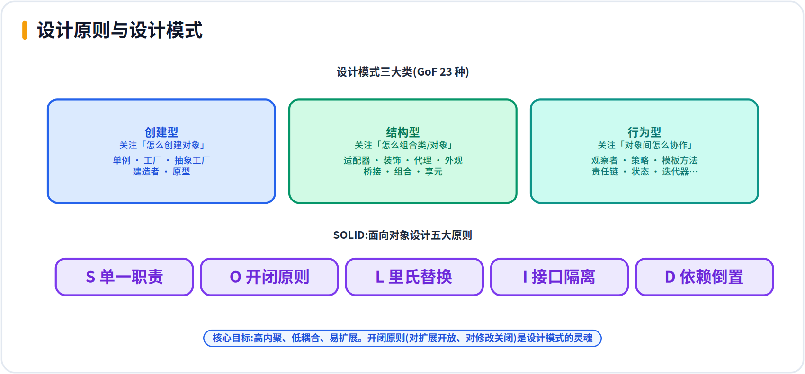

**几个最常考的设计模式**

| 模式 | 类型 | 用途 |
| --- | --- | --- |
| 单例 Singleton | 创建型 | 保证一个类只有一个全局实例 |
| 工厂 Factory | 创建型 | 封装对象的创建过程 |
| 适配器 Adapter | 结构型 | 转换接口,让不兼容的类协作 |
| 代理 Proxy | 结构型 | 控制对对象的访问(如缓存、权限) |
| 观察者 Observer | 行为型 | 一对多通知(发布-订阅) |
| 策略 Strategy | 行为型 | 把算法封装成可替换的策略 |

**再往下挖**

SOLID:单一职责、开闭原则(对扩展开放、对修改关闭)、里氏替换、接口隔离、依赖倒置。其中开闭原则是设计模式的灵魂——加功能靠「扩展」而不是「改旧代码」。

**常见误区**

设计模式是手段不是目的,别为了用而用(过度设计反而增加复杂度);要在「确有重复 / 多变」时才引入。

> **放到 vibe coding 里**　模型写得快，也耦合得快。拿 SOLID（尤其单一职责、依赖倒置）去审它的产出，你能看出“这个类管太多了”“这里该抽个接口”，而不是任由它越堆越乱。

## 第 8 章 · 软件测试

> **一句话讲透**
> 测试方法两大类:黑盒测试(只看输入输出、不看代码,如等价类划分、边界值分析)、白盒测试(看代码内部逻辑,如语句 / 分支 / 路径覆盖)。测试层次(V 模型):单元测试 集成测试 系统测试 验收测试,分别验证详细设计 / 概要设计 / 需求。

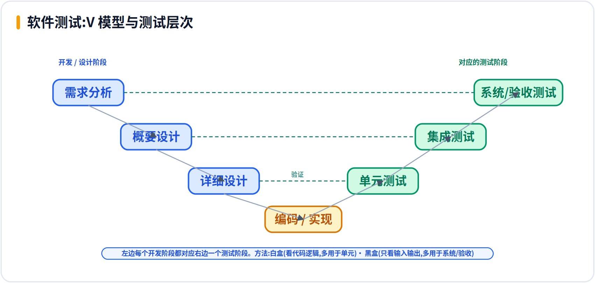

| 层次 | 测什么 | 谁来测 |
| --- | --- | --- |
| 单元测试 | 单个模块 / 函数(多用白盒) | 开发 |
| 集成测试 | 模块之间的接口 | 开发 / 测试 |
| 系统测试 | 整个系统(多用黑盒) | 测试 |
| 验收测试 | 是否满足用户需求 | 用户 / 客户 |

**再往下挖**

用例设计:等价类划分、边界值分析(错误最常发生在边界)、因果图、错误推测。回归测试:改动后重跑已有用例,防止引入新错。α测试在开发方场地、β测试在用户场地。

**常见误区**

测试只能证明「有错」、不能证明「无错」;白盒看代码逻辑、黑盒看功能表现;边界值是最高频的出错点,务必重点测。

> **放到 vibe coding 里**　“我测过了”是模型最不可信的一句话。懂测试设计（边界、等价类、覆盖），你才知道该让它补哪些用例，而不是它跑通一条 happy path 就算完。

## 第 9 章 · 软件维护与质量

> **一句话讲透**
> 软件维护分四类:改正性(修复 bug)、适应性(适应软硬件 / 环境变化)、完善性(增改功能、提升性能,占比最大)、预防性(为未来改善结构)。软件质量属性(ISO / McCall):功能性、可靠性、易用性、效率、可维护性、可移植性。

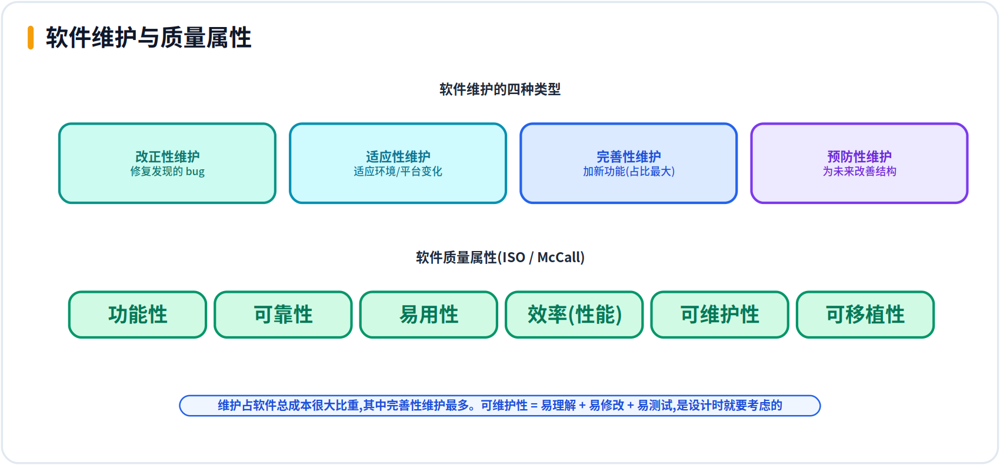

| 维护类型 | 做什么 | 占比 |
| --- | --- | --- |
| 改正性 | 修复发现的缺陷 | 较小 |
| 适应性 | 适应软硬件 / 环境变化 | 中等 |
| 完善性 | 增改功能、提升性能 | 最大(约一半) |
| 预防性 | 改善结构、为未来维护铺路 | 较小 |

**再往下挖**

维护占软件总成本很大比重,其中完善性维护最多。可维护性 = 易理解 + 易修改 + 易测试,要在设计阶段就考虑。软件质量保证(SQA)贯穿整个开发过程。

**常见误区**

占比最大的是「完善性维护」(不是改正性);软件维护成本常常超过开发成本,这点常考。

## 第 10 章 · 软件项目管理

> **一句话讲透**
> 项目管理主要管「进度、成本、质量、风险」。进度上用甘特图(横条展示各任务排期)和 PERT / 网络图(找关键路径 = 最长路径,它决定最短工期);成本估算常用 COCOMO 模型;还要做风险管理(识别 评估 应对)。

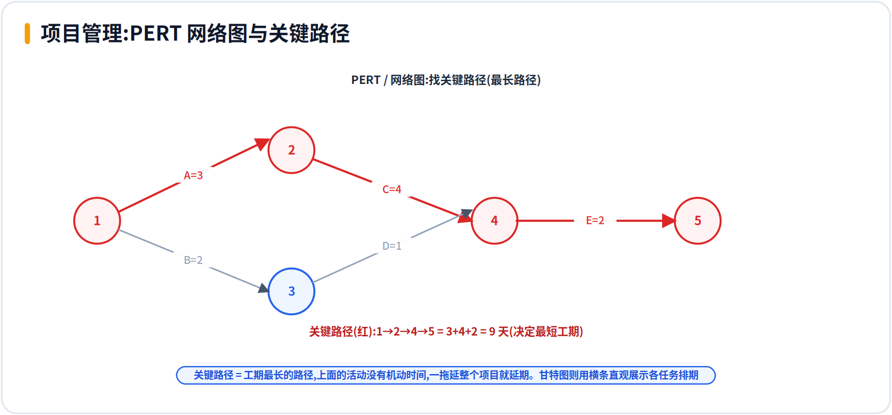

**再往下挖**

关键路径上的活动没有机动时间(总时差为 0),一旦拖延,整个项目就延期。挣值管理(EVM)用 PV / EV / AC 衡量进度和成本偏差。COCOMO 按代码行或功能点估算工作量。

**常见误区**

关键路径是「最长」路径(不是最短);甘特图直观看排期但不擅长表达任务依赖,PERT 网络图才擅长表达依赖关系和关键路径。

## 第 11 章 · 软件过程改进(CMMI)

> **一句话讲透**
> CMMI(能力成熟度模型集成)衡量一个组织的软件过程管理水平,分五级:L1 初始级(混乱、靠个人)、L2 已管理级(项目级、可重复)、L3 已定义级(组织级标准过程)、L4 量化管理级(用数据量化控制)、L5 优化级(持续改进、防缺陷)。

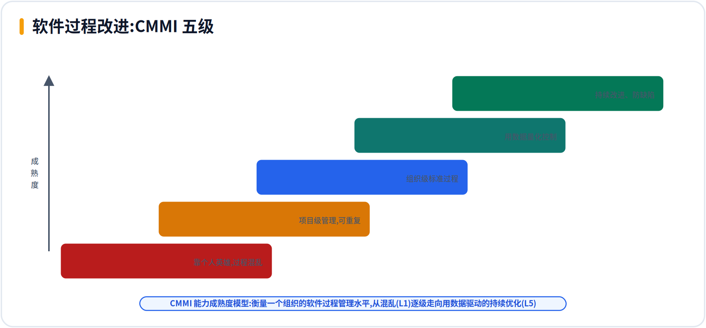

**再往下挖**

级别越高,过程越规范、越可预测、产出越稳定。CMMI 既可用于评估一个组织,也可用于指导改进。等级是逐级递进的,要先稳固下一级才能上一级。

**常见误区**

CMMI 衡量的是「组织的过程能力」,不是「个人能力」或「单个产品的质量」;高等级不保证一定做出好产品,但能显著提高稳定性和可预测性。

## 第 12 章 · 软件配置管理与复用

> **一句话讲透**
> 软件配置管理(SCM)保证「改动可控、版本可追溯」,三要素:版本控制(如 Git,记录每次改动)、基线(经过评审、被冻结的稳定版本)、变更控制(变更申请 评估 批准 实施)。软件复用:通过复用成熟的构件、框架、设计模式来提高质量和效率。

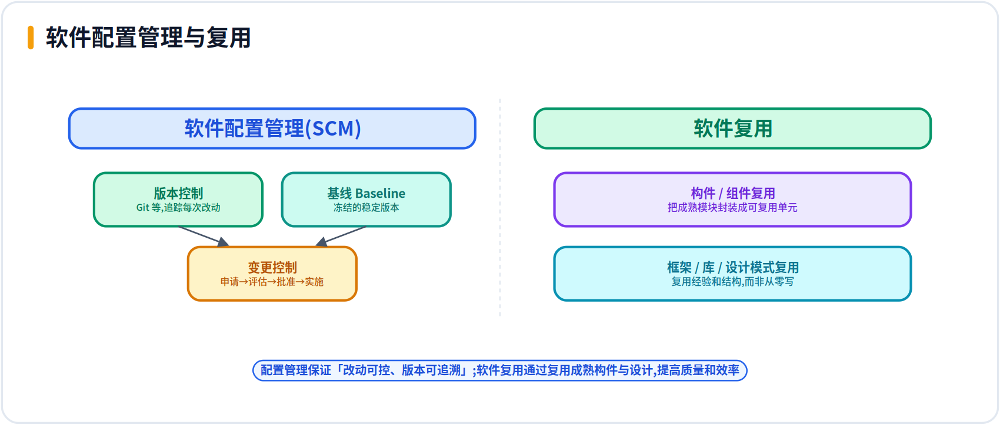

**再往下挖**

基线是被「冻结」的版本,之后任何变更都必须走变更控制流程。软件复用层次由低到高:代码复用 < 构件复用 < 框架 / 架构复用,越高层复用的价值越大。

**常见误区**

配置管理不等于「仅仅做版本控制」(还包括基线和变更控制);软件复用也不是简单复制粘贴,而是有计划地把成熟模块封装成可复用单元。

## 第 13 章 · 总结与速查

把这门收个尾。主线再走一遍:概述与生命周期 开发模型 需求 设计(结构化 / 面向对象 / UML / 设计模式) 测试 维护与质量 项目管理 过程改进 配置管理与复用。软件工程的核心精神,始终是用「工程化的流程和方法」对抗「软件规模带来的复杂度」。

**核心考点速查**

| 概念 | 一句话 |
| --- | --- |
| 软件危机 | 规模变大后难管理 催生软件工程。 |
| 生命周期 | 可行性需求设计编码测试维护。 |
| 瀑布 vs 敏捷 | 线性文档驱动 vs 短迭代拥抱变化。 |
| 需求三类 | 功能 / 非功能 / 设计约束;核心产物 SRS。 |
| DFD | 画数据如何流动变换;不表示控制时序。 |
| 内聚 / 耦合 | 内聚越高越好、耦合越低越好。 |
| OO 三特性 | 封装 / 继承 / 多态。 |
| 类关系 | 依赖 < 关联 < 聚合 < 组合(强度递增)。 |
| UML 两类 | 结构图(静态)+ 行为图(动态)。 |
| 设计模式 | 创建型 / 结构型 / 行为型,共 23 种。 |
| SOLID | 五大原则;开闭原则是灵魂。 |
| 黑盒 / 白盒 | 看功能 vs 看代码逻辑。 |
| 测试层次 | 单元集成系统验收(V 模型)。 |
| 维护四类 | 改正 / 适应 / 完善(最多)/ 预防。 |
| 关键路径 | 最长路径,决定最短工期。 |
| CMMI | 五级:初始已管理已定义量化优化。 |

> 复习建议 这门概念多、对比多,纯靠死记容易乱。最好的办法是:先用本篇的图把各种「模型、图、原则、流程」的框架立起来,再用对比表把易混点(瀑布 vs 敏捷、聚合 vs 组合、黑盒 vs 白盒、内聚 vs 耦合、各种维护类型)一组组拎清楚,最后刷真题巩固。需求、设计、测试、UML 这几块在架构师的案例和论文里也常出现,值得认真过。

理解框架 + 拎清对比,软件工程就不再是一堆零散名词。
