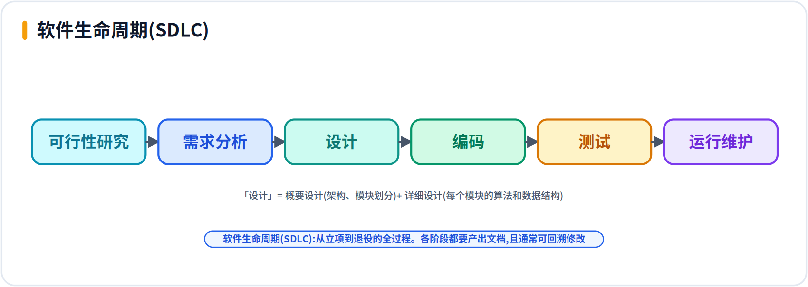

# 第 1 章 · 软件工程概述

> **一句话讲透**
> 软件工程是用工程化的方法系统地开发和维护软件,目的是解决「软件危机」(开发超期超预算、质量差、难维护)。软件生命周期(SDLC)是软件从立项到退役的全过程:可行性研究 需求分析 设计(概要 + 详细) 编码 测试 运行维护。

**再往下挖**

软件 = 程序 + 数据 + 文档(不只是代码)。软件工程三要素:方法、工具、过程。每个阶段都要产出文档,既便于团队沟通,也是后续维护的依据。

**常见误区**

软件危机的根源不是「程序写不出来」,而是「规模大了之后难以管理」;软件的维护成本往往超过开发成本,所以可维护性要在设计时就考虑。
