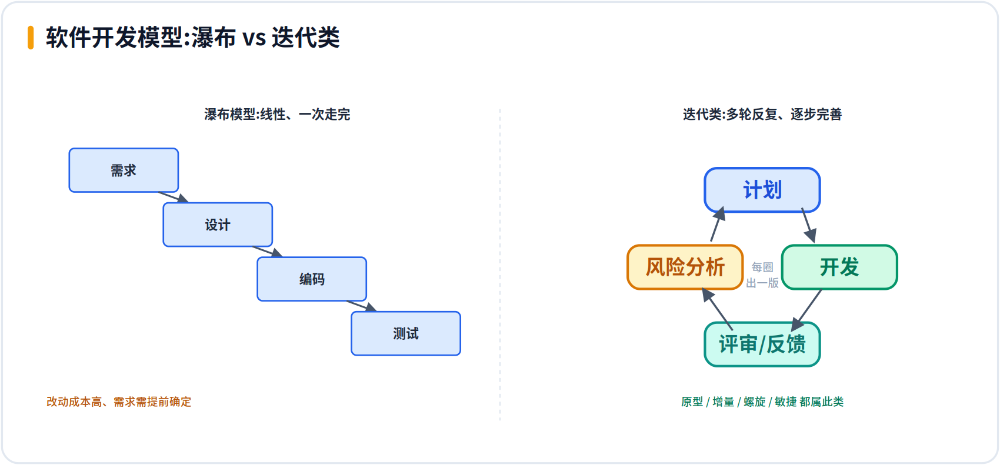

# 第 2 章 · 软件开发模型

> **一句话讲透**
> 开发模型规定各阶段如何组织。瀑布模型:线性、阶段分明、文档驱动,但需求要提前定死、后期改动成本高;原型模型:先做个原型让用户确认需求;增量模型:分块逐步交付;螺旋模型:风险驱动、迭代;敏捷:短迭代 + 持续反馈、拥抱变化。

| 模型 | 特点 | 适用 |
| --- | --- | --- |
| 瀑布 | 线性、文档驱动、阶段分明 | 需求明确稳定的项目 |
| 原型 | 先做原型探清需求 | 需求不清晰时 |
| 增量 | 分块、逐步交付 | 可分阶段上线 |
| 螺旋 | 风险驱动、迭代 | 大型、高风险项目 |
| 敏捷(Scrum) | 短迭代 + 持续反馈 | 需求多变、要快速交付 |

**再往下挖**

RUP(统一过程)以用例驱动、以架构为中心、迭代增量。敏捷代表:Scrum(冲刺 Sprint、每日站会、产品待办)、XP(极限编程)。V 模型是瀑布的变体,强调「每个开发阶段都对应一个测试阶段」。

**常见误区**

瀑布不是「过时无用」(需求稳定时仍合适);敏捷不是「不写文档」,而是「文档够用即可、拥抱变化」。
