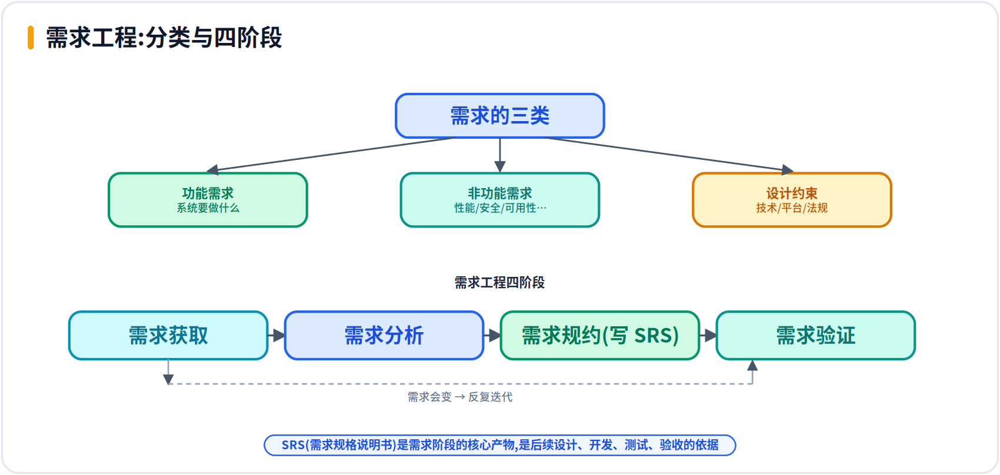

# 第 3 章 · 需求工程

> **一句话讲透**
> 需求分三类:功能需求(系统要做什么)、非功能需求(性能、安全、可用性等)、设计约束(技术、平台、法规)。需求工程四阶段:需求获取 需求分析 需求规约(写 SRS 需求规格说明书) 需求验证。

**再往下挖**

需求获取方法:访谈、问卷、观察、做原型。SRS(需求规格说明书)是需求阶段的核心产物,是后续设计、开发、测试、验收的共同依据,也是甲乙双方的「合同」基础。

**常见误区**

需求一定会变,要做好需求变更管理;非功能需求(性能、安全)经常被忽视,却往往是项目成败的关键。

> **放到 vibe coding 里**　给模型一句模糊需求，它会自信地补全一个可能不是你要的东西。需求工程教你先把“到底要解决什么”问清楚——这一步省下的返工，远多于它写代码省下的时间。
