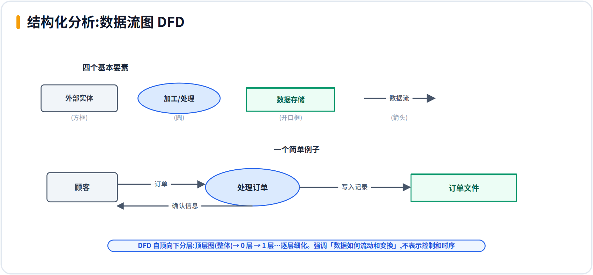

# 第 4 章 · 结构化分析与设计

> **一句话讲透**
> 结构化方法面向「过程 / 数据流」。分析阶段用数据流图(DFD)描述数据如何流动和变换,四要素:外部实体、加工处理、数据存储、数据流,并配数据字典定义数据。设计阶段追求高内聚、低耦合,用结构图表示模块层次。

**内聚与耦合(衡量模块设计好坏的核心)**

| 内聚(模块内部,越高越好) | 耦合(模块之间,越低越好) |
| --- | --- |
| 功能 > 顺序 > 通信 > 过程 | 非直接 < 数据 < 标记 |
| > 时间 > 逻辑 > 偶然 | < 控制 < 外部 < 公共 < 内容 |

**再往下挖**

DFD 自顶向下分层:顶层图(整体) 0 层 1 层…逐层细化。结构化设计原则:模块化、抽象、信息隐藏、模块独立——其中「高内聚、低耦合」是衡量模块独立性的核心。

**常见误区**

DFD 只表示数据如何流动和变换,不表示控制和时序(别和程序流程图混);「高内聚、低耦合」不止是结构化设计,而是一切软件设计的核心目标。
