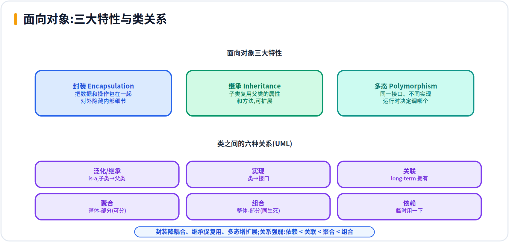

# 第 5 章 · 面向对象

> **一句话讲透**
> 面向对象三大特性:封装(把数据和操作包在一起、对外隐藏细节)、继承(子类复用父类、可扩展)、多态(同一接口、不同实现、运行时决定调哪个)。类之间有六种关系:泛化(继承)、实现、关联、聚合、组合、依赖。

**再往下挖**

对象 = 属性 + 方法,类是对象的模板。关系强弱:依赖 < 关联 < 聚合 < 组合。开发流程:面向对象分析(OOA) 面向对象设计(OOD) 面向对象编程(OOP)。

**常见误区**

聚合和组合都是「整体-部分」,区别在生命周期是否绑定:组合是「同生共死」(如人和心脏),聚合是「可分离」(如班级和学生);多态依赖继承和方法重写(override)。
