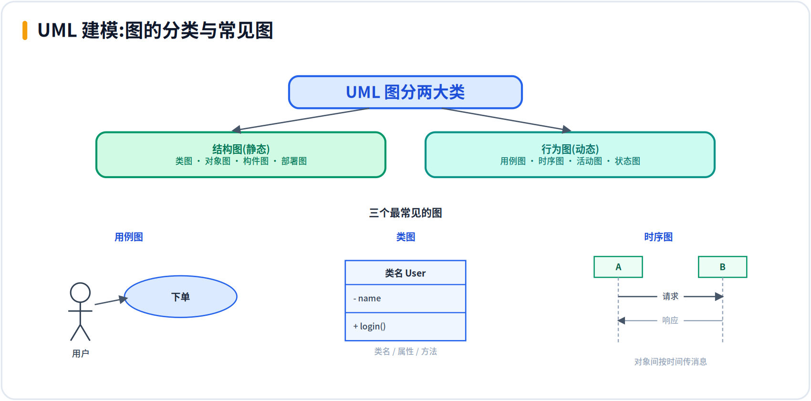

# 第 6 章 · UML 建模

> **一句话讲透**
> UML 是面向对象建模的标准图形语言,图分两大类:结构图(静态:类图、对象图、构件图、部署图)和行为图(动态:用例图、时序图、活动图、状态图)。最常用三个:用例图(表达需求)、类图(静态结构)、时序图(对象交互)。

**再往下挖**

用例图描述「谁(参与者)能用系统做什么(用例)」;类图分三段(类名 / 属性 / 方法);时序图按时间顺序展示对象间的消息传递;活动图≈流程图;状态图描述对象状态的变迁。

**常见误区**

类图是静态(结构)、时序图是动态(行为),别搞混;用例图是需求分析阶段的核心产物,不要和流程图混为一谈。
