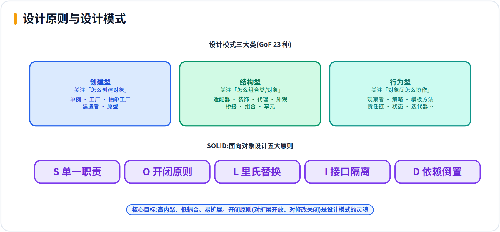

# 第 7 章 · 设计原则与设计模式

> **一句话讲透**
> 设计模式是前人总结的、可复用的设计经验,GoF 共 23 种,分三类:创建型(关注怎么创建对象)、结构型(关注怎么组合类 / 对象)、行为型(关注对象间怎么协作)。配合面向对象设计五大原则 SOLID,目标都是高内聚、低耦合、易扩展。

**几个最常考的设计模式**

| 模式 | 类型 | 用途 |
| --- | --- | --- |
| 单例 Singleton | 创建型 | 保证一个类只有一个全局实例 |
| 工厂 Factory | 创建型 | 封装对象的创建过程 |
| 适配器 Adapter | 结构型 | 转换接口,让不兼容的类协作 |
| 代理 Proxy | 结构型 | 控制对对象的访问(如缓存、权限) |
| 观察者 Observer | 行为型 | 一对多通知(发布-订阅) |
| 策略 Strategy | 行为型 | 把算法封装成可替换的策略 |

**再往下挖**

SOLID:单一职责、开闭原则(对扩展开放、对修改关闭)、里氏替换、接口隔离、依赖倒置。其中开闭原则是设计模式的灵魂——加功能靠「扩展」而不是「改旧代码」。

**常见误区**

设计模式是手段不是目的,别为了用而用(过度设计反而增加复杂度);要在「确有重复 / 多变」时才引入。

> **放到 vibe coding 里**　模型写得快，也耦合得快。拿 SOLID（尤其单一职责、依赖倒置）去审它的产出，你能看出“这个类管太多了”“这里该抽个接口”，而不是任由它越堆越乱。
