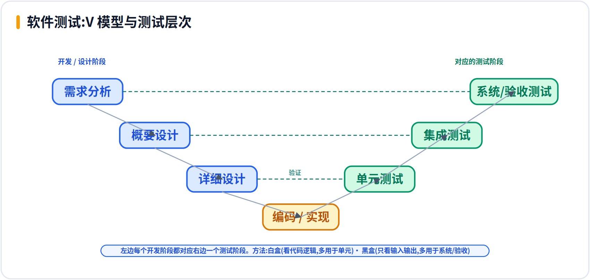

# 第 8 章 · 软件测试

> **一句话讲透**
> 测试方法两大类:黑盒测试(只看输入输出、不看代码,如等价类划分、边界值分析)、白盒测试(看代码内部逻辑,如语句 / 分支 / 路径覆盖)。测试层次(V 模型):单元测试 集成测试 系统测试 验收测试,分别验证详细设计 / 概要设计 / 需求。

| 层次 | 测什么 | 谁来测 |
| --- | --- | --- |
| 单元测试 | 单个模块 / 函数(多用白盒) | 开发 |
| 集成测试 | 模块之间的接口 | 开发 / 测试 |
| 系统测试 | 整个系统(多用黑盒) | 测试 |
| 验收测试 | 是否满足用户需求 | 用户 / 客户 |

**再往下挖**

用例设计:等价类划分、边界值分析(错误最常发生在边界)、因果图、错误推测。回归测试:改动后重跑已有用例,防止引入新错。α测试在开发方场地、β测试在用户场地。

**常见误区**

测试只能证明「有错」、不能证明「无错」;白盒看代码逻辑、黑盒看功能表现;边界值是最高频的出错点,务必重点测。

> **放到 vibe coding 里**　“我测过了”是模型最不可信的一句话。懂测试设计（边界、等价类、覆盖），你才知道该让它补哪些用例，而不是它跑通一条 happy path 就算完。
