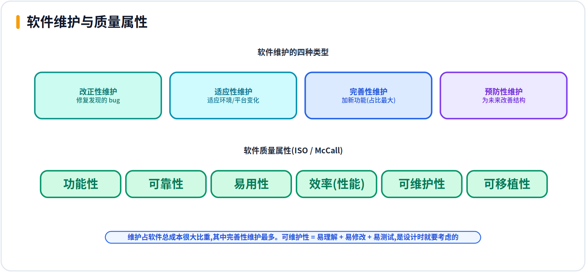

# 第 9 章 · 软件维护与质量

> **一句话讲透**
> 软件维护分四类:改正性(修复 bug)、适应性(适应软硬件 / 环境变化)、完善性(增改功能、提升性能,占比最大)、预防性(为未来改善结构)。软件质量属性(ISO / McCall):功能性、可靠性、易用性、效率、可维护性、可移植性。

| 维护类型 | 做什么 | 占比 |
| --- | --- | --- |
| 改正性 | 修复发现的缺陷 | 较小 |
| 适应性 | 适应软硬件 / 环境变化 | 中等 |
| 完善性 | 增改功能、提升性能 | 最大(约一半) |
| 预防性 | 改善结构、为未来维护铺路 | 较小 |

**再往下挖**

维护占软件总成本很大比重,其中完善性维护最多。可维护性 = 易理解 + 易修改 + 易测试,要在设计阶段就考虑。软件质量保证(SQA)贯穿整个开发过程。

**常见误区**

占比最大的是「完善性维护」(不是改正性);软件维护成本常常超过开发成本,这点常考。
